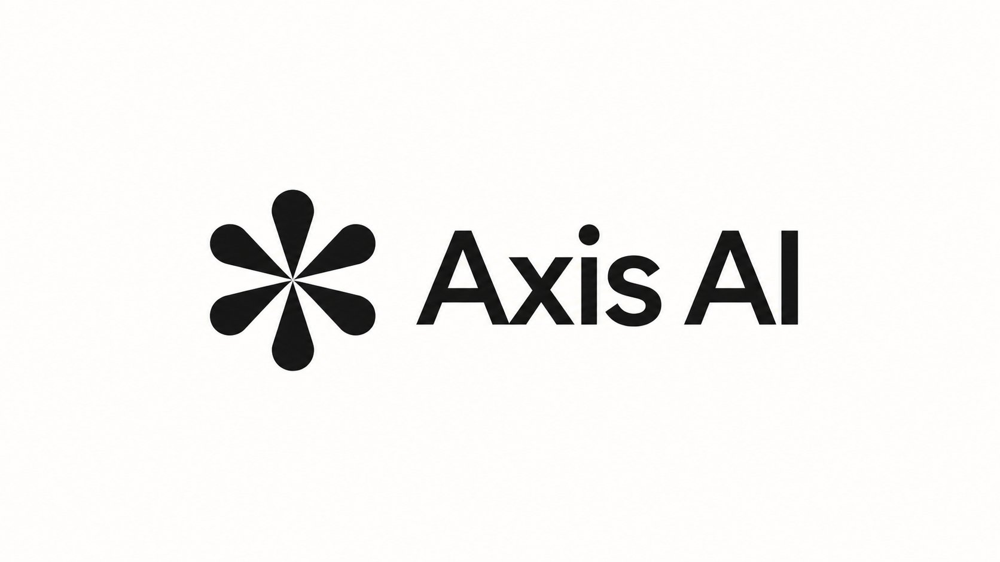

# DSH-A-Su · DSHA Sunset Mod

> A third-party **Mod** of [DSH-APP/DSHA](https://github.com/DSH-APP/DSHA) — not an official DSHA distribution.
> Runs the complete [DeepSeek Harness](https://github.com/deepseek-ai/deepseek-harness) on Android: no root, no Termux, works right after install.

<<<<<<< 208ea63a
<!-- build198-software-candidate -->
> **Current source: build198 software candidate** — `0.2.1-rc.3-20261025.2100-dsh0.2.1-rc.3` /Standard /dsh.android.client /E7E3 nondebug. True Sunset merge, consent pause fix, complete PC feature removal, single safe-area ownership and decoupled activity sampling. Selected Standard:806 tests,0fail/error,7 Windows symlink skips separately covered by44 real POSIX cases; Release Lint0fatal/error,279warnings. Phone acceptance is paused at the user’s request; the device still runs197. This is not installation or publication proof. [Scope and retained failures](docs/releases/v0.2.1-rc.3-build198-20261025.md). Actual source:`C:/Users/18768/.codex/worktrees/build198-from197/DSHA_RESTART`. Older current-version blocks below are historical.


<!-- build197-current -->
> **Current: 0.2.1-rc.3 / build197** — `0.2.1-rc.3-20261025.2000-dsh0.2.1-rc.3`, non-debuggable Standard / `dsh.android.client` / E7E3. One recents card and Home Back, explicit LAN status, phone tools in the current conversation, and ten interface/prompt languages. Fixes IME cancellation, stale polling and a restored blank Home page. 505 selected Standard tests, Release Lint and exact APK checks passed. Scoped Android13 coverage includes signed upgrades, real model/native confirmation, task reuse and normal shutdown; empty WebView semantic nodes, consent timeouts and candidate-specific limits remain documented in the [report](docs/releases/v0.2.1-rc.3-build197-20261025.md). Private delivery only; no Low tasks. Earlier current entries are historical.

<!-- build196-current -->
> **Current: 0.2.1-rc.3 / build196** — `0.2.1-rc.3-20261024.1835-dsh0.2.1-rc.3`, Standard / `dsh.android.client` / E7E3 / non-debuggable, conventional APK filename. Fixes the assistant composer and task bindings, physical semantic node tools, sharing/saving dispatch, and ports for side-by-side installations. Computer connections start from Home; its background-task button is removed. 279 selected Standard tests and Release Lint passed, with scoped Android16 acceptance. See the [report](docs/releases/v0.2.1-rc.3-build196-20261024.md) for candidate-specific evidence, timing samples and limits. Private prerelease delivery only; no Low tasks. Earlier entries below are historical.

<!-- build195-current -->
> **Current: 0.2.1-rc.3 / build195** — `0.2.1-rc.3-20261024.0645-dsh0.2.1-rc.3`, Standard /dsh.android.client /E7E3/non-debuggable. Adds paired computer workspaces, encrypted QR connections, floating text/system-voice assistant and separately authorized phone tools. Remote mode does not require local Ubuntu. LAN and self-hosted relay are available; the official relay is not deployed. 129 selected JVM tests and Release Lint passed. No Android device or Low tasks this round. [Report](docs/releases/v0.2.1-rc.3-build195-20261024.md); [plugin draft](docs/plugin-contract-v0.1.md). Earlier current-version entries below are historical.


<!-- build194-current -->
> **Current: 0.2.1-rc.3 / build194** — `0.2.1-rc.3-20261024.0345-dsh0.2.1-rc.3`, nondebug Standard/dsh.android.client/E7E3. Fixes download compression, Android empty-CA parsing, localized notes and normal empty update checks. Original Android16 remains unverified. Earlier entries are historical. [Report](docs/en/releases/v0.2.1-rc.3-build194-update-download-20261024.md).


<!-- current-rc3-identity -->
> **Current: 0.2.1-rc.3 / build193** — `0.2.1-rc.3-20261024.0120-dsh0.2.1-rc.3`; nondebug Standard / E7E3. APK: `release/0.2.1-rc.3/dsha-0.2.1-rc.3.apk`. The application and both DSH environments use rc.3. Earlier rc.2-named entries below are historical. [Report](docs/en/releases/v0.2.1-rc.3-build193-version-align-20261024.md).

<!-- build193-rc3:begin -->
> **2026-10-24 build193 / DSH rc.3**: `0.2.1-rc.2-20261023.2047-dsh0.2.1-rc.3` / nondebug Standard / dsh.android.client / E7E3; conventional filename retained. 217 selected JUnit tests, 13 host entries, Release Lint0 error/fatal (255 warnings) and 8 exact APK gates passed. No current device acceptance; private delivery only, no Low tasks. [Report](docs/en/releases/v0.2.1-rc.2-build193-issue183-plugin-env-20261023.md).
<!-- build193-rc3:end -->

<!-- build192-files:begin -->
> **2026-10-23 build192 file transfers (locally verified; private delivery scope only)**: `0.2.1-rc.2-20261023.1836-dsh0.2.1-rc.2` / code192 / `dsh.android.client` / E7E3 / nondebug Standard; conventional filename retained. 292,301,320 bytes, SHA `f1b332bc087e999bf9bd8954a70c9c7ad869d0a04193933d446854f0e31fbf3c`. Decimal 5,000,000,000-byte per-file limit, native Downloads/resume, minimum keyboard avoidance and redacted search preflight. Standard: 20 selected classes/102 tests, failures/errors/skips 0/0/0; 16 host entries, lint0 error/fatal and 254 warnings, 7 APK gates; limited Android13 operations only, see the actual report. Host 5 GB does not establish phone acceptance. Phone5 GB/reboot resume/Android16/realme and forwarding-search recovery remain unverified. R1 rejection/corrections are retained. Final commit/ZIP hash/private release status are externally verified. No public DSHA/website or Low tasks. [Current report](docs/en/releases/v0.2.1-rc.2-build192-files-20261023.md).
<!-- build192-files:end -->

<p align="center">
  <b>DeepSeek Harness launcher for Android</b><br>
  Run the full <a href="https://github.com/deepseek-ai/deepseek-harness">deepseek-harness</a> on your phone — no root, no Termux, nothing to type
</p>

<p align="center">
  <a href="LICENSE"></a>
  <a href="https://github.com/DSH-APP/DSHA/releases/latest"></a>
  <a href="https://github.com/DSH-APP/DSHA/stargazers"></a>
  
  
  <a href="https://afdian.com/a/dsha_apk"></a>
  <a href="https://qm.qq.com/q/N5aZSlnmgM"></a>
</p>

<p align="center">
  <b>English</b> · <a href="README.md">Simplified Chinese</a> · <a href="https://dsha.cc">dsha.cc</a> · <a href="CHANGELOG.md">Changelog</a> · <a href="docs/en/security-model.md">Security model</a> · <a href="AGENTS.en.md">AGENTS.en.md (for AI / contributors)</a>
</p>

> 🤖 If you are an AI agent or a new contributor, read **[AGENTS.en.md](AGENTS.en.md)** first
> (structure, startup contracts, traps we already fell into). Don't scan the whole repo.

> **0.2.1-rc.2 · build191 Sunset merge (locally verified; private delivery only)** — `0.2.1-rc.2-20261023.1640-dsh0.2.1-rc.2`, unchanged code191, preserving previous191/1500 and16 incoming commits. Production remains `dsh.android.client`/E7E3 non-debuggable Standard/`dsha-0.2.1-rc.2.apk`. Both flavors pass44 classes/242 tests each with zero failures/errors/skips, five real external fixtures each,18 hosts, Release Lint and9 APK gates. No new-APK device acceptance, SunsetRNE identity or new Low delivery. APK/complete source go only to the [current private Release](https://github.com/ym2025szz/DSHA-prerelase/releases/tag/v0.2.1-rc.2-20261023.1640); actual remote availability and source ZIP hash come from the Release/external receipt. [Changes/checks/limits](docs/en/releases/v0.2.1-rc.2-build191-sunset-merge-20261023.md) · [Previous191/1500](docs/en/releases/v0.2.1-rc.2-build191-startup-20261023.md).

[Previous build190 UI maintenance](docs/en/ui-performance-20261022.md): selected software and limited device checks belong to the 2100 APK. Its approximately 3.1–3.4s toggle samples and page timings are not build191 measurements. PiP stays default OFF; the limited 1817 three-frame anomaly remains open.

## ❤️ Sponsor

<table>
<tr>
<td width="180"><a href="https://zdxjl.com/register?aff=WDYTNDJ5LT4X"></a></td>
<td>Thanks to <a href="https://zdxjl.com/register?aff=WDYTNDJ5LT4X">Lvluo Relay</a> for sponsoring this project! Lvluo Relay is an AI platform covering models from many vendors: mainstream large models are ready to use on demand, and coding, image generation and more can all be called from one platform. Models from China and abroad are available, new releases land promptly, the service is attentive and the pricing is attractive. Registering through this link gives a 105% top-up bonus.</td>
</tr>
</table>

<table>
<tr>
<td width="180"><a href="https://ai.onyxaxis.org/"></a></td>
<td>Thanks to <a href="https://ai.onyxaxis.org/">Axis AI</a> for sponsoring this project! Axis AI is a free public-interest AI platform where multiple mainstream models are ready to use. Chat, write code, and generate images from one unified platform.</td>
</tr>
</table>

---
=======
## Status

| Item | Value |
|---|---|
| App name | **DSH-A-Su** (test variant: `DSH-A-Su Test`) |
| Version | `0.2.1-rc.5-20261105.0230-dsh0.2.1-rc.5` |
| versionCode | 316 |
| Package | `io.github.sunsetrne.dsha` (test variant `io.github.sunsetrne.dsha.test`) |
| Coexistence | Fully independent from the original `dsh.android.client` and the older `com.dsh.client`; data and system grants are not shared |
| Signing | Mod release certificate, SHA-256 `a4b0413c67fa46dd30dc7e2bce3ad56151ed8bfde2a3315fff685baf786b5d5d` |
| System | Android 11+ (API 30) / arm64-v8a; **Android 10 and below are no longer supported** |
| Main branch | `main` (the former `Sunset-3090-Q` was merged and removed) |
| License | MIT (inherited from upstream) |
>>>>>>> sunset/main

## What this is

DeepSeek Harness is DeepSeek's official agent harness, written for glibc Linux; running it on Android directly runs into native-module builds, SELinux restrictions, sandbox startup and desktop-oriented layout.

DSHA wraps all of that into a single APK: a complete Ubuntu environment where `apt`, interactive PTYs and native modules that need compiling all work. On first launch it unpacks and verifies the bundled offline environment; models and API keys are then configured in the Web UI — no Termux, root or command line required.

<<<<<<< 208ea63a
Maintained by contributor [@ym2025szz](https://github.com/ym2025szz), with thanks to
original author [@qiannianhuanxiang](https://github.com/qiannianhuanxiang) and all other contributors.
=======
This repository is a Mod maintained on top of the original; the changes focus on the terminal, device capabilities and the mobile UI.
>>>>>>> sunset/main

## Shape of this Mod (build209 and later)

- **Own identity**: app name `DSH-A-Su`, package `io.github.sunsetrne.dsha`, a newly created release key. It installs next to the original without touching its data, grants or signature chain; migration is export-a-backup → import into the new package.
- **Single Standard variant**: only the Android 11+ / arm64 system-WebView build remains; the `low` compatibility line and GeckoView are removed, and no Android 10-or-below package is produced.
- **Island edition folded in**: task-status island (Live Updates / Dynamic Island) and multi-select/custom answers in notifications are built into the regular package; the separate island package name is gone.
- **Variant-neutral accessibility declaration**: the service is declared in `src/main`, does not restrict `packageNames` and is not replaced per flavor; its component is derived from the runtime package name, so the regular, test and debug packages can each be enabled independently without displacing one another.
- **Public fixed build inputs**: the offline rootfs, DSH runtime, Ubuntu tools and other large files ship as a public pre-release asset; `ci/sunset-inputs.lock.json` pins its SHA-256, so a clone can restore them and build the full APK (see [docs/fixed-build-inputs.md](docs/fixed-build-inputs.md)).
- **All 10 UI languages kept**: zh / zh-Hant / en / ru / ja / ko / ar / pt / la / fr; short UI labels in fr, pt, ru, ar and la were shortened for screen space, without changing long-form meaning.

## Mod highlights

<<<<<<< 208ea63a
New APKs and complete source are distributed only through [private maintenance Releases](https://github.com/ym2025szz/DSHA-prerelase/releases), requiring repository access. Actual attachments and the final receipt establish availability, the fully dated/time-stamped versionName and APK/source hashes. Standard targets Android11+/arm64 with system WebView and E7E3 non-debuggable signing. No new Low delivery this round; old public versions remain in [historical Releases](https://github.com/DSH-APP/DSHA/releases).
=======
- **Three-mode root command policy**: strict (default allow-list), relaxed (blocks irreversible actions) and fully relaxed. Root channel only; Shizuku / ADB stay strict, and SMS reads always require native authorization.
- **Terminal**: standalone full-screen terminal, session sidebar (three states, landscape compression), extra keys, an output "more" panel, output preview / copy / share / save and a responsive sidebar.
- **Mobile UI v5**: plugin page cards and filters, componentized settings sub-pages, page and dialog transitions, unified launch state and floating-ball details.
- **Device capabilities**: accessibility read/tap, ADB / Shizuku / Root command channels, SMS read gate, virtual display, notifications, clipboard and sensors.
- **Web UI and access**: mobile-adapted interface, LAN access with authentication, dynamic ports.
- **Backup and restore**: encrypted backups (v5 format), upgrade and restore, external-workspace protection.
- **Plugin ecosystem**: bundled plugins, plugin package installation, permission and state management.
- **Reliability and recovery**: least-privilege model, self-check diagnostics, emergency recovery entry and background Web recovery.
>>>>>>> sunset/main

## Branches

The public repository keeps a single `main` branch (the former `Sunset-3090-Q` carried the same content and was merged and removed):

| Branch | Purpose |
|---|---|
| `main` | Default and mainline: terminal, UI, device capabilities, root three-mode policy and the Mod identity change |

Per-version changes and verification boundaries are recorded in [CHANGELOG.md](CHANGELOG.md) and [docs/releases/](docs/releases/).

## Install and migrate

1. Get an APK (this repository does not host a permanent APK asset; see the build section below, or use your own CI output).
2. On first launch the bundled offline environment is unpacked and verified; the main screen then appears and the Web service starts in the background.
3. Open the Web UI and configure provider, model and API key in settings.
4. To migrate from the original DSHA: export a backup there first, then import it in DSH-A-Su. Data, system grants and accessibility switches are not inherited across packages, and both apps can coexist.
5. To upgrade from an older DSH-A-Su build: the package name and the Mod release key recorded here must match.

## Build from source

Requires JDK 17, Node 24, Python 3.9+, Android SDK 37 and NDK 26. Restore the fixed inputs from the public pre-release asset; toolchain and signing are documented in [BUILD.md](BUILD.md) and [docs/fixed-build-inputs.md](docs/fixed-build-inputs.md).

```bash
python3 tools/ci-assets.py --url "$(python3 -c 'import json;print(json.load(open("ci/sunset-inputs.lock.json"))["url"])')" \
  --sha256 "$(python3 -c 'import json;print(json.load(open("ci/sunset-inputs.lock.json"))["sha256"])')"
python3 tools/run-host-tests.py --check-manifest
python3 tools/run-host-tests.py --stage fast
./gradlew :app:testStandardDebugUnitTest :app:lintStandardRelease
./gradlew :app:assembleStandardRelease
```

On Windows use `gradlew.bat`. `Debug` in test task names only selects the test variant; it does not require building or installing a debug APK. Signing keys, user data, device screenshots and logs are never committed.

## Documentation

| Document | Content |
|---|---|
| [AGENTS.md](AGENTS.md) | Project layout, startup contract and technical constraints (contributor entry point) |
| [docs/en/index.md](docs/en/index.md) | Complete English documentation index |
| [docs/fixed-build-inputs.md](docs/fixed-build-inputs.md) | Public pre-release asset for fixed build inputs, restore/update flow |
| [docs/i18n-length-policy.md](docs/i18n-length-policy.md) | UI copy length budget and multilingual shortening policy |
| [docs/security-model.en.md](docs/security-model.en.md) | Security model: permission boundaries and known weaknesses |
| [docs/plugins.md](docs/plugins.md) | Plugin installation and packaging requirements |
| [BUILD.md](BUILD.md) / [CONTRIBUTING.md](CONTRIBUTING.md) | Build, signing and contribution workflow |
| [CHANGELOG.md](CHANGELOG.md) | Full change history |

## Compatibility and known limitations

- arm64, Android 11+ only; permissions, background behaviour and power policies differ notably between ROMs.
- Virtual display, root policy modes and SMS reads depend on the OS version and native authorization state.
- Some vendor native dependencies are not guaranteed to be fully reproducible from source; the first offline-environment unpack takes a while.
- The desktop/PC connection capability has been removed from the current version; phone control and local/LAN access remain.

## Credits and license

This project is a Mod derived from [DSH-APP/DSHA](https://github.com/DSH-APP/DSHA) and keeps the original [MIT](LICENSE) license (Copyright (c) 2026 qiannianhuanxiang), preserving the original copyright and license notices.

<<<<<<< 208ea63a
| Topic | Contact |
|---|---|
| Original author (partnership / licensing) | QQ 2921185884 |
| Current maintainer (proposals / feedback, or just open an issue) | QQ 1876843459 |
| Email | 1437ht@gmail.com |
=======
The upstream harness is [deepseek-ai/deepseek-harness](https://github.com/deepseek-ai/deepseek-harness); the container layer uses [proot](https://github.com/termux/proot) / [proroot](https://github.com/coderredlab/proroot), the terminal is based on [Termux terminal-view](https://github.com/termux/termux-app), the mobile adaptation is based on [dsh-web-mobile](https://github.com/mexiaosqwq/dsh-web-mobile), and the fallback device channel is [Shizuku](https://shizuku.rikka.app/). See [THIRD_PARTY_NOTICES.md](THIRD_PARTY_NOTICES.md) for the full third-party notices.
>>>>>>> sunset/main

Thanks to the original author [@qiannianhuanxiang](https://github.com/qiannianhuanxiang) and all contributors.
