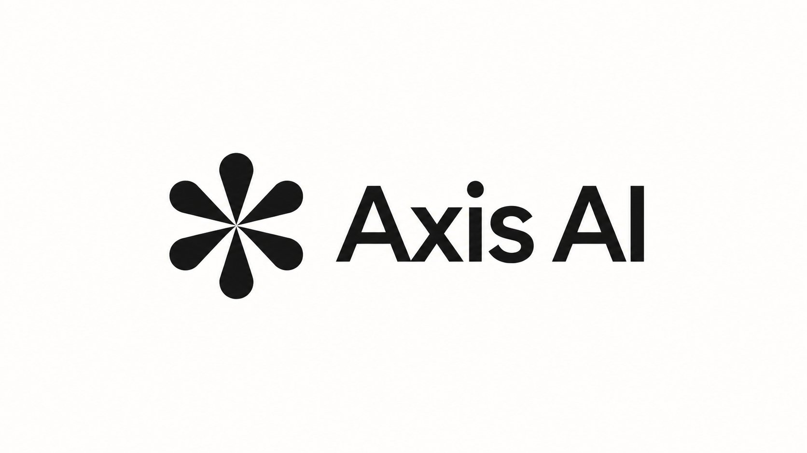

# DSH-A-Su · DSHA Sunset Mod

> 基于 [DSH-APP/DSHA](https://github.com/DSH-APP/DSHA) 的第三方 **Mod 版本**，不是 DSHA 官方发行版。
> 在 Android 手机上运行完整的 [DeepSeek Harness](https://github.com/deepseek-ai/deepseek-harness)：免 ROOT、免 Termux，装完即用。

## 当前状态

<<<<<<< 208ea63a
<!-- build198-software-candidate -->
> **当前源码：build198软件候选** — `0.2.1-rc.3-20261025.2100-dsh0.2.1-rc.3` /Standard /dsh.android.client /E7E3非调试。真实合入Sunset19提交，修复授权切换隐藏暂停，撤下整套电脑连接，统一顶部安全区并解耦活动服务等待。91类806项Standard测试零失败/错误，7项Windows软链权限skip已由真实POSIX44项补验覆盖；Release Lint0错误/致命279警告。用户暂停手机验收，手机仍197；本条不证明198装机或发布。[范围与失败记录](docs/releases/v0.2.1-rc.3-build198-20261025.md)。实际源 `C:/Users/18768/.codex/worktrees/build198-from197/DSHA_RESTART`，不构建旧F173/S197。下方旧当前条目按历史阅读。


<!-- build197-current -->
> **当前：0.2.1-rc.3 / build197** — `0.2.1-rc.3-20261025.2000-dsh0.2.1-rc.3`，Standard / `dsh.android.client` / E7E3非调试。统一最近任务及主页返回，补齐LAN状态与地址，普通对话直接调用手机能力，新增十语及自适应主提示。修复IME自动取消、旧poll和恢复空白页。505项所选Standard测试、Release Lint及精确APK检查通过；Android13有限验收含覆盖、实际模型/原生确认、返回复用及正常停止。WebView空语义节点、确认超时与候选范围见[本轮报告](docs/releases/v0.2.1-rc.3-build197-20261025.md)。仅私有交付，不运行Low；下方旧当前条目按历史阅读。

<!-- build196-current -->
> **当前：0.2.1-rc.3 / build196** — `0.2.1-rc.3-20261024.1835-dsh0.2.1-rc.3`，Standard / `dsh.android.client` / E7E3非调试，常规文件名不变。修复悬浮助手输入与任务绑定、物理屏语义节点接口、分享与保存分流、双安装端口共存；删除首页后台任务按钮，电脑连接从首页进入。279项所选Standard单测与Release Lint通过，Android16完成有限实际验收；具体候选、启动样本与未验范围见[本轮报告](docs/releases/v0.2.1-rc.3-build196-20261024.md)。只交付私有预发布仓库，不运行Low；下方195及更早记录按历史阅读。

<!-- build195-current -->
> **当前：0.2.1-rc.3 / build195** — `0.2.1-rc.3-20261024.0645-dsh0.2.1-rc.3`，Standard /dsh.android.client /E7E3非调试。新增电脑工作区、扫码配对、端到端加密连接、可展开文字/系统语音的悬浮助手及手机控制工具。无需先安装本机Ubuntu即可进入远程工作区；官方中继尚未部署，可用局域网或自托管。129项所选单测及Release Lint通过；本轮未操作手机、不跑Low。[本轮报告](docs/releases/v0.2.1-rc.3-build195-20261024.md)；[插件参考v0.1](docs/plugin-contract-v0.1.md)。下方194及更早版本按历史阅读。


<!-- build194-current -->
> **当前：0.2.1-rc.3 / build194** — `0.2.1-rc.3-20261024.0345-dsh0.2.1-rc.3`，Standard /dsh.android.client /E7E3非调试。修复下载压缩空响应、Android证书解析为空、旧版本说明与通道空结果；原反馈Android16未复验。旧193/rc2条目按历史阅读。[本轮报告](docs/releases/v0.2.1-rc.3-build194-update-download-20261024.md)。


<!-- current-rc3-identity -->
> **Current / 当前：0.2.1-rc.3 · build193** — `0.2.1-rc.3-20261024.0120-dsh0.2.1-rc.3`；Standard / E7E3 / 非调试，文件为 `release/0.2.1-rc.3/dsha-0.2.1-rc.3.apk`，应用与正式/独立应急DSH均为rc.3。下方rc.2命名条目按历史阅读。[本轮报告](docs/releases/v0.2.1-rc.3-build193-version-align-20261024.md)。

<!-- build193-rc3:begin -->
> **2026-10-24 build193 / DSH rc.3**：`0.2.1-rc.2-20261023.2047-dsh0.2.1-rc.3` / Standard / dsh.android.client / E7E3非调试；常规文件名不变。217项所选JUnit、13host、Release Lint零错误/致命（255警告）、8项精确APK门禁通过。设备未验，旧反馈边界保留；仅私有交付、不跑Low。[本轮报告](docs/releases/v0.2.1-rc.2-build193-issue183-plugin-env-20261023.md)。
<!-- build193-rc3:end -->

<!-- build192-files:begin -->
> **2026-10-23 build192 文件传输修订（本地已验证，仅私有交付范围）**：`0.2.1-rc.2-20261023.1836-dsh0.2.1-rc.2` / code192 / `dsh.android.client` / E7E3 / 非调试Standard，常规文件名不变；292,301,320字节，SHA `f1b332bc087e999bf9bd8954a70c9c7ad869d0a04193933d446854f0e31fbf3c`。单文件十进制5,000,000,000字节、原生下载记录/续传、键盘最小避让与搜索脱敏前置诊断。Standard所选20类102项JUnit，失败/错误/skip 0/0/0；16host，Lint错误/致命0、警告254，精确APK7门禁；仅Android13有限设备操作，范围见本轮报告实际记录。5GB宿主往返不算手机验收；手机5GB/重启续传/Android16/realme与转发搜索恢复未验。R1拒绝和后续修正保留，不称一路全绿。仅私有仓库交APK/完整源码；最终commit/ZIP自身SHA/发布状态由外部回执核验，不公开DSHA/网站、不跑Low。本条覆盖下方旧当前版本说明。[本轮报告](docs/releases/v0.2.1-rc.2-build192-files-20261023.md)。
<!-- build192-files:end -->

<p align="center">
  <b>DeepSeek Harness 安卓启动器</b><br>
  在手机上跑完整的 <a href="https://github.com/deepseek-ai/deepseek-harness">deepseek-harness</a> —— 免 ROOT，免 Termux，装完即用
</p>

<p align="center">
  <a href="LICENSE"></a>
  <a href="https://github.com/DSH-APP/DSHA/releases/latest"></a>
  <a href="https://github.com/DSH-APP/DSHA/stargazers"></a>
  
  
  <a href="https://afdian.com/a/dsha_apk"></a>
  <a href="https://qm.qq.com/q/N5aZSlnmgM"></a>
</p>

<p align="center">
  <a href="README.en.md">English</a> · <b>简体中文</b> · <a href="https://dsha.cc">官网 dsha.cc</a> · <a href="CHANGELOG.md">更新记录</a> · <a href="docs/security-model.md">安全模型</a> · <a href="AGENTS.md">AGENTS.md（给 AI / 开发者）</a>
</p>

> 🤖 下一个 AI / 开发者请先读 **[AGENTS.md](AGENTS.md)**（项目结构、启动契约、踩过的坑），不要先全库扫描。

> **0.2.1-rc.2 · build191 Sunset合并（本地已验证，仅私有交付）**：`0.2.1-rc.2-20261023.1640-dsh0.2.1-rc.2` / code191不变，保留上一191/1500并合入新增16提交。正式 `dsh.android.client`/E7E3非调试Standard/`dsha-0.2.1-rc.2.apk`保持。两版44类各242项JUnit零失败/错误/skip、5完整外部夹具每版实跑、18host、Release Lint和APK9项通过；新APK设备未验，不启用SunsetRNE、不新增Low交付。新包及完整源码仅交[本轮私有Release](https://github.com/ym2025szz/DSHA-prerelase/releases/tag/v0.2.1-rc.2-20261023.1640)，实际远端与源码ZIP自身SHA由该Release/外部回执核验。[修订、检查与未验范围](docs/releases/v0.2.1-rc.2-build191-sunset-merge-20261023.md) · [上一191/1500](docs/releases/v0.2.1-rc.2-build191-startup-20261023.md)。

[此前build190 UI维护](docs/ui-performance-20261022.md)：2100标准包完成所选软件门禁及有限设备路径；其插件开关约3.1–3.4秒和页面样本仅属该包，不是build191实测。PiP默认关闭，1817局部3帧异常保留待查。

## ❤️ 赞助商

<table>
<tr>
<td width="180"><a href="https://zdxjl.com/register?aff=WDYTNDJ5LT4X"></a></td>
<td>感谢 <a href="https://zdxjl.com/register?aff=WDYTNDJ5LT4X">绿萝中转站</a> 赞助本项目！绿萝中转站是一个包含多种厂家模型的 AI 平台，多款主流大模型随开随用，写代码、生成图片等等都能在同一平台调用。国内外模型应有尽有，上新及时，服务周到，价格美丽。使用本链接注册可享受充值 105% 优惠。</td>
</tr>
</table>

<table>
<tr>
<td width="180"><a href="https://ai.onyxaxis.org/"></a></td>
<td>感谢 <a href="https://ai.onyxaxis.org/">Axis AI</a> 赞助本项目！Axis AI 是一个免费的公益 AI 平台，多款主流大模型随开随用，聊天、写代码、生成图片都能在同一平台内实现。</td>
</tr>
</table>

---
=======
| 项目 | 值 |
|---|---|
| 应用名 | **DSH-A-Su**（测试变体为 `DSH-A-Su Test`） |
| 版本 | `0.2.1-rc.5-20261105.0230-dsh0.2.1-rc.5` |
| versionCode | 316 |
| 包名 | `io.github.sunsetrne.dsha`（测试变体 `io.github.sunsetrne.dsha.test`） |
| 并行安装 | 与原版 `dsh.android.client`、更早的 `com.dsh.client` 完全独立，数据与系统授权互不继承 |
| 签名 | Mod 自有发布证书，SHA-256 `a4b0413c67fa46dd30dc7e2bce3ad56151ed8bfde2a3315fff685baf786b5d5d` |
| 系统 | Android 11+（API 30）/ arm64-v8a；**Android 10 及以下不再支持** |
| 主线分支 | `main`（原 `Sunset-3090-Q` 已合并删除） |
| 许可 | MIT（沿用原版） |
>>>>>>> sunset/main

## 这是什么

DeepSeek Harness 是 DeepSeek 官方的 agent harness，为 glibc Linux 编写；直接跑在 Android 上会撞上原生模块编译、SELinux 拦截、沙箱启动与桌面排版等问题。

DSHA 把这些封进一个 APK：内置完整的 Ubuntu 环境，`apt`、交互式 PTY 与需要编译的原生模块都能用；首次启动解压并校验离线环境，随后在 Web UI 中配置提供商、模型与 API Key，不需要 Termux、ROOT 或命令行。

<<<<<<< 208ea63a
由贡献者 [@ym2025szz](https://github.com/ym2025szz) 维护，感谢原作者
[@qiannianhuanxiang](https://github.com/qiannianhuanxiang) 和其他贡献者。
=======
本仓库是在原版基础上维护的 Mod，改动集中在终端、设备能力与移动端界面。
>>>>>>> sunset/main

## 这个 Mod 的形态（build209 起）

- **独立身份**：应用名 `DSH-A-Su`，包名 `io.github.sunsetrne.dsha`，新建发布签名。与原版并存安装，旧版数据、授权、签名链均不受影响；迁移走应用内导出备份 → 新包导入。
- **单一 Standard 变体**：只保留 Android 11+ / arm64 的系统 WebView 内核；`low` 兼容线与 GeckoView 已整体删除，不再提供 Android 10 及以下安装包。
- **上岛版并入正式包**：任务状态上岛（实时活动/灵动岛）与通知内多选/自定义回答直接内置，不再有单独的“上岛版”包名。
- **无障碍声明多变体共用**：服务声明固定在 `src/main`，不限定 `packageNames`、不按 flavor 覆盖；服务组件由运行时包名生成，因此正式包、测试包、debug 包可各自独立启用、互不顶掉。
- **固定构建输入公开可还原**：离线 rootfs、DSH runtime、Ubuntu tools 等大文件作为公开仓库的预发布 Release 资产分发，`ci/sunset-inputs.lock.json` 锁定 SHA-256，clone 后即可还原并完整构建（见 [docs/fixed-build-inputs.md](docs/fixed-build-inputs.md)）。
- **10 种界面语言保留**：zh / zh-Hant / en / ru / ja / ko / ar / pt / la / fr；fr、pt、ru、ar、la 的界面短标签做过占屏优化，长句语义不变。

## Mod 主要改动

<<<<<<< 208ea63a
新APK和完整源码仅从[私有维护仓库的Releases](https://github.com/ym2025szz/DSHA-prerelase/releases)取得，需有仓库权限；可得性、完整日期时间versionName、APK/源码摘要以实际附件和最终交付回执为准。标准版面向Android11+/arm64、系统WebView、E7E3非调试签名。本轮不新增Low交付，旧正式版本见[历史Releases](https://github.com/DSH-APP/DSHA/releases)。
=======
- **Root 命令三态拦截**：严格（默认白名单）、放宽（拦截不可逆操作）、完全放宽；入口在 设置 → 设备能力授权 → Root 命令拦截。仅作用于 Root 通道，Shizuku / ADB 仍按严格档，短信读取始终需要原生授权。
- **终端增强**：独立全屏终端、会话侧栏（三向态与横屏压缩）、附加键、输出“更多…”面板、输出预览 / 复制 / 分享 / 保存与响应式侧栏。
- **移动界面 v5**：插件页卡片与筛选、设置二级页组件化、页面与弹窗动效、启动状态与悬浮球细节统一。
- **设备能力**：无障碍读屏与点按、ADB / Shizuku / Root 三条命令通道、短信读取闸门、虚拟屏、通知、剪贴板与传感器等宿主能力。
- **Web UI 与访问**：移动端适配界面、局域网访问与鉴权、动态端口。
- **备份与恢复**：加密备份（v5 格式）、升级与恢复、外置工作区保护。
- **插件生态**：内置插件与插件包安装、权限与状态管理。
- **可靠性与应急**：最小权限模型、自检诊断、应急恢复入口、后台 Web 恢复。
>>>>>>> sunset/main

## 分支说明

公开仓库只保留 `main` 一条分支（原 `Sunset-3090-Q` 与它内容一致，已合并删除）：

| 分支 | 定位 |
|---|---|
| `main` | 默认与主线：终端、界面、设备能力、Root 三态拦截与 Mod 身份改造 |

各版本的详细改动与验证边界见 [CHANGELOG.md](CHANGELOG.md) 与 [docs/releases/](docs/releases/)。

## 安装与迁移

1. 获取 APK（本仓库不提供常驻 APK 资产；构建方式见下节，或使用你自己 CI 的产物）。
2. 首次启动会解压并校验内置离线环境；完成后进入主界面，Web 服务在后台启动。
3. 打开 Web UI，在设置中配置提供商、模型与 API Key。
4. 从原版 DSHA 迁移：先在原版导出备份，再在 DSH-A-Su 导入；两个包的数据、系统授权、无障碍开关互不继承，可长期并存。
5. 从 Mod 自身旧构建升级：必须使用同一包名与同一签名（本仓库记录的 Mod 发布证书）。

## 从源码构建

需要 JDK 17、Node 24、Python 3.9+、Android SDK 37 与 NDK 26。固定输入用公开预发布资产还原，工具链与签名配置见 [BUILD.md](BUILD.md) 与 [docs/fixed-build-inputs.md](docs/fixed-build-inputs.md)。

```bash
python3 tools/ci-assets.py --url "$(python3 -c 'import json;print(json.load(open("ci/sunset-inputs.lock.json"))["url"])')" \
  --sha256 "$(python3 -c 'import json;print(json.load(open("ci/sunset-inputs.lock.json"))["sha256"])')"
python3 tools/run-host-tests.py --check-manifest
python3 tools/run-host-tests.py --stage fast
./gradlew :app:testStandardDebugUnitTest :app:lintStandardRelease
./gradlew :app:assembleStandardRelease
```

Windows 使用 `gradlew.bat`。测试任务名中的 Debug 只表示测试变体，不要求生成或安装调试 APK。签名私钥、用户数据、设备截图与日志不进入仓库。

## 文档

| 文档 | 内容 |
|---|---|
| [AGENTS.md](AGENTS.md) | 项目结构、启动契约与技术约束（新贡献者入口） |
| [docs/documentation-index.md](docs/documentation-index.md) | 完整文档索引 |
| [docs/fixed-build-inputs.md](docs/fixed-build-inputs.md) | 固定构建输入的公开预发布资产与还原/升级流程 |
| [docs/i18n-length-policy.md](docs/i18n-length-policy.md) | 界面文案长度预算与多语言精简口径 |
| [docs/security-model.md](docs/security-model.md) | 安全模型：权限边界与已知弱点 |
| [docs/plugins.md](docs/plugins.md) | 插件安装与打包要求 |
| [docs/virtual-screen-architecture.md](docs/virtual-screen-architecture.md) | 虚拟屏架构与前提 |
| [BUILD.md](BUILD.md) / [CONTRIBUTING.md](CONTRIBUTING.md) | 构建、签名与贡献流程 |
| [CHANGELOG.md](CHANGELOG.md) | 完整更新记录 |

## 兼容性与已知限制

- 仅 arm64、Android 11+；不同 ROM 的权限、后台与省电策略差异较大。
- 虚拟屏、Root 档位与短信读取依赖具体系统版本和原生授权状态。
- 部分 vendor 原生依赖不保证完全从源码复现；首次解压离线环境耗时较长。
- 电脑端连接能力已从当前版本撤下；手机控制与本机 / 局域网能力保留。

## 致谢与许可

本项目是 [DSH-APP/DSHA](https://github.com/DSH-APP/DSHA) 的衍生 Mod，沿用原版 [MIT](LICENSE) 许可（Copyright (c) 2026 qiannianhuanxiang），保留原版版权与许可声明。

<<<<<<< 208ea63a
| 事宜 | 联系 |
|---|---|
| 项目主创（合作/授权/入伙） | QQ 2921185884 |
| 现维护者（项目提议/反馈，或直接提 issue） | QQ 1876843459 |
| Email | 1437ht@gmail.com |
=======
上游本体为 [deepseek-ai/deepseek-harness](https://github.com/deepseek-ai/deepseek-harness)；容器层使用 [proot](https://github.com/termux/proot) / [proroot](https://github.com/coderredlab/proroot)，终端基于 [Termux terminal-view](https://github.com/termux/termux-app)，移动端适配基于 [dsh-web-mobile](https://github.com/mexiaosqwq/dsh-web-mobile)，设备命令备用通道为 [Shizuku](https://shizuku.rikka.app/)。完整第三方许可见 [THIRD_PARTY_NOTICES.md](THIRD_PARTY_NOTICES.md)。
>>>>>>> sunset/main

感谢原版作者 [@qiannianhuanxiang](https://github.com/qiannianhuanxiang) 与所有贡献者。
