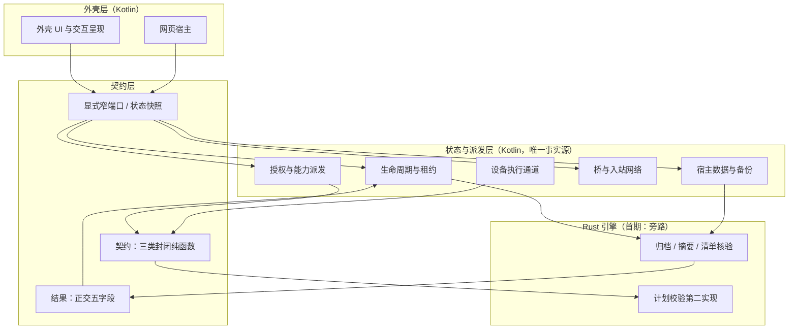
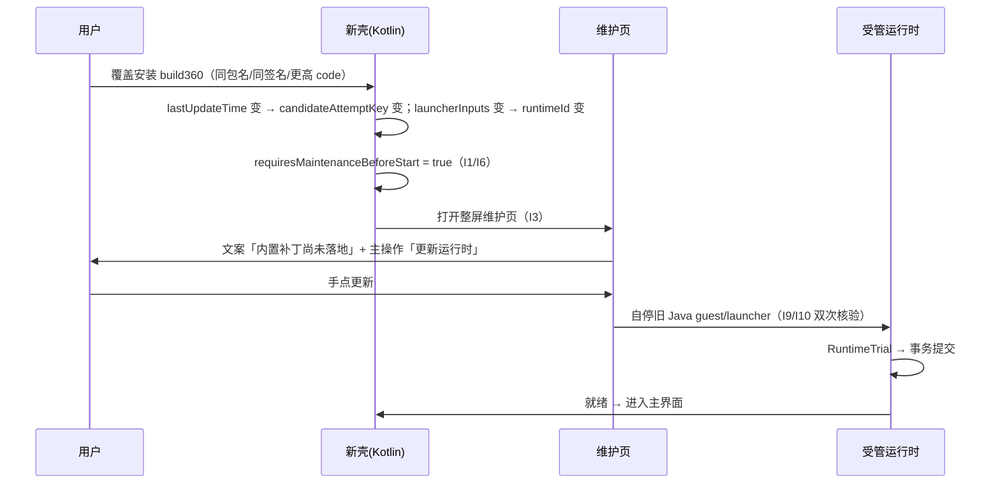

# 外壳重写：Kotlin 模块化 + Rust 核心引擎 —— 可行性评审

状态：**设计评审稿，待用户确认；未实现、未构建、未真机验证。**
核验日期：2026-11-12。基线：`0.2.1-rc.5-20261111.1200-dsh0.2.2-rc.1` / build359 / `92acaa04` / `io.github.sunsetrne.dsha` / 单一 Standard。
评审方式：5 条并行评审线（A 外壳、B Rust、C 模块、D 覆盖更新、E 安全）+ Lead 汇总；只读源码与文档，**未跑 Gradle、未构建、未安装、未测任何性能数据**。所有数字为工作树实测，所有结论给文件证据。

五份原始草稿（保留分歧与细节，正文做压缩）：

| 草稿 | 主题 |
|---|---|
| [01-kotlin-shell.md](drafts/01-kotlin-shell.md) | Kotlin / Gradle 模块化可行性、UI 路线、分批迁移 |
| [02-rust-core.md](drafts/02-rust-core.md) | Rust 职责分界、FFI 选型、构建与进程约束 |
| [03-module-decomposition.md](drafts/03-module-decomposition.md) | 10 模块逐个评审、缺失模块、DAG、状态单点 |
| [04-update-compat.md](drafts/04-update-compat.md) | I1–I10 覆盖更新不变式、数据兼容、灰度回滚 |
| [05-safety-permissions.md](drafts/05-safety-permissions.md) | 安全不变式、三通道归属、识屏统一化 |

---

## 0. 结论速览

**判定：方向成立，但不能按字面执行。** 三个词必须先改定义，否则会同时踩到工程、安全、兼容三个坑：

| 用户用词 | 字面理解（不建议） | 本项目里的正确含义 |
|---|---|---|
| 外壳重写 | 把 964 个 Java 文件翻成 Kotlin、页面重画 | **宿主壳**：Android API 面 + 状态所有权 + 界面；**重切边界、增量换语言，不做全量重写** |
| Rust 核心引擎 | 进程、权限、桥、终端全部搬进 Rust | **确定性计算 + 计划校验内核**：只接受 Kotlin 已判定、带不可伪造许可的计划 |
| N 个模块 | N 个 Gradle 模块 / N 个目录 | **N 个状态所有权单元**；编译单元（Gradle 模块）数量要少得多 |

**四个数字**（本评审的净产出）：

| 粒度 | 建议数量 | 说明 |
|---|---|---|
| 状态模块（职责与状态所有权） | **21**（15 必须 + 4 建议 + 2 强制隔离） | 用户 10 个是骨架：重切 4 处、拆出 15 个、再补 6 个净新增 |
| Gradle 编译模块 | **9**（+ 2 个二期） | 用户 10 模块 ≠ 10 个 Gradle 模块；`ui/util/backup` 内部的循环与 3 处构建脚本耦合是真阻碍 |
| Rust crate | **1**（首期） | 旁路计算 + 计划校验；不接管进程与信号 |
| 用户可见行为变化 | **0**（重构期间，除本轮回环外） | 覆盖更新兼容必须保持 I1–I10 一条不丢 |

**用户清单遗漏或只隐含的职责（按优先级，共 10 项；其中 6 项是净新增模块）**：

1. **宿主数据与备份事务** —— `backup/` 83 个类，是全仓唯一允许删除/覆盖用户数据的模块，也是体积最大的包。用户 10 模块里完全没有它。
2. **进程身份与退出证据** —— 出生身份、双次核验、停止证据，被生命周期、终端、虚拟屏、受管安装四方共用；抽不出来，21 个模块里就有 4 个各建一套。
3. **桥与入站网络** —— 3090 桥（`HttpShellService`，实测 4889 行）不只是"网络请求"，它是入站鉴权 + 数十条 `/app/*` 端点的能力派发宿主面（`util/BridgeRoutes` 中 51 条唯一 `/app/*` 字面量）。用户模块 2「网络请求管理」只覆盖出站下载，方向正好相反。
4. **网页宿主** —— WebView 容器、页面脚本、IME、PiP、麦克风、文件上传下载；与"外壳 UI"不是同一失败域。
5. **虚拟屏** —— `vscreen/` 36 类 + 独立 `app_process` Core。用户模块 10 只写了"ADB 识屏与无障碍"，把 36 个类漏了。
6. **配置与状态 / 凭据与密钥** —— `ConfigStore` 956 行是唯一配置入口；`KeyVault` 是 Keystore 边界，失败域独立。
7. **legacy 兼容层 / 独立应急环境** —— 前者是"只读旧格式"的防腐层（覆盖更新兼容的落点），后者按设计必须独立运行根；两者按"强制隔离"对待，不计入普通模块依赖图。

净新增：M01 配置、M02 凭据、M04 进程身份、M12 宿主数据、M20 legacy、M21 应急；从用户模块拆出但必须独立：M08 虚拟屏、M11 受管安装、M15 桥与入站、M19 网页宿主。

**三个最大风险**（按"会真的发生"排序）：

1. **把 Rust 当成绕过 Android 权限的捷径** —— 一旦 FFI 暴露 `exec(String)` 形状的入口，`DeviceShellPolicy` 白名单就从强制拒绝降级为惯例，等价于把 root 执行面交给任意调用点。
2. **把"模块化"当成"重写"** —— 706 个 `*Test.java`、50 个 Manifest 组件、19 个自定义 Gradle 任务、10 条覆盖更新不变式，任何一项在重写中丢失都无法靠"能编译"发现。
3. **用换包名 / 换签名 / 清数据解决兼容** —— 换签名即 `INSTALL_FAILED_UPDATE_INCOMPATIBLE`，唯一出路是卸载重装，等于丢 Keystore 加密的会话记录与设备授权。

**答案先行：旧版覆盖更新怎么办？** 包名、签名、versionCode 单调三条红线不动；I1–I10 判定逻辑原样移植、做 Java↔Kotlin/Rust 差分回归；新壳首启必然"不是当前候选"，因此**必然进一次整屏维护页**（这是 I6 的设计，不是缺陷）；数据只许"双读单写 + 新格式走旁路文件"；回滚永远靠发更高 versionCode 的旧代码，绝不靠清数据。详见 §7。

---

## 1. 评审分工与团队分歧

### 1.1 分工

| 线 | 关注 | 主要结论 |
|---|---|---|
| A 外壳 | Kotlin/Gradle 可行性、UI 路线、分批 | 可行；真阻碍是依赖环与构建脚本，不是语言 |
| B Rust | 职责分界、FFI、构建、进程 | 现有代码里没有值得 Rust 重写的 CPU 热点；Rust 应收敛为旁路 |
| C 模块 | 10 模块逐个评审、缺失模块 | 骨架对，但需重切 4 处、拆成 15 个、再补 6 个，最终 21 个状态模块 |
| D 覆盖更新 | I1–I10、数据格式、灰度回滚 | 全部可存活，条件是"证据链等价"而非"代码等价" |
| E 安全 | 不变式、三通道、识屏统一 | Rust 只能执行"已判定 + 带许可"的计划；凭据不可统一 |

### 1.2 三处真实分歧与裁决

**分歧一：模块数 8 vs 21。**

A 认为"10 个模块各一个 Gradle 模块"不可行，给出 8 个 Gradle 模块；C 给出 21 个状态模块。
**裁决：两者不矛盾，是不同粒度。** 21 个是**状态所有权单元**（谁持有唯一事实源、谁有独立失败域），9 个是**编译单元**（Gradle 模块，受依赖环与构建脚本约束）。把它们混为一谈会得出"要么 8 要么 21"的假选择。本文档两套表都给（§4.2 与 §4.7），并明确禁止把 21 个状态模块机械展开成 21 个 Gradle 模块。

**分歧二：Rust 的定位。**

用户希望 Rust 做"处理核心引擎"；B 的实测结论是：10 个候选里真正的 CPU 热点只有 gzip deflate 一处半，其余是 `/proc` 读、`kill`、Provider I/O、内核 PTY、Android API 薄包装——搬进 Rust 只增加 FFI 往返与双实现漂移，不减少任何字节搬运。
**裁决：接受 B 的事实，但不放弃 Rust 的另外三种价值。** Rust 在这个项目里的正当理由不是"更快"，而是：① 确定性计算可做差分对拍与内存安全约束（归档、摘要、清单核验）；② 计划校验可以有第二实现，防止单点逻辑腐化；③ 未来若确实需要引擎级隔离，`out-of-process` 引擎是唯一不把 App 一起赔进去的路径（§6.6）。**首期 Rust 只做旁路，是"可验证性"驱动而非"性能"驱动。**

**分歧三：识屏统一化的边界。**

用户要"ADB 识屏与无障碍操作集成 + 统一化"。E 的结论是：只能统一能力枚举、失败码、通道声明；**凭据本身不能统一**（坐标 `PixelObservation` / 语义 `SemanticNode` / 锚定 `Anchor` 三套身份，ADR0003 决定二明确不可互换）；C 补充：物理屏与虚拟屏连实现都不该统一（`vscreen/` 36 类有独立 Core 生命周期）。
**裁决：统一"能力与结果分类"，不统一"实现与凭据"。** 这条不采纳"完全统一"的方案，因为它会把"旧坐标作用于新屏"重新变成可能。

---

## 2. 现状基线（实测，2026-11-12）

> **文档漂移警告**：`AGENTS.md` 与 `docs/` 里的目录数量（ui 69 / core 27 / util 118 / 根包 27）是 build170 历史快照。实测差异很大，迁移前必须先修文档，否则评审基准错位。

| 事实 | 实测值 | 证据 |
|---|---|---|
| 主源码 | 964 个 `.java`、206,983 行、**0 个 `.kt`** | `app/src/main/java` 统计 |
| 包规模 | util 404、ui 169、backup 83、runtime 63、core 60、vscreen 36、根包 36、screen 19、bridge 12、assistant 11、plugins 9、transfer 8、device 6、capabilities 6、recovery 5、control 5、saf 4、data 4、extdev 3、diagnostics 3、skills 2、nethealth 2 | 目录统计 |
| 测试 | 716 个测试类，其中 706 个 `*Test.java` | `app/src/test/java` 统计 |
| 资源 | 536 个 XML；10+ 语言 `values-*` 目录 | `app/src/main/res` |
| Manifest | 50 个 `activity/service/receiver/provider` 组件 | `app/src/main/AndroidManifest.xml` |
| 构建 | 单 `:app`；`minSdk 30` / `targetSdk 37` / `compileSdk 37` / `arm64-v8a`；`minifyEnabled false`；AGP 9.1.1；19 个 `tasks.register` | `app/build.gradle:78-102`、`:165`、`:86`、`:96`、`:98`、`:101` |
| 原生 | 14 个 `.so`，合计 **1,157,940 B ≈ 1.10 MiB**；`useLegacyPackaging = true`（决定 `.so` 能否被解压成可执行文件） | `app/src/main/jniLibs/arm64-v8a/`；`app/build.gradle:171-173` |
| 桥协议 | `BRIDGE_PROTOCOL = 3`（**AGENTS.md 写 2，已过期**） | `HttpShellService.java:2623` |
| 受管运行时 | `inputs` 205 键、`launcherInputs` 481 键（含 `HttpShellService.java` 与 jniLibs ELF 摘要）；`runtimeId=4d55973d…`；`baseVersion=10`；`launcherContract=DSHA_ARM64_V2`；`dataWrite=dsh-0.2.2-rc.1` | `app/src/main/assets/runtime-descriptor.json` |
| 数据 | v5 备份（`DSHA-data-v5-<UUID>.tar.gz`）；`web-session.enc` schema 1 | `docs/backup-format-v5.md`、`StoredWebSession` |

### 2.1 现有代码比文档干净，但有 4 处必须修的腐化

C 线实测：`runtime/`、`backup/`、`bridge/`、`core/` 对 `ui/` **零 import**，由 `tools/test-core-boundaries.py` 强制。但仍有：

| 腐化 | 证据 | 影响 |
|---|---|---|
| `screen ↔ vscreen` 双向 import | 1 + 6 处 | 两屏无法拆成独立模块 |
| `util` 反向依赖 `backup`/`core`/`capabilities` | `util/MaintenanceTransaction.java`、`util/ScreenSessionGrant.java:4` 等 17 处 | 「util 是叶子」是假象，模块化会直接成环 |
| 根包服务 import UI Activity | `AgentTaskNotifications.java:20`、`TerminalRuntimeService.java:19`、`UpdateDownloadService.java:15` | 层级倒挂固化 |
| `UpdateEngine` 可变静态单例 | `core/UpdateEngine.java:31` | 违反"组合根唯一持有" |

### 2.2 构建脚本对源码路径的硬依赖（比 Kotlin 更硬的阻碍）

| 位置 | 现状 | 移目录后果 |
|---|---|---|
| `app/build.gradle:18` | 正则读 `util/Constants.java` 取 `DSH_VERSION` | 换路径即 `BUNDLED_DSH_NATIVE_VERSION_ANCHOR` 失败 |
| `app/build.gradle:381` | `launcherSources` 拼 `src/main/java/com/deepseekharness/app/${it}` | 启动器源码下沉模块后 `prepareRuntimeDescriptor --check` 失败 |
| `app/build.gradle:215-217` | `main.assets`/`main.java` 指向 `build/generated/*` | 生成源集归属须重新指定，否则 i18n 与 assets 静默缺失 |

---

## 3. 目标架构与三条硬边界

### 3.1 三层结构



### 3.2 三条硬边界（不可协商）

| # | 边界 | 含义 | 破坏后果 |
|---|---|---|---|
| 1 | **状态单点** | 每个可变状态只有一个持有者，其余模块只拿快照或提交请求 | 出现第二个 `isStarting` / 第二把维护锁 / 第二个虚拟屏 Core，事故形态见 build323→324 白屏 |
| 2 | **授权在 Kotlin、执行可下沉** | 谁能做由 Kotlin 判定；Rust 只拿"已判定 + 带许可"的计划 | 白名单降级为惯例，插件获得等价 root 执行面 |
| 3 | **证据链等价，不是代码等价** | 停止/弃旧版/覆盖更新，宁可重写实现，也必须逐字段保留出生身份与核验顺序 | 杀到复用 PID、杀到 proot 启动器（环境连 App 一起走） |

### 3.3 为什么不做"全量重写"

- 964 个文件 / 206,983 行 / 706 个测试类，全量重写没有中间态，也没有视觉与行为门禁的对照物。
- 10 条覆盖更新不变式（I1–I10）每一条都是事故换来的；重写会把它们从"有回归的代码"降级为"文档里的意图"。
- 模块化的收益来自**边界与可测试性**，不来自"文件是 Kotlin 还是 Java"。分批重切可以在每一步保持可发布。

---

## 4. 模块清单

### 4.1 三种粒度（先统一口径）

| 粒度 | 作用 | 数量 | 变更成本 |
|---|---|---|---|
| 状态模块 | 职责边界、状态所有权、失败域、回归归属 | 21 | 低（先文档后代码） |
| Gradle 模块 | 编译边界、依赖方向、增量编译、R8 | 9（+2 二期） | 中高（受依赖环与构建脚本约束） |
| Rust crate | 纯计算、无 Android 依赖、可差分测试 | 1（首期） | 中（受离线 cargo 约束） |

### 4.2 用户 10 模块 → 建议模块（逐个评审结论）

| # | 用户模块 | 判定 | 建议模块 | 理由 |
|---|---|---|---|---|
| 1 | 安卓权限控制管理 | **重切** | M05 授权与能力派发 | 它只管"能不能"：授权状态机 + 一次性派发许可；现 `DeviceGrants` 552 行 + `CapabilityBroker` |
| 2 | 网络请求管理 | **拆两处** | M16 网络与传输（出站）+ M15 桥与入站网络 | 现无统一 HTTP 栈；出站（下载/健康探测）与入站（3090 鉴权/端点）失败域相反，合并是伪抽象 |
| 3 | 更新与覆盖 | **拆两处** | M17 应用更新与覆盖安装 + M11 受管运行时安装 | 签名/安装器失败域 ≠ 进程/数据事务失败域；核心不变式是"APK 更新 ≠ 环境就绪" |
| 4 | 日志输出与记录 | **改名** | M03 诊断与可观测 | 实际模型是有界脱敏诊断域（环形历史 + 导出包），不是通用 logger；Rust 不得直写 logcat |
| 5 | 容器生命周期与挂载 | **拆两处** | M09 生命周期与租约 + M10 命令与挂载组装 | 有状态（代次/停止意图/屏障）vs 纯组装（argv/env/BINDS）；拆开才能让 Rust 承接组装 |
| 6 | 外壳 UI 渲染框架 | **保留 + 拆出** | M18 外壳 UI 与交互呈现（吸收 i18n/主题/通知/助理）+ M19 网页宿主 | 169 类 + 536 XML + i18n 3763 条；WebView/IME/PiP/麦克风是独立失败域 |
| 7 | 终端管理 | **保留** | M14 终端 | 真 PTY 会话身份、显示编号、退出回收；与插件同域但不是同一职责 |
| 8 | Root 与 ADB 集成权限 | **重切** | M06 设备执行通道 | 去掉开关面（归 M05），只留通道选择/白名单/实际身份；「1 与 8 不重复」但现状互相渗透 |
| 9 | 插件热更新热检查容器 | **改名** | M13 插件生命周期与热检查 | 不是"容器"（同 UID 进程内插件树）；热检查必须与 writer 锁同所有者，不得独立 |
| 10 | ADB 识屏与无障碍统一化 | **拆两处** | M07 物理屏观察与动作 + M08 虚拟屏 | 两屏共享的是"能力请求与凭据语义"，不是生命周期/实现；`vscreen/` 36 类 + 独立 Core |

### 4.3 必须补充的模块（用户清单遗漏）

| 模块 | 必须性 | 现状证据 | 为什么不能省 |
|---|---|---|---|
| **M12 宿主数据与备份事务** | **必须独立** | `backup/` 83 类；`NativeBackupJobs.java:18`（1591 行）、`HostDataTransaction.java:7` | 全仓唯一允许删除/覆盖用户数据的模块；v5 格式、编号槽位、NOFOLLOW、数据代次都在这里 |
| **M04 进程身份与退出证据** | **必须独立** | `util/ProcessBirthHandshake`、`ProcessIdentity`、`WebPidIdentity`、`WebProcSel`、`WebProofStop` | 被 M09/M14/M07/M08/M11 五方共用；不抽出来就会各建一套判据，而停止语义已经改坏过三轮 |
| **M15 桥与入站网络** | **必须独立** | `HttpShellService.java:48`（4889 行）+ `util/BridgeRoutes` | 入站鉴权 + 能力派发 + 文件边界；不是"网络请求"，是宿主对外面 |
| **M19 网页宿主** | **必须独立** | `WebPreviewActivity`、`WebPageScripts`、`BrowserMicrophone`、PiP | WebView 生命周期与页面代次，与原生 UI 的失败域不同 |
| **M08 虚拟屏** | **必须独立** | `vscreen/` 36 类 + 独立 `app_process` Core | 用户模块 10 漏掉了它；与物理屏只共享能力契约 |
| **M11 受管运行时安装** | **必须独立** | `runtime/InstallPipeline.java:17`、`backup/RuntimeDescriptor.java:7`、`ManagedRuntimeTransaction.java:8` | `runtimeId/inputs` 是独立身份，不能由 APK 版本推导 |
| **M01 配置与状态** | 建议独立 | `core/ConfigStore.java:14`（956 行） | 唯一配置读写入口；偏好键兼容是覆盖更新的一部分 |
| **M02 凭据与密钥** | 建议独立 | `data/KeyVault.java:24`、`assets/credential-paths.json` | Keystore 失败域独立（四态、备份排除、别名不可改） |
| **M20 legacy 兼容层** | **强制隔离** | `LegacyBackupImporter`、`LegacyTarReader`、旧偏好键、`BrowserOriginRestore*` | 唯一允许"读旧写新"的区域；散落各处会变成永久技术债 |
| **M21 独立应急环境** | **强制隔离** | `recovery/` 5 类 | 按设计独立运行根、独立 HOME、不经正式环境迁移与全局锁 |

**用户清单完全没有的净新增 6 个**：M01 配置与状态、M02 凭据与密钥、M04 进程身份与退出证据、M12 宿主数据与备份、M20 legacy 兼容层、M21 独立应急环境（后两个强制隔离）。另有 4 个是**从用户模块里拆出来、但必须独立成立**的：M08 虚拟屏、M11 受管安装、M15 桥与入站、M19 网页宿主；M16 网络与传输归"建议独立"。

### 4.4 不建议独立的（避免过度拆分）

| 候选 | 结论 | 理由 |
|---|---|---|
| 事件总线 / 通用消息层 | **不做** | 现有显式窄端口（`RuntimeHostPorts`、`MaintenanceGate`、`RuntimeWorkPort`）已够；总线引入隐式依赖，与工程规范相反 |
| 通用 HTTP 栈 | **不做** | 出站下载有续传/偏移/签名语义，入站桥有 token/能力派发语义，抽一层"通用 HTTP"只会两边都不好用 |
| 独立 i18n 模块 | **并入 M18** | 文案目录 3763 条由构建生成 Java 字典；"系统语言最早锁存"是 UI 内契约，不是独立模块 |
| 独立日志框架 | **并入 M03** | 现状 `DiagnosticLog`/`DiagnosticRepository` 已是有界脱敏域；再抽一层 logger 会把脱敏责任分散 |
| 独立"网络请求管理" | **并入 M16** | 见 4.2 第 2 条 |

### 4.5 模块依赖 DAG（21 节点，已验无环）

```mermaid
graph TD
  subgraph L0[L0 基础设施]
    M01[配置与状态] M02[凭据与密钥] M03[诊断与可观测] M04[进程身份与退出证据]
  end
  subgraph L1[L1 授权与设备]
    M05[授权与能力派发] M06[设备执行通道] M07[物理屏] M08[虚拟屏]
  end
  subgraph L2[L2 运行环境]
    M09[生命周期与租约] M10[命令与挂载] M11[受管安装] M12[宿主数据与备份] M13[插件] M14[终端]
  end
  subgraph L3[L3 宿主表面]
    M15[桥与入站网络] M16[网络与传输] M17[应用更新] M18[外壳UI] M19[网页宿主]
  end
  subgraph ISO[强制隔离]
    M20[legacy 兼容] M21[独立应急]
  end
  M18 --> M05
  M18 --> M09
  M18 --> M12
  M18 --> M13
  M19 --> M09
  M19 --> M15
  M19 --> M18
  M15 --> M05
  M15 --> M06
  M15 --> M07
  M15 --> M08
  M15 --> M12
  M15 --> M14
  M17 --> M11
  M17 --> M16
  M16 --> M01
  M14 --> M04
  M14 --> M10
  M09 --> M04
  M09 --> M10
  M09 --> M12
  M11 --> M01
  M11 --> M09
  M11 --> M12
  M13 --> M09
  M13 --> M12
  M12 --> M01
  M12 --> M02
  M12 --> M04
  M10 --> M01
  M10 --> M04
  M07 --> M04
  M07 --> M05
  M08 --> M04
  M08 --> M05
  M08 --> M06
  M06 --> M04
  M06 --> M05
  M05 --> M01
  M05 --> M03
  M20 -. 只读兼容 .-> M12
  M21 --> M04
```

**禁止的反向依赖**：

1. 任何模块 → `ui/`（现状 runtime/backup/bridge/core 均 0 条，由 `tools/test-core-boundaries.py` 守住）。
2. M10 不得 → M09（否则 Rust 无法单独承接命令组装）。
3. M12 不得 → M13（`tools/architecture-backup-core-baseline.json` 的 17 条 backup→core 边只许减少，不许扩张）。
4. 根包服务不得 → UI Activity（现违规 3 条，见 §2.1）。
5. M20 不得被普通模块调用（只许 M12 读旧格式）。

### 4.6 状态单点持有清单

| 状态 | 唯一持有者 | 新架构禁令 |
|---|---|---|
| Web 代次 / 停止意图 | M09 `WebLifecycleController` + `HarnessSessionState` | UI/桥不得自缓存 `isStarting`；旧代次回调不得发布端口或鉴权 |
| 环境代次 / runtimeId | M01 + M11 | 不得由 APK 版本推导；描述符变化必须进维护页 |
| 维护屏障 | M09 `MaintenanceCoordinator` | 备份/安装/插件不得各建第二把锁；忙状态不得用通用任务锁冒充 |
| 运行租约 | M09 `HarnessService` + `SharedServiceLeases` | 「服务还在」≠「Web 未停止」 |
| 授权 / 派发栅栏 | M05 | `policyRevision` / `authorityEpoch` / Web generation 不可合并或归零 |
| 虚拟屏 Core owner | M08 单例工厂（`DshaApp.virtualScreenManager()`） | 预览/Activity/桥不得各建 Core |
| 更新任务 | M17（须由 Application 注入） | `UpdateEngine` 的可变静态单例必须消除 |
| 插件 writer 锁 | M13 `PluginManagementEngine` | UI 与桥不得直接 refresh/改写 profile |
| 终端会话 | M14 `TerminalSessionOwner` | 维护前核验实际会话退出，不能只关 UI |

### 4.7 状态模块 → Gradle 模块 → 分期

| Gradle 模块 | 承载的状态模块 | 允许依赖 | 分期 |
|---|---|---|---|
| `:app` | 组合根、Manifest、assets、签名、变体、生成源集 | 全部 | P0 |
| `:core:policy` | 纯判定/契约（`ShellQuote`、`HttpProtocol`、`DeviceShellPolicy`、`BridgePathPolicy`、`WebProcSel`、`EnvironmentIdentity`、`RuntimeUpgradeState`、`UiStateText`…） | 无（唯一叶子） | P1 |
| `:platform:android` | Android 适配（通知、SAF、Keystore、SharedPreferences、`SystemLanguage`、主题） | `:core:policy` | P1 |
| `:core:grants` | M05 授权与能力派发 | `:core:policy`、`:platform:android` | P1 |
| `:bridge` | M15 桥与入站 + M16 网络与传输 + SAF 文件面 | `:core:policy`、`:platform:android` | P2 |
| `:device` | M06 设备执行通道 + M07 物理屏 + M08 虚拟屏 | `:core:policy`、`:core:grants`、`:platform:android` | P2 |
| `:runtime` | M09 生命周期 + M10 命令挂载 + M11 受管安装 + M14 终端 | `:core:policy`、`:platform:android`、`:data` 契约 | P2 |
| `:data` | M12 宿主数据与备份 + M01 配置 + M02 凭据 + M20 legacy | `:core:policy`、`:platform:android` | P2 |
| `:ui` | M18 外壳 UI + M19 网页宿主 + M03 诊断呈现 | 各模块 `*Api` 契约 + `:core:policy` | P3 |
| `:feature:terminal`（二期） | M14 独立编译单元（Termux AAR + `libtermux.so`） | `:runtime` 契约 | P3+ |
| `:feature:plugin`（二期） | M13 插件生命周期与热检查 | `:data`、`:runtime` 契约 | P3+ |

**规则一句话**：依赖单向，`:core:policy` 是唯一叶子，`:ui` 只许被 `:app` 依赖。当前 `recovery→ui`、`transfer→ui`、`assistant→ui`、`vscreen→ui` 各 1–2 处反向边，必须换成端口注入。

### 4.8 边界回归（防止模块化后腐化）

| 边界 | 现有检查点 | 防腐化手段 |
|---|---|---|
| runtime/backup → ui 零依赖 | `tools/test-core-boundaries.py` | 每模块一份 `module-deps.json` 白名单，只许收紧 |
| backup→core 适配边 | 基线 JSON（17 条）+ `test_existing_backup_host_coordination_edges_can_only_decrease` | 端口化后逐条删基线项，基线不得扩张 |
| 组合根唯一 | `test_one_application_owns_the_runtime_ports_and_web_state` 等 | 新增静态单例即失败 |
| 门面不执行业务 | `test_harness_facade_does_not_execute_split_concerns`（`HarnessController` ≤300 行） | 新壳 `HarnessFacade` 沿用行数 + 行为双上限 |
| 设备白名单 | `DeviceShellPolicyTest`、`tools/test-device-shell-policy.py` | 策略纯逻辑独立成模块，执行器内不得内嵌例外 |
| 授权与派发 | `CapabilityBrokerTest`、`DeviceGrantsTest`、`ScreenSessionGrantTest` | 一次 dispatch、撤销栅栏、损坏 fail-closed 随模块走 |
| 桥鉴权 | `BridgeCredentialAuthTest`、`tools/test-bridge-token-transport.py` | 鉴权与路由同模块，避免跨模块传 token |
| 数据与备份 | `OneClickBackup*Test`、`BackupDownloadsPublicationTest` | 事务/范围纯逻辑不依赖 Android |
| 虚拟屏 | `VirtualScreen*Test`、ADR0003 | 帧/节点/anchor 三类凭据分别测试 |
| 全量 | 706 个 `*Test.java` + host manifest 252 项 + `dsha-gradle` | 模块独立可测；跨模块只测端口契约 |

---

## 5. Kotlin 外壳可行性

### 5.1 可行，但真阻碍不在 Kotlin

- 语言层面：964 个 `.java` → Kotlin 是纯工作量；仓库现无任何 Kotlin 坐标（`app/build.gradle:1-3` 只应用 `com.android.application`）。
- **真阻碍一：依赖环。** 12 对包级循环（`util↔backup` 15/24、`util↔core` 1/111、`backup↔runtime` 2/38 等）。Gradle 不允许模块环，所以"先破环"必须早于"建模块"。
- **真阻碍二：构建脚本读源码路径。** 见 §2.2；三处都要随迁移改写，否则 `--check` 直接失败。
- **真阻碍三：测试配置分散。** 706 个测试依赖 `app/build.gradle:206-212`、`:318-323`、`:532-538` 三处 Robolectric/资产配置；无 convention plugin 会在模块化后静默跳过测试。

### 5.2 UI 路线：不引 Compose

| 维度 | A：保留 Material3 + Fragment/XML，Kotlin 化（**推荐**） | B：Compose 重写 |
|---|---|---|
| 视觉门禁 | `LayoutAuditInstrumentation` 的 View/`R.id`/43.5dp 与 1.5dp 居中容差继续有效 | 断言对象消失，需先建 Compose 等价门禁，期间**没有门禁** |
| 改造面 | 169 类、536 XML 原地演化 | 全量重写页面 + 主题 + 组件 |
| i18n | 生成物继续落 `util` 包 + `values-*`（3763 条） | 需新增 CompositionLocal/资源读取路径 |
| 回退 | 单文件级可回退 | 一次性切换，无中间态 |
| 依赖 | 无新坐标 | 新增 Kotlin + Compose 工具链 |

**结论：Compose 仅允许在"新页面、且不替换已有页"的前提下单独评审，不作为模块化载体。**

### 5.3 政策冲突：现行规范禁止 Kotlin

`docs/engineering-standard.md:13` 写「Java 17，不引入 Kotlin」；`docs/project-architecture-handbook.md:41` 写「不新增 Kotlin 旁路」。这是**现行仓库规则**，本次方向与它直接冲突，必须走正式变更而不是"悄悄加一个 Kotlin 文件"：

建议新增 `docs/adr/0004-kotlin-rust-direction.md`，内容至少包括：方向变更理由、Kotlin 引入规则（按模块切换、不按文件混写、禁止同文件互改）、格式工具锁（现锁 google-java-format，`tools/format-java.py:264`；Kotlin 侧需同批加 ktfmt/ktlint 并进离线锁）、以及"`util` 零 Android import"规则在 Kotlin 模块下的等价表述。**在 ADR 落地前，不写任何 Kotlin 代码。**

### 5.4 分批迁移

| 批 | 范围 | 退出判据 | 回退点 |
|---|---|---|---|
| B0 破环（不动 Gradle） | util 拆 policy/host；反转 17 处反向 import；切 `runtime↔backup`、`core↔plugins`、`ui↔<root>` 单点 | 边界脚本 PASS + 全量单测 + `assembleStandardRelease` | 分支内 revert，无产物变化 |
| B1 判定层（仍 Java） | `:core:policy`、`:platform:android`、`:core:grants` | Lint + 单测 + APK 内容比对（不安装） | 单提交 revert |
| B2 运行时与数据 | `:runtime`、`:data` | 启动/停止/维护路径不变 + 定向测试 | tag 回切 |
| B3 设备与桥 | `:device`、`:bridge` | `BRIDGE_PROTOCOL` 不变 + 设备审计用例 | tag 回切 |
| B4 UI 模块化 + Kotlin 化 | `:ui`，先 Activity/Fragment，再布局逻辑 | `LayoutAuditInstrumentation` style 中英/日夜/短屏/1.3× | 单文件级 |

**明确不做的事**：不重画页面、不改主题资源体系、不动 50 个 Manifest 组件的语义、不把 `util` 的纯逻辑判据翻译成另一种语言后就地删除原实现（必须有差分测试）。

### 5.5 UNKNOWN（不承诺）

| 项 | 状态 | 说明 |
|---|---|---|
| Kotlin 插件离线可得性 | **UNKNOWN** | 本容器无 `/root/.gradle` 且本轮禁止跑 Gradle，无法核验 `dsha-gradle --offline` 能否解析 KGP |
| AGP 9.1.1 × KGP 兼容 | **UNKNOWN** | 仓库无任何 Kotlin 坐标，兼容矩阵未核验 |
| 模块化对 APK 体积 / 增量编译收益 | **UNKNOWN** | 无构建数据，本文不作数字承诺 |
| 库模块 `ContentProvider` 合并顺序 | 已知风险 | 早于 `Application.onCreate` 会威胁语言锁存（`DshaApp.java:152`） |
| androidTest 门禁可用性 | 已知缺口 | `docs/design/hide-from-recents-20261106/README.md:49` 已记录既有编译错误 |

---

## 6. Rust 引擎可行性

### 6.1 职责分界：Rust 该接什么

| 候选 | 真实瓶颈 | 判定 |
|---|---|---|
| 归档打包/解包（deflate） | **唯一真实的 CPU 热点**（`PortableBackupEnvelope.java:81`、`DiagnosticExportArchive.java:92`，默认级别、单线程） | **条件承接**：旁路双实现 + 差分对拍，不承诺倍数 |
| 大文件流式摘要 | Provider I/O + 哈希（ARM 加速） | **条件承接**：先旁路试，必须与 `MessageDigest` 逐文件比对 |
| 计划校验第二实现 | 纯逻辑 | **承接**（首期即可做：与 Kotlin 判定做同输入对拍） |
| 文件摘要/事务/原子写 | Provider I/O 主导 | 不承接 |
| 进程出生身份与停止证明 | `/proc` 读 + `kill`，延迟由退出窗口决定 | **不承接**（11 个单测类会失去覆盖） |
| proot/proroot 启动器 | 上游二进制本体（GPL/闭源 vendor） | 不承接；Rust 最多做 argv 组装（= 复制 `RuntimeLauncher`） |
| PTY 与终端流 | 内核 PTY + 终端仿真，原生侧已是 C | 不承接 |
| 3090 桥 | 网络 I/O + 每个端点都是 Android API 薄包装 | 不承接 |
| 日志轮转与脱敏 | 文本量小 | 不承接（且 Rust 不得直写 logcat，见 §8.4） |
| 插件摘要与事务 | 执行域在容器内 Python | 不承接（迁移会把事务证据搬出 guest 域） |
| 环境就绪探测（ELF/加载器） | 最多约 4 KiB 读 | 不承接 |

**不能进 Rust 的 Android API 面**：权限/授权、Service/前台服务/看门狗、WebView、无障碍、SAF/DocumentsProvider、通知/悬浮窗/原生确认、Keystore、Shizuku Binder、Root 通道入口。这些是"壳"的地基，Rust 侧无法调用。

### 6.2 FFI 选型

| 方案 | 类型安全 | Kotlin 互操作 | 构建复杂度 | 建议 |
|---|---|---|---|---|
| 手写 JNI（`extern "C"` + cbindgen 头 + Kotlin 薄包装） | 3 | 4 | 5 | **推荐**（仓库已有同形状先例 `tools/termux-jni/`） |
| jni-rs | 4 | 4 | 4 | 备选（`JNIEnv` 生命周期/attach/panic 语义更绕） |
| UniFFI | 5 | 5 | 2 | 不推荐（离线 codegen 最脆） |
| cbindgen 纯 `extern "C"` | 2 | 2 | 5 | 仅适用"独立进程 + socket" |
| JNA | 1 | 2 | 3 | 不建议 |

### 6.3 运行时与错误模型

- **同步阻塞 FFI 为主，不引 tokio**：承接面只有批处理；Kotlin 侧已有线程池与 deadline；tokio 会带来跨 runtime 回调 JVM 的 attach 问题。若确实要异步，Rust **不回调** JVM：返回句柄，Kotlin 轮询或阻塞取结果。
- **JNI attach 规则**：任何回调必须在入口线程 `AttachCurrentThread` 并在返回前 detach；禁止把 `JNIEnv*` 存进跨线程结构体。
- **取消/超时**：协作式取消标志，结果三态 `DONE / CANCELLED / UNKNOWN`；`CANCELLED` 后仍须由 Kotlin 读回真实产物状态，不得当"没做"重放。有界缓冲沿用现有 256 KiB / 32 MiB 边界。
- **panic 策略：`panic = "unwind"` + 每个入口 `catch_unwind`，禁止 `abort`**。Android 上 `panic=abort` 直接杀整个 App 进程。注意 `catch_unwind` **只覆盖可展开 panic**，拦不住 abort、SIGSEGV/UB、OOM 与 JNI 异常；这五类必须分别定义边界（见 [ADR-0004 决定四](../../adr/0004-kotlin-rust-direction.md) 的失败域矩阵）。
- **错误映射**：`i32` 码 + 固定枚举 → Kotlin `sealed class`；**不把字符串消息当判据**，也不把历史的 `[POLICY_BLOCKED]` 文本协议复制到 FFI 层。

### 6.4 构建与分发

| 项 | 要求 |
|---|---|
| 目标 | `aarch64-linux-android` + NDK r26 clang 作 linker；API 与 `tools/native-session/build.py` 的 `aarch64-linux-android23` 保持可核对 |
| 16 KB 页 | 链接参数必须 `max-page-size=16384`、`common-page-size=4096`；门禁 `tools/audit-standard-apk.py:81-86`（`verify-stability.py:309` 逐变体调用） |
| 体积预算 | 现有 14 份 `.so` 合计 1.10 MiB 为零增量基线；CI 记录 strip 后增量，超预算即失败 |
| strip | 沿用 `llvm-strip --strip-unneeded`；注意 `app/build.gradle:175` 的 `keepDebugSymbols` 只保护两份被字节核验的 proot ELF |
| 可复现 | `Cargo.lock` + 固定 toolchain + `--remap-path-prefix`，接入 `tools/native-session/build.py:38-40` 的"重编字节比对 `--check`" |
| **离线 cargo** | **最大冲突点**：仓库现无任何 `Cargo.toml`；本机离线 + `--offline` + 共用 `/root/.gradle`。要么 `cargo vendor` 入库，要么预置 crate 缓存——这会新增体积与许可审计面 |
| 打包 | 以 `jniLibs` 库形式随包，`useLegacyPackaging = true` 才会解压到可执行的 `nativeLibraryDir`；不能放 `assets`/`filesDir` |

### 6.5 进程与信号

- 三条红线在任何语言里都成立：①不按裸 PID / 端口 / 名称发信号；②出生身份连读两次一致才发信号；③`UNKNOWN` 不重放。
- Rust 若做进程监督，只能接收 `VerifiedProcess` 类型的句柄，**不提供 `kill(pid)` 入口**；每次发信号前由 Kotlin 完成身份核验并登记。
- 现成范式是 `libdsha-session.so`：`IsolatedInstallProcess.java:44` 从 `nativeLibraryDir` 取用，`session-launcher.c` 建 `setsid` + 父死信号 + 出生身份握手。Rust 若同形，必须复刻**同一套握手语义**，不另发明。
- **PTY 出生握手、停止/信号、桥协议面、root 通道若迁移必须一次切换、不做双实现**——两套并存时"谁在管进程"本身就是事故源。

### 6.6 可选路线：Rust 引擎进程化（若用户坚持更大范围）

如果目标不是"旁路计算"而是"Rust 作为真正的引擎"，唯一站得住的形态是**独立进程**（`dsh-core`），而不是把更多逻辑塞进 `.so`：

| 维度 | `.so` 内联（本文首期方案） | 独立引擎进程（二期选项） |
|---|---|---|
| panic/UB 失败域 | 杀整个 App | 只杀引擎进程，App 与 DSH 继续 |
| 状态隔离 | 共享 JVM 进程，静态状态易腐化 | 天然隔离，接口即 socket/管道 |
| 成本 | 低 | 高：IPC、生命周期、出生身份、退出证明、双份停止逻辑 |
| 现成参考 | `tools/termux-jni/` | [`web-process-isolation-20261102`](../web-process-isolation-20261102/README.md)（`:web` 独立进程设计，估计 2–3 周，未实现） |
| 适用 | 归档/摘要/校验 | 用户明确要求"引擎级别"时 |

**结论：不要为"引擎"这个词直接跳到进程化。** 先做旁路 `.so`（可差分、可回退），进程化作为独立 ADR 单独评审。

### 6.7 替换顺序

| 顺序 | 内容 | 方式 |
|---|---|---|
| 1 | 归档 deflate / 解压流水线 | 旁路双实现 + 差分测试（对拍"解压后字节 + 摘要 + 清单"，不比 gzip 字节） |
| 2 | 批量 stat / 小文件批量读 | 旁路；`NativeStorage` 已有 JNI 先例可对拍 |
| 3 | 大文件流式摘要 | 旁路；逐文件比对全部摘要 |
| 4 | 计划校验第二实现 | 与 Kotlin 判定同输入对拍，不一致即 fail-closed |
| — | 其余 8 项 | **不迁移** |

### 6.8 UNKNOWN

- Rust deflate 相对本机 Java 的真实倍数（无 arm64 基准，**禁止预设 2×/3×**）。
- Rust 在 16 KB 页真机的装载与运行（现有只有静态对齐检查，`docs/runtime-engines.md:80` 明确"对齐检查不等于全部 16 KiB 手机实测"）。
- 本容器能否离线取得 crate（未见缓存证据）；CI 是否接受新增 native 构建阶段。
- Rust 产物是否允许入库 `jniLibs`（与"生成文件不提交"政策的冲突未裁决）。

---

## 7. 旧版覆盖更新兼容（用户点名要求）

> 主源：[覆盖安装、运行时维护与内置插件依赖契约](../../overwrite-upgrade-and-maintenance.md) 的 I1–I10。那里每一条都是事故换来的，本节的职责是说明它们在新架构里怎么活下来。

### 7.1 三条红线

| 项 | 现值 | 违反后果 |
|---|---|---|
| applicationId | `io.github.sunsetrne.dsha`（`app/build.gradle:86`，另有 `:240` 强制等于身份文件） | **换包名不是升级**：新包是第二个应用，`files/linux`、`noBackupFilesDir`、Keystore 别名都不共享 |
| 签名 | Mod 自签，v1+v2+v3（`app/build.gradle:147-149`、`verifyPublishCertificate:224-243`） | **换签名不是升级**：系统 `INSTALL_FAILED_UPDATE_INCOMPATIBLE`；唯一出路卸载重装 = 丢 Keystore 密钥、会话记录、`noBackup` 数据 |
| versionCode | 359 | 必须单调递增；新壳首发建议 360；回滚只能发"更高 code 的旧代码" |

补充：`appIdentity()` = `包名:lastUpdateTime:VERSION_NAME`（`StoredWebSession:57-65`）。覆盖安装后它必变——这是 T91「弃旧版」的前提，新壳必须继续写入，不能改成随机安装 ID。

### 7.2 I1–I10 存活方式

分类：**纯判定** = 只吃布尔与字符串，可逐行移植；**需重写** = 依赖 `/proc`、序列化或 UI 渲染，实现重建但语义不变。

| # | 不变式（压缩） | 新架构负责模块 | 分类 |
|---|---|---|---|
| I1 | 已装运行时非当前候选 ⇒ 必须维护（即使兼容健康） | M17 更新门禁（Kotlin） | 纯判定 |
| I2 | `isEnvironmentReady()` ≠ 无事可做 | M18/M17 状态投影 | 纯判定 |
| I3 | 覆盖后必须整屏维护页 + 一键更新 | M18 外壳 UI | 判定纯，渲染需重写 |
| I4 | 未确认旧 Web 只拦自动开始，不拦入口 | M17 + M09 会话证据 | 纯判定 |
| I5 | "旧树 + 新 APK" 必须拒绝 Web 启动 | M09 启动准入 | 需重写 |
| I6 | UI-only 不重建；受管 `inputs` 变化必须补丁级维护 | M11 受管安装（摘要可下放 Rust） | 纯判定 |
| I7 | 同候选只自动尝试一次；受限入口不写就绪 | M17 + M18 | 纯判定（`lastUpdateTime` 需 Kotlin） |
| I8 | 插件只依赖自有属性 + 实测几何 | M13 插件字节与补丁链 | 需整组重跑 |
| I9 | 维护动作自行完全停止；只许一次身份核验强制；不按端口/名称/进程组 | M09 顺序 + M04 观测 | 顺序纯；观察/信号需重写 |
| I10 | 弃旧版：guest→旧启动器各自双次核验，任一不符不发信号 | 同上，证据改读 `StoredWebSession.Record.proof` | 判定纯；其余需重写 |

**移植纪律**：I1/I2/I6 的输入必须仍是「已装描述符 + 期望描述符 + 健康回执 + attempted 键 + busy/pending」，不许用"启动成功"或"版本号相等"替代。任一处自己用 `isEnvironmentReady()` 代替"已是最新"，就会重演 build323→324 事故。

### 7.3 首次升级路径（新壳 360 覆盖 build359 用户）



要点：

1. 同一判定让 `requestStart` 返回 `REJECTED`（I5），看门狗不会用"兼容但过期"的旧树拉起 Web。**主界面 Web 空白是门禁的正常后果**，不是 WebView/网络故障。
2. 旧 Java Web 仍存活 → 记录 `app` ≠ 新 `appIdentity()` → `hasUnresolvedWebSession()` 真 → `shouldAutoStart` 为 false（I4）→ 维护**不自动开始**，但入口不能消失。
3. 维护页必须传 `ready=false`，否则 `MaintenanceFooterPolicy` 退化为"进入主界面为主操作"，即事故形态。
4. 受限入口允许看日志/配置，但不写就绪标记，Web/插件仍受门禁（I7）。

### 7.4 数据兼容矩阵（压缩）

总规则：**双格式读、单格式写、未知数据保留并报告**；新字段走旁路文件或可选字段，不抬既有容器版本号。

| 数据 | 新壳首启策略 | 旧版读新版 | 新版读旧版 |
|---|---|---|---|
| 运行时描述符 | 主文件仍写 `version=1`，新字段放 `runtime-descriptor.v2.json` | 主文件升 v2 → 旧版构造失败 → 误判未就绪 → **禁止** | 必须读 v1 |
| v5 备份/恢复 | 读 v5 + legacy；只写 v5 | `DshVersionPolicy` 返回 `INSTALLED_NEWER` → 强制维护、拒绝静默覆盖 | 走 legacy 导入 + 同一预检；未知 scope 拒绝而非猜全量 |
| 格式声明 `dataWrite` | 首版**不得**提升（否则旧版拒读整棵树） | fail-closed 进维护页，可接受 | 必须读 `dsh-0.2.1-rc.5` |
| `StoredWebSession`（schema 1） | 双读 schema 1；新字段可选且回写仍带完整 schema 1；**Keystore 别名与算法不得改** | 升 schema 2 → 旧版保守 UNKNOWN（安全但丢后台恢复） | 必须读 schema 1，否则 T91 失效 |
| 维护事务日志（plan format 1–3） | 只读旧日志进维护门禁；新格式另开目录 | `format>3` → 旧版 fail-closed，灰度期**不可写**新格式 | 读 1–3；pending 一律进维护页、不自动重放 |
| attempted 键 | 键名语义不变，只增不删 | 忽略新键 | 读旧键，否则违反 I7 |
| API Key | KeyVault 别名 `dsh_api_key` 不变 | — | 解不开即 `NEEDS_ATTENTION`，不得新建替代密钥 |

### 7.5 桥协议与插件契约

| 契约 | 新壳必须保持 |
|---|---|
| `BRIDGE_PROTOCOL` | 实测 3；只增不减；客户端 `>=` 检测，禁 `==`；端点集合、`x-token` 头、`/root/.dsh/.bridge_headers` 位置不变 |
| 桥安全语义 | 凭据区拒绝（字符串 + `getCanonicalPath()` 双重核验）、查询串预算 ≥8192；Rust 实现不得因"内部调用"放宽 token 门控 |
| 系统插件重建 | 由**新 APK 的实际字节**精确证明重建；不复用旧树 `node_modules` 里的系统插件字节 |
| `.disabled` 意图 | 只读意图，不做"自动恢复默认启用" |
| 未提交插件事务 | pending 即进维护页、不自动重放，不得绕过 `plugin-install` 域 |
| 插件 UI 依赖（I8） | 新壳若改 Web 容器/注入 DOM/加原生指示条，整组重跑 `tools/test-mobile-gear-contract.mjs` |

### 7.6 T91「覆盖更新弃旧版」的等价实现

证据链逐字段保留：`Record.proof` = boot、generation、instance、nonce、`webPid/webStarted/webCommand`、`launcherPid/launcherStarted/launcherCommand`，加当前 UID、`WebProcSel.maySignalWeb`、`trialProfile` 为空。

| 条件 | 要求 |
|---|---|
| 记录读取 | 仍由 Kotlin 解密（Keystore 只在 Android 侧），`Saved` 结构经 FFI 交 Rust；Rust 不得自解析 `web-session.enc` |
| 身份原语 | Rust 读 `/proc/<pid>/stat` starttime + `cmdline` + uid，与 Java 逐字段一致；**"读不了" ≠ "已退出"** |
| 双次核验 | 两次观察同窗口内完成，结论不同即 UNKNOWN |
| 顺序 | guest 先、launcher 后；guest 未确认退出绝不 kill launcher |
| 信号语义 | 保留 `SENT/GONE/FOREIGN_UID/DENIED` 四态 |
| 明令禁止 | 端口反查、进程名/pgid、`killpg`、`/proc` 全表扫描、pidfd 批量收割 |
| 差分回归 | 用现有 `WebOverwriteRetireTest`/`WebProofStopTest`/`WebSessionProofTest` 夹具做「Java vs Rust」同输入对比（PID 复用、出生时间变化、命令行变化、boot 变化、他人 UID、记录不可读 6 类） |
| 失败出口 | 保留原环境 + 既有可重试文案，不得放宽为"按端口杀" |

### 7.7 灰度与回滚

| 阶段 | 内容 | 退出判据 | 回滚点 |
|---|---|---|---|
| 0 壳内并行 | 同 APK 内新壳与旧 Java 路径共存，开关选择；code 360 | I1–I10 回归全绿；Java↔Kotlin 判定差分一致；覆盖安装真机 7 项通过 | 切回旧路径，**不清数据、不降 code** |
| 1 默认新壳、保留旧路径 | 默认走新壳，旧路径只在显式降级时可用；code 361–362 | 连续两个候选真机覆盖：无白屏、无侧栏重复、插件默认启用、维护成功率 100% | 发更高 code 的旧实现 rollback build |
| 2 移除 Java 实现 | 删实现，但保留旧格式**读**能力；code 363+ | 灰度窗口零回退；旧格式读路径仍有测试 | 阶段 1 的 rollback build 仍可覆盖 |

**不允许的捷径**：换包名、换签名、清数据/`pm clear`/删 `noBackupFilesDir`、"一次性迁移后删旧格式"、把"卸载重装"当升级、用"禁用内置插件"掩盖白屏、放宽 I5 门禁、按端口/名称杀进程绕过停止屏障。

### 7.8 破坏性变更清单

| 变更 | 影响 | 可否接受 |
|---|---|---|
| 新壳首发触发一次补丁级维护 | 多一次点按；`/root`、`/opt`、工作区不动 | **接受**（I6 设计） |
| `launcherContract` V2→V3 | 旧树 `compatible()` 假 → 必须维护；受管更新可交付 | 接受（若确需新系统库） |
| `baseVersion=10`→11 | **整树重建**：`/opt` 按数据复制（实测 3.5 GB / 48,294 条目），逼近 `BackupLimits.ENTRIES=100_000` | **不接受**随架构切换默认发生 |
| `bridgeProtocol` 3→4 | 旧客户端 `>=3` 仍通过；`==3` 判断失效 | 接受（须先确认仓库无 `==`） |
| 插件 journal `format=4` | 旧版 fail-closed | 灰度期**不接受** |
| `web-session.enc` `schema=2` | 旧版读失败 → 保守 UNKNOWN，丢后台恢复 | 灰度期**不接受**，改用可选字段 |
| 描述符主文件 `version=2` | 旧版构造失败 → 误判未就绪 | **不接受**，用旁路文件 |
| 改 Keystore 别名/算法 | 旧密文永久不可读 | **绝不接受** |
| 改动态端口 `--port 0` 策略 | 破坏鉴权/停止证明与 LAN 前提 | **不接受** |

---

## 8. 安全边界

### 8.1 重写不得破坏的 10 条（压缩）

| # | 不变式 | 破坏后果 |
|---|---|---|
| S1 | 白名单默认拒绝，只接受可完整识别的单条 argv；拒绝返回 `[POLICY_BLOCKED]` + 126，无"仍然允许" | 插件获得等价 root 执行面 |
| S2 | 凭据区双重核验（字符串 + canonical）；相对路径与 `\` 一律拒绝 | 一条 `/app/export` 即把 token 落到公共目录 |
| S3 | 敏感能力默认关闭、可撤销、不从备份/环境/插件恢复 | 一次覆盖安装或恢复即静默开启短信/屏幕/剪贴板 |
| S4 | 备份/导出排除机器凭据与 ADB 私钥；`.credentials.yaml` 字段级剔除 | 拿到归档即可连接这台手机 |
| S5 | 同 UID 非内核沙箱，且对外如实声明（已知弱点不删改） | 被解读为"Rust 带来强隔离"，据此放宽默认值 |
| S6 | `UNKNOWN` 与 `NOT_SENT` 分开；未确认不重放、不换通道/换屏 | 重复输入、重复 root 命令 |
| S7 | 不按裸 PID/端口/名称发信号；停止靠出生身份与会话证据 | 杀到复用 PID；杀 proot 启动器 = 环境连 App 一起走 |
| S8 | 设备写边界（共享根、DCIM、Pictures、`Android/data` 与 `Android/obb` 只读）与短信独立闸门 | 受管命令读走短信库或写穿媒体目录 |
| S9 | 敏感界面分档是屏幕策略的子策略：全局 `ALLOW_ALL` 不代答敏感类别、不解除密码硬阻断 | 隐私页面被放行、密码框回显 |
| S10 | 识屏模式互斥，不匹配一律拒绝且不回退另一块屏 | 请求落到用户没授权的屏 |

### 8.2 Rust 的接口边界（首期没有执行入口）

1. **首期 FFI 只有三类封闭纯函数**：`archive_pack/archive_unpack`、`digest`、`verify_plan`。输入是有界字节流或 Kotlin 已核验并移交的 fd + 偏移/长度；不接收路径字符串，不自行 `open`。
2. **没有 `execute(...)`、不接收 `argv`、不接收 fd 执行、不提供进程/信号操作**。`PlanEnvelope` 与 `permitMac` 只是将来执行路径的类型占位，不进首期 ABI；将来要接，须另立 ADR 重新评审（那才是"第二套命令执行器"的风险点）。
3. 若将来真的引入执行路径：HMAC 只能防**无钥输入**篡改，**不是同进程恶意代码隔离**——同 UID 同进程代码拥有密钥即可自造合法计划；独立进程也不等于独立 UID 权限隔离。不得用"类型上不可能绕过"这类表述。
4. crate 不访问 SharedPreferences / Keystore / Binder；唯一输入面是字节流、已核验 fd 与只读视图。
5. 最终拒绝权永远在 Kotlin；Rust 只能更严，不能更松。

### 8.3 识屏统一化：统一什么、不统一什么

**统一**：能力枚举（`DUMP/TREE/NODE_ACTION/TAP_TEXT/PIXEL_GESTURE/INPUT/KEY/SWIPE/SCREENSHOT/FRAME_OBSERVE/ANCHOR`）、失败码、能力对通道的声明位。

**不统一**：凭据。统一层只持三套 sealed 类型——`PixelObservation(observationId, display, generation, frameSeq, issuedAt)`、`SemanticNode(treeId, nodeId, connectionEpoch, observedAt)`、`Anchor(originalObservation, anchorId, geometry)`——参数位必须互不兼容。ADR0003 决定二明确三套观察门不可互换。同样不抽"observe 自动附加"、"失败后换输入路径"、"敏感界面自动确认"。

**跨语言的动作状态**：传**正交字段**，不是单个枚举——`dispatched`、`executed`、`partial`、`effect`、`retry` 五组（定义见 [ADR-0004 决定四](../../adr/0004-kotlin-rust-direction.md)）。枚举只作日志/界面的**投影**：未知 tag 一律 fail-closed 映射 `UNKNOWN`；`PARTIAL` 不再同时承担"效果未验证"与"取消后可能已执行"；`UNKNOWN` 却带"远端已退出"的断言直接报错；重试只能由 Kotlin 在**新观察 + 新凭据**后显式发起。

### 8.4 新增风险（Rust 化带来的）

| 风险 | 形态 | 对策 |
|---|---|---|
| Rust 持 fd | panic/超时后泄漏；或自行 `open` 绕过 `BridgePathPolicy` | fd 只由 Kotlin 打开并移交；Rust 记录 close 责任 |
| Rust 发信号 | 仅拿 pid 的 `signal()` 重演 S7 | 类型层禁止裸 pid，只接受 `VerifiedProcess` |
| Rust 监听 socket | 多一个未登记监听面，审计与撤销点丢失 | 除受管 Core 既有回环端口外禁止 `bind`，端口登记走 Kotlin |
| 原生故障 | 只有可展开 panic 可捕获；abort、SIGSEGV/UB、OOM、JNI 异常会杀进程或静默恶化 | 按五类失败域分别定义（ADR-0004 决定四）；零/最小 `unsafe`；高风险任务需隔离时另立独立进程 ADR |
| `.so` 供应链 | 新二进制未 pin 可被替换；16 KB 页与可复现 | 固定工具链、`--remap-path-prefix`、strip 后摘要进锁文件与运行时描述符 |
| JNI 字符串/路径 | `NewStringUTF` 是 modified UTF-8（NUL/代理对），路径可被截断 | 路径与命令走 `byte[]` + 长度上限；禁止 Rust 重实现 shell 拼接，argv 数组贯穿到底 |
| 脱敏退化 | 新增 Rust 日志绕过 `SensitiveData` | Rust 不直写 logcat，统一回 Kotlin 经 `SensitiveData.redact` |

### 8.5 安全回归清单

`DeviceShellPolicyTest`、`DeviceShellPolicyDeleteTest`、`BridgePathPolicyTest`、`CredentialPathsTest`、`CredentialReadTest`、`CredentialWriteTest`、`DeviceGrantsTest`、`DeviceGrantsPreferenceRecoveryTest`、`BackupScopeTest`、`BackupScopesTest`、`ExternalBackupDataPresenceTest`、`NativeConsentPolicyTest`、`ScreenConfirmationPolicyTest`、`SensitiveScreenPolicyTest`、`ScreenModePolicyTest`、`ScreenCapabilityGateTest`、`VirtualScreenTransportTest`、`VirtualScreenStartOutcomeTest`、`OneShotLaunchAuthorityTest`、`WebProcSelTest`、`VirtualScreenAnchoredChainTest`、`SensitiveDataTest`、`ShellQuoteTest`、`tools/test-device-shell-policy.py`、`tools/test-native-device-policy.py`。

**如实标注两处"没有回归"**：S5 非沙箱表述（仅文档与 PR 审查）；S8 短信递归 READ 缺口（`docs/security-model.md:55`，需新增"跟随链接的递归 READ"反例用例）。

---

## 9. 分期路线图

| 期 | 内容 | 退出判据 | 回退 | 估计 |
|---|---|---|---|---|
| **P0 决策（✅ 2026-11-12）** | ADR-0004（Kotlin/Rust 方向 + 引入规则 + 格式工具锁）；修文档漂移（目录数量、`BRIDGE_PROTOCOL`、不存在的 `bridge/AppBridge.java`）；冻结 21 模块清单与 9 Gradle 模块；风险登记册 | ADR 通过；模块清单冻结；文档数字与实测一致 | 无代码变更 | 3–5 天 |
| **P1 破环** | 依赖环、反向 import、端口化、边界脚本改路径；**仍 Java、仍单模块** | 边界脚本 PASS + 全量单测 + `assembleStandardRelease` | 分支 revert | 2–3 周 |
| **P2 Gradle 模块化** | 9 个模块落地（Java 不变） | 构建产物内容比对；启动/停止/维护路径不变 | tag 回切 | 2–3 周 |
| **P3 Kotlin 化** | 按模块切换；先判定层，后 UI | 每模块单测迁移完成 + 视觉门禁通过 | 单提交 revert | 分批，按模块 |
| **P4 Rust 旁路** | FFI 骨架 + 归档/摘要/计划校验；cargo vendor；16 KB 页；字节复现门禁 | 差分测试全绿；体积增量在预算内；CI 可复现 | 开关一键回 Kotlin | 2–4 周 |
| **P5 可选** | 引擎进程化 / 扩大 Rust 范围（须独立 ADR） | 见 ADR | 停用引擎进程 | 未估 |

**P0–P4 全程不允许用户可见行为变化**；P4 之前不承诺任何性能数字。上表时间均为未测量估计，仅用于排序而非排期。

> **执行口径以迭代路径为准**：本节的 P0–P5 是**工程分期**（按依赖与风险组织），实际交付按 [A1–A8 迭代路径](iteration-roadmap-20261112.md) 的**产品纵向闭环**推进。两者对应关系：

| 工程分期 | 迭代路径落点 |
|---|---|
| P0 决策 | P0 ✅（2026-11-12 完成） |
| P1 破环 | 分散在 A1–A8 每轮（每轮清掉它经过的依赖边），A8 收口检查 |
| P2 Gradle 模块化 | A8 |
| P3 Kotlin 化 | 按模块随各轮推进（A1 起） |
| P4 Rust 旁路 | A3 |
| P5 可选（引擎进程化） | 路径外，另立 ADR |

---

## 10. 风险登记册

| # | 风险 | 概率 | 影响 | 触发条件 | 缓解 | 止损 |
|---|---|---|---|---|---|---|
| R1 | FFI 长出执行入口，白名单降级 | 中 | 极高 | 有人为"方便"加 `exec(String)`/`argv` | §8.2：首期只有纯函数，无执行入口；新增执行路径须另立 ADR；PR 逐条核对 | 回退到 Kotlin 执行器 |
| R2 | 全量重写丢失 I1–I10 / 视觉门禁 | 中 | 高 | "先重写再补测试" | 分批 + 差分回归 + 每批退出判据 | 停在上一批 |
| R3 | 停止/信号搬进 Rust 后单测覆盖归零 | 中 | 高 | 为"引擎化"把进程监督下沉 | 明确不承接；只接受 `VerifiedProcess` | 回退 Kotlin 停止链 |
| R4 | 离线 cargo 链断裂（本机能编、CI 编不出） | 高 | 中 | 首次引入 crate 依赖 | 先 `cargo vendor` + 锁文件 + `--check` | 放弃 Rust 旁路，保留 Java |
| R5 | 换包名/签名/清数据被当捷径 | 低 | 极高 | 兼容问题"太麻烦" | 本文档 §7.1 + 发布门禁 | 无法止损（用户数据已丢） |
| R6 | `baseVersion` 升级触发整树重建 | 中 | 高 | 顺手升级 Ubuntu 基础 | 明确不接受；独立评审 | 保留旧基础树 |
| R7 | 模块化后测试静默跳过 | 中 | 中 | 无 convention plugin | P2 前置：测试配置收敛 | 回退单模块 |
| R8 | Rust 体积/依赖审计绕过 | 中 | 中 | `.so` 未进锁文件 | 摘要进描述符 + 体积预算 | 移除该 crate |
| R9 | 语言锁存被库模块 ContentProvider 破坏 | 低 | 中 | Manifest 合并顺序变化 | P2 时核对 ContentProvider 时机 | 回退合并配置 |

---

## 11. 裁决记录（2026-11-12 已定）

> 用户已于 2026-11-12 批准全部推荐项；下表「推荐」列即最终结论，正式记录见 [ADR-0004](../../adr/0004-kotlin-rust-direction.md)。执行状态见 [A1–A8 迭代路径](iteration-roadmap-20261112.md)。

| # | 问题 | 选项 | 结论（已采纳 2026-11-12） |
|---|---|---|---|
| D1 | 是否接受"**重切 + 增量 Kotlin 化**"，而不是全量重写外壳？ | A 接受（推荐）／B 仍要全量重写 | **A**：全量重写会同时失去 706 个测试与 10 条覆盖更新不变式的保护 |
| D2 | Rust 首期范围是否收敛为"**旁路计算 + 计划校验**"？ | A 收敛（推荐）／B 承接进程监督／C 引擎进程化 | **A**；B 会让 11 个停止相关单测类失去覆盖；C 另立 ADR |
| D3 | 是否接受 UI **不引 Compose**、只做 XML + Kotlin 化？ | A 接受（推荐）／B Compose 重写 | **A**：Compose 会让唯一视觉门禁失明 |
| D4 | 模块对外口径按 **21 个状态模块 / 9 个 Gradle 模块**，还是压到 14–16？ | A 21（推荐）／B 压缩（把 M01/M02/M03/M16 并入宿主/运行） | **A**：21 是职责清单，不影响 Gradle 数量；压缩会让失败域重新混合 |
| D5 | 新壳首发接受**一次可见的补丁级维护**（多一次点按）？ | A 接受（推荐）／B 要求免维护 | **A**：I6 的设计；免维护意味着描述符不再覆盖新源码，不可接受 |
| D6 | 是否允许 `cargo vendor` 把 crate 入库？ | A 允许（推荐）／B 只用预置缓存 | **A**：否则 CI 不可复现，离线环境不可构建 |
| D7 | 灰度期是否禁止写新格式（journal format 4 / session schema 2）？ | A 禁止到阶段 2（推荐）／B 允许 | **A**：否则旧版回滚即 fail-closed |
| D8 | Java↔Kotlin/Rust 身份判定差分回归是否列为 P0 硬门槛？ | A 是（推荐）／B 否 | **A**：6 类夹具成本低，能挡住最贵的回归 |
| D9 | 短信递归 READ 缺口（`docs/security-model.md:55`）现在单独修，还是与新架构一并修？ | A 现在单独修（推荐）／B 一并修 | **A**：它是已发布的真实缺口，不该等架构迁移 |

---

## 12. 附录

### A. 一句话回答（给决策者）

> 方向成立：**外壳按状态所有权切成 21 个模块、编译上收敛为 9 个 Gradle 模块、Rust 首期只做可差分验证的旁路计算与计划校验**；用户 10 模块需重切 4 处、拆成 15 个、再补 6 个；覆盖更新按 I1–I10 原样移植并做差分回归，包名/签名/versionCode 三条红线不动，首次升级必然进一次维护页。**不要把"模块化"执行成"重写"，也不要把"Rust 引擎"执行成"接管进程与权限"。**

### B. 与现有未实施方案的关系

| 已有设计 | 关系 |
|---|---|
| [DSH Web 独立进程 `:web`](../web-process-isolation-20261102/README.md) | 与 §6.6「引擎进程化」同构：独立进程 + 单向镜像 + 跨进程维护屏障；估计 2–3 周，未实现 |
| [ADB 通道原生化（T42）](../adb-native-20261103/README.md) | M06/M15 的既定方向；其"判定只留 Java 一份"与本文 §8.2 一致 |
| [物理屏两套观察路径（T107）](../physical-screen-observation-20261107.md) | M07 的既定方向；与 M08 只共享能力契约 |
| [ADB 识屏与物理屏提速（T105）](../physical-screen-speed-20261107/README.md) | 动作即观察、事件驱动 settle；新壳的识屏契约须保留这些语义 |
| [覆盖升级与维护门禁](../../overwrite-upgrade-and-maintenance.md) | §7 的全部依据 |

### C. 本评审明确未验证

未跑 Gradle、未构建、未安装、未测性能、未在真机运行；未核验 Kotlin/KGP 离线可得性、cargo 离线可得性、16 KB 页真机装载、Rust deflate 真实倍数、"模块化对体积/增量编译的收益"。凡本文出现"估计"二字，均未测量。

### D. 文档更正清单（P0 一并修）

1. `AGENTS.md` 与 `docs/` 的目录数量（ui 69 / core 27 / util 118 / 根包 27 / 测试 172）→ 实测 169 / 60 / 404 / 36 / 706。
2. `BRIDGE_PROTOCOL=2` → 实测 3（`HttpShellService.java:2623`）。
3. 不存在 `bridge/AppBridge.java`；桥契约实际是 `HttpShellService` + `util/BridgeRoutes`。
4. `docs/project-architecture-handbook.md:41`「不新增 Kotlin 旁路」与 `docs/engineering-standard.md:13`「不引入 Kotlin」需随 ADR-0004 更新，而不是删除。
