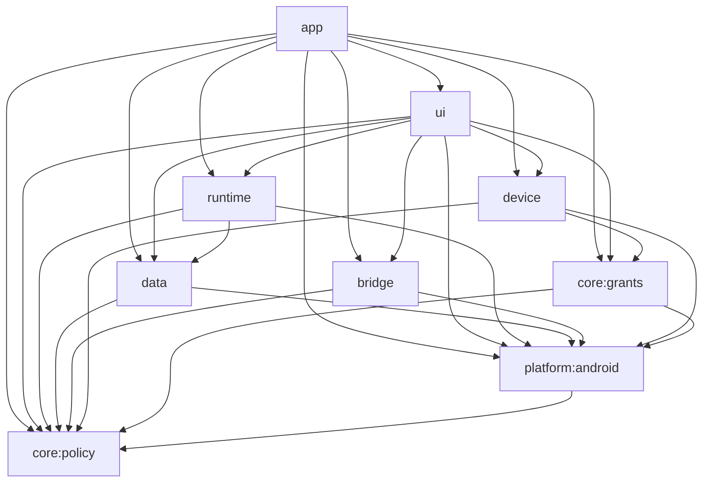

# A8 任务基线：任务窗口与工程收口（2026-11-14）

> 状态：**第一阶段调查完成，待 Lead 审批；docs-only，不代表 A8 实现开工或出口通过。**
> 源码快照：`d9b75bc52c7b36cad265dbe2b32a90ecb9971d74`（build364，建树时的 `origin/main`）。分支 `feat/a8-closure`；owner `@a8-closure` / `session-9cc06001-36f0-4e7f-98a1-726002211d5a`。
> 协调对象：当前 `main` 为 `177cb2f8`，以 relay 运行时解析为准；任务最初点名的 `fe61d7df` 已不是当前主会话。版本线与发布由 Lead 持有。
> 本文源码行号均绑定上述快照；合入或开工前须重核，不把后续 main 的行号或统计套回本快照。截至2026-11-14T13:56Z，版本线报告 `origin/main=09ffb1f4`（RC1/A4/A2切片已合，Source checks 43601013097 success），候选为495启动输入、runtimeId `7a149f7f…`；最新发布为build365。**这些是协调状态，不是本文软件验证证据**。本文统计保留建树快照的205资产/490启动输入，不改写为后续源码实测。

依据：[迭代路径 A8 / §2.1 / §4 / §8](iteration-roadmap-20261112.md#a8-任务窗口与工程收口)、[ADR-0004](../../adr/0004-kotlin-rust-direction.md)、[评审主稿](README.md)、[21 状态模块收敛表](convergence-table-20261112.md)、[项目总手册](../../project-architecture-handbook.md)、[工程规范](../../engineering-standard.md)、[Kotlin 工具链](../../kotlin-toolchain.md)、[齿轮单实例契约](../../mobile-sidebar-settings-gear.md)。本文补充 A8 执行基线，不改写 Lead 专管的路线图进度看板。

## 1. 两阶段门禁与前置轮

第一阶段只调查、写基线、做不改变产品字节的检查并本地提交。**Lead 批准本文后，仍须 A4/A5/A6/A7 已合入、占用文件交还、基线刷新完成，才允许改源码、构建或生成物。** 不从待合入侧分支吸收代码，不与其他轮并行改同一模块。

| 前置项 | 建树事实与收尾协调更新（不重测后续源码） | A8 实现解锁要求 |
|---|---|---|
| A4 | 建树时 `feat/a4-terminal@0971a2d4` 待合；收尾时版本线已报告A4合入 `63b57efe` 且CI双绿 | 开工刷新为最终交付SHA的祖先核验与出口回执，不以本快照的待合状态阻塞已完成的轮次 |
| A5 | 建树时调查；随后已交付docs-only基线 `d7193629`（10:30Z版本线） | 生命周期、维护、安装、更新接口与 I1–I10 出口证据合入 |
| A6 | 建树时P1交付 `5f3deeeb`；收尾时P2–P4审查修复与Robo接线中，整轮未合 | 整轮收口后冻结插件 owner、writer 锁和运行时端口 |
| A7 | 建树时调查；收尾时S1–S3已APPROVE，S4实施中，整轮未合 | 三通道、实体/虚拟屏契约与凭据边界合入；`:device`提取归A8，沿用Lead已定方法级占用窗口 |
| A2/A3 横切收口 | 收尾时A2切片已合入 `09ffb1f4`，整轮出口仍有N3/N4、full与视觉待办；A3 archive接线仍待排期 | A8 不代做它们的业务实现；最终搬文件前须接收已合入 API、测试与未验项 |
| A8 基线 | 本文；尚无批准回执 | Lead 明确批准范围、依赖图、测试迁移和分阶段回退方案 |

实现解锁时，在声明和首个实现提交中记录：新 `origin/main` SHA、A4–A7 各交付 SHA 的祖先核验、活跃声明/模块占用、全量软件回执、相对本文的计数差异。若任一前置未完，只更新调查证据。不得以模块拆分的名义替其他轮补业务代码。

## 2. 目标、非目标与出口

目标是 F08 桌宠/任务气泡/对话窗的一个逻辑窗口 owner 与真实任务关联，A06 系统 WebView 宿主收口，A02 桥与传输边界收口，以及 21 状态模块映射到 **9 个生产 Gradle 模块 + 2 个二期规划**。每次提取都要有真实生产代码与随行测试、可独立编译、可单提交回退。

- F08：显隐、拖动、收起/展开、半透明对话卡片、回复与停止入口共用绑定快照；隐藏不暂停任务，停用呈现不等于取消会话。
- M19：保留同代网页、页面/导航代次、IME、PiP、麦克风与上传下载的既有身份围栏；宿主适配从 UI 大类经窄端口收敛。
- M01/M02/M03：配置唯一写入口、凭据失败分类/Keystore 别名、诊断脱敏与呈现分工明确，不能为拆环复制配置、密钥或维护状态。
- 工程：单向依赖白名单、跨模块源码/测试清单、共享 convention plugin、运行输入解析与格式/边界/CI 报告适配同步到位。

非目标：动态可安装模块平台、Compose 全量重画、全仓 Java 翻译、恢复 Low、引入 GeckoView 依赖、Rust 扩展执行入口或进程接管、Root 写入口、变更 applicationId/签名/versionCode、修改旧偏好键或数据格式。已有组件 FQCN、JNI 类名/符号、Provider authority、协议文本和读取兼容性保持。

A8 最终出口需要：18 项逻辑功能有归属；9 个模块均有真实编译内容、图无环且 `:core:policy` 是唯一无生产模块依赖的叶子；测试身份集合不丢、全量 0 failure/error/skipped；Standard 编译/Lint/APK/资产/ELF/身份门禁；窗口与网页反例；中英/日夜/短屏/1.3×视觉与覆盖更新证据；文档一致性和独立评审。**731 个命名测试文件不是全量执行数，不能拿历史“706 全绿”作为出口。** 本会话不做发布、安装或手机操作。

## 3. 当前工程快照与重数方法

统计只含当前 Git 跟踪的受管源集，不含 build/generated；`.java/.kt` 数是文件数，不解析嵌套类。命名测试文件按 `*Test.java/*Test.kt`，辅助类不算测试选择数；静态数字不代表执行/通过。

| 项 | 2026-11-12 设计快照 | 本文 d9b75bc5 快照 | 依据 |
|---|---|---|---|
| main 源码 | 964 Java，0 Kotlin | **999 Java + 1 Kotlin = 1,000**；214,786 行；含 vendored Termux 14 Java | [历史口径:15](drafts/01-kotlin-shell.md#L15)、[ShellQuote:12](../../../app/src/main/java/com/deepseekharness/app/util/ShellQuote.kt#L12)；逐文件 LF 行数合计 |
| DSHA main（扣 Termux） | 未单列 | 985 Java + 1 Kotlin = 986 | 与上项同一清单，扣固定 vendored 目录，不删除或迁写上游代码 |
| test 源码 | 716 Java，其中 706 命名测试 | **742 Java + 1 Kotlin = 743**；其中 **730 Java + 1 Kotlin = 731** 命名测试文件，另 12 Java 辅助文件 | [历史口径:18](drafts/01-kotlin-shell.md#L18)、[Kotlin 测试:13](../../../app/src/test/java/com/deepseekharness/app/util/ShellQuoteKotlinTest.kt#L13) |
| 额外源集 | 未并入 main 口径 | standard 3 Java；debug 39；androidTest 10；deviceAudit 21 | 不混入上两行；Standard 生产 main+standard 共 1,003 源文件 |
| 主要包 main | util404 / ui169 / backup83 / runtime63 / core60 | util412 Java+1 Kotlin / ui170 / backup84 / runtime63 / core60 | 根包36、vscreen36未变；contract18、saf11 等新增已在总数内 |
| Gradle | 单 `:app`；19 注册任务 | **仍单 `:app`，19 个 `tasks.register`** | [settings:26–28](../../../settings.gradle#L26)、§5 完整清单；不含 AGP 自动任务 |
| Manifest | 主清单50 | **仍50 = 30 Activity + 12 Service + 5 Receiver + 3 Provider** | [主清单:57](../../../app/src/main/AndroidManifest.xml#L57)、§6；不等于 merged APK 清单 |
| Kotlin | 未引入 | AGP9.1.1 built-in Kotlin / 固定KGP2.2.10 / JVM17 已有 | [settings:26](../../../settings.gradle#L26)、[构建:312](../../../app/build.gradle#L312)、[工具链回执](../../kotlin-toolchain.md#验证回执)；历史 UNKNOWN 不再当当前事实 |
| 受管身份 | 205 assets / 481 launcherInputs | **205 / 490 = 432 Java + 14 ELF + 44 generator；0 Kotlin，ui/为0** | [描述符:3](../../../app/src/main/assets/runtime-descriptor.json#L3)、[输入契约:623](../../../app/src/main/assets/managed-runtime-inputs.json#L623)；§10 |

重数口径可复现：在该 SHA 检出上用 `git ls-files` 限定源集，再按后缀/文件名聚合；import 图只解析受管 main `.java/.kt` 的普通与 static import，归并至 `com.deepseekharness.app` 首层包，根类记 `<root>`，wildcard 整句计1。Manifest 只数主清单 application 的四种直接子元素。Gradle 只数显式注册语句。后续重新取数必须保留这套口径与新增类身份集合，不能通过改变分母降低门槛。

## 4. 12 对包级双向 import：证据、落点、破法

当前直接双向包边仍恰好12对；**这不是全依赖图只有12个环/SCC**。同包隐式引用、完全限定名、反射、资源和生成代码均不在该计数中，例如 [DshaApp:152](../../../app/src/main/java/com/deepseekharness/app/DshaApp.java#L152) 的 FQCN 装配不出现于 import 图。模块化必须再用实际编译依赖验证。

下表数字按“左→右 / 右→左 import 语句数”，证据分别给两个方向。历史只给部分数字的地方不补造旧值。

| 包对 / 当前数 | 双向 file:line 证据 | 处理方式（实现前按前置轮接口刷新） |
|---|---|---|
| util↔backup **15/29**（旧15/24） | [AdbWheelCache:3](../../../app/src/main/java/com/deepseekharness/app/util/AdbWheelCache.java#L3) / [AutomaticBackupService:7](../../../app/src/main/java/com/deepseekharness/app/backup/AutomaticBackupService.java#L7) | 按职责拆 util：事务/文件实现归 data，纯值/判据归 policy；不把整个 util 搬成叶子。util→backup15句来自14文件，不能混计 |
| util↔core **1/111** | [ScreenSessionGrant:4](../../../app/src/main/java/com/deepseekharness/app/util/ScreenSessionGrant.java#L4) / [BackupTask:7](../../../app/src/main/java/com/deepseekharness/app/core/BackupTask.java#L7) | 授权所需运行快照收成纯只读契约；从组合根传入，不让 policy 读取运行实现 |
| backup↔core **9/26** | [AutomaticBackups:5](../../../app/src/main/java/com/deepseekharness/app/backup/AutomaticBackups.java#L5) / [ColdSetupTiming:7](../../../app/src/main/java/com/deepseekharness/app/core/ColdSetupTiming.java#L7) | 配置/数据协作者归 data；维护顺序归 runtime；data 经工作/维护端口接受租约，不向上查询 Controller |
| backup↔runtime **2/38** | [AndroidTreeFileSystem:8](../../../app/src/main/java/com/deepseekharness/app/backup/AndroidTreeFileSystem.java#L8) / [AndroidTrustedAssetFileSystem:8](../../../app/src/main/java/com/deepseekharness/app/runtime/AndroidTrustedAssetFileSystem.java#L8) | 文件系统适配下沉 platform/data；runtime 只依赖 data 对外契约；data 不依赖 runtime 实现。不得复制一套维护锁 |
| core↔plugins **1/6** | [PluginRepository:11](../../../app/src/main/java/com/deepseekharness/app/core/PluginRepository.java#L11) / [PluginBackendAdapter:8](../../../app/src/main/java/com/deepseekharness/app/plugins/PluginBackendAdapter.java#L8) | M13 engine/repository 留 data 同子域；容器执行接口由 app 注入，热检查和 writer 锁仍同 owner |
| root↔core **11/13** | [AgentTaskNotifications:15](../../../app/src/main/java/com/deepseekharness/app/AgentTaskNotifications.java#L15) / [BackupTask:6](../../../app/src/main/java/com/deepseekharness/app/core/BackupTask.java#L6) | 根包逐类分配。Application/组件壳留 app，业务域拿端口，不 import DshaApp/具体 Service 反查组合根 |
| root↔ui **4/135**（旧4/133） | [AgentTaskNotifications:20](../../../app/src/main/java/com/deepseekharness/app/AgentTaskNotifications.java#L20) / [AboutFragment:8](../../../app/src/main/java/com/deepseekharness/app/ui/AboutFragment.java#L8) | 通知/服务导航用显式 Intent 工厂端口；app 装配 UI 实现。弹窗主题适配下沉 platform 或注入；ui 不反向 import app 实现 |
| root↔bridge **2/1** | [DeviceBridgeService:18](../../../app/src/main/java/com/deepseekharness/app/DeviceBridgeService.java#L18) / [AppDeviceActions:6](../../../app/src/main/java/com/deepseekharness/app/bridge/AppDeviceActions.java#L6) | ADB/设备运输实现归 device，桥只派发窄能力端口；app 绑定，不在 bridge 再造设备 owner |
| ui↔transfer **7/1** | [FileTransfersActivity:34](../../../app/src/main/java/com/deepseekharness/app/ui/FileTransfersActivity.java#L34) / [DownloadService:9](../../../app/src/main/java/com/deepseekharness/app/transfer/DownloadService.java#L9) | 下载状态留 bridge/M16；通知点按端口由 app 连接 ui，UiStateText 仅显示边界渲染 |
| ui↔recovery **2/1** | [RecoveryActivity:10](../../../app/src/main/java/com/deepseekharness/app/ui/RecoveryActivity.java#L10) / [RecoveryService:7](../../../app/src/main/java/com/deepseekharness/app/recovery/RecoveryService.java#L7) | 应急组合与独立根留 app 的隔离区域，ui 经恢复端口访问；正常模块不得反向依赖 recovery，不借正式维护锁 |
| ui↔vscreen **1/1** | [ScreenOperationFragment:18](../../../app/src/main/java/com/deepseekharness/app/ui/ScreenOperationFragment.java#L18) / [VirtualScreenStrip:19](../../../app/src/main/java/com/deepseekharness/app/vscreen/VirtualScreenStrip.java#L19) | Activity/预览呈现归 ui，Core 与生命周期归 device；通知/预览导航注入 |
| vscreen↔screen **6/1** | [VirtualScreenAnchorProof:8](../../../app/src/main/java/com/deepseekharness/app/vscreen/VirtualScreenAnchorProof.java#L8) / [ScreenMode:11](../../../app/src/main/java/com/deepseekharness/app/screen/ScreenMode.java#L11) | 同编译模块 device 内保留两个状态子域；共享纯策略下沉 grants/policy。凭据、Core与实体屏任务 authority 继续分开，不能靠统一 token 破环 |

已有 [core 边界脚本:14](../../../tools/test-core-boundaries.py#L14) 的扫描根固定在 app，但支持 Java/Kotlin；[旧 architecture 脚本:7–17](../../../tools/test-architecture-boundaries.py#L7) 只扫固定路径 Java。二者均须由同一源码布局清单解析，保留既有 owner、反向引用、backup→core 只减不增断言，再加编译依赖白名单、FQCN 与字符串反射入口审计。禁止删除规则、忽略目录、扩张基线来消除红灯。

## 5. 构建路径耦合与19个自定义任务

### 5.1 “三处”历史口径与真正的迁移面

[原始评审:7](drafts/01-kotlin-shell.md#L7) 点名18/36/381三行：前两行其实是同一 Constants 文件的配置期读取与任务输入登记，当前对应18/36/509。主稿还把生成源集列为第三类耦合。A8 同时保留三行和三类两种证据，不宣称只有三处路径要改。

| 耦合 | 当前 file:line | 迁移约束 |
|---|---|---|
| ① Constants 源文件读取 + 输入登记 | [构建:18](../../../app/build.gradle#L18)、[构建:36](../../../app/build.gradle#L36) | 正则绑定 Java 的 `public static final String DSH_VERSION`；路径或语言语法变更必须更新生成/核验入口，不弱化 npm/lock/registry/native 一致性 |
| ② launcher 显式源 + 整树枚举 | [构建:488–512](../../../app/build.gradle#L488)、[输入解析:107–136](../../../tools/runtime_input_contract.py#L107) | 固定 Java 根，`.java/.kt` 后缀保留；未知 java/kotlin 根直接拒绝。先建逻辑键→物理文件映射与重名/缺失失败，再搬文件；Gradle inputs 与 Python 身份集合必须一致 |
| ③ 生成 assets / i18n Java 源集 | [构建:298–308](../../../app/build.gradle#L298)、[i18n 生成器:12](../../../tools/prepare-ui-languages.py#L12)、[构建:611](../../../app/build.gradle#L611) | 主 assets 由两份 generated 目录提供；UiMessages 是包私有类，必须与 UiText/UiStateText 同一编译所有者，不把生成任务继续只挂 app 而让库看不到 |
| 额外生成 Java 锚点 | [构建:393](../../../app/build.gradle#L393)、[构建:399](../../../app/build.gradle#L399)、[构建:533](../../../app/build.gradle#L533) | BuiltinPluginRegistry、CredentialPathRules、RecoveryDescriptorLimits 的生成器、inputs 与实际类同批迁移 |
| 测试资源与离线配置 | [构建:276–295](../../../app/build.gradle#L276)、[构建:440–445](../../../app/build.gradle#L440)、[构建:660](../../../app/build.gradle#L660) | Robolectric 资源、资产绝对路径、source-only输入、JVM opens、Rust required 与离线 SDK 要随每个 Test 任务；不能由库 projectDir 推导错误资产根 |
| 格式/本机测试脚本 | [Java 格式:41–62](../../../tools/format-java-tree.py#L41)、[Kotlin 格式:39–58](../../../tools/format-kotlin-tree.py#L39)、[本机 runner:220–270](../../../tools/run-unit-tests.py#L220) | 五个源集当前都固定 app；Java adoption manifest、包批次、生成物排除和 Kotlin 全扫描要覆盖所有新模块；本机 runner 当前只 javac，不得冒充已覆盖 Kotlin |
| Rust ABI / 差分探针 | [JNI Java:8](../../../app/src/main/java/com/deepseekharness/app/util/RustNative.java#L8)、[JNI Rust:198](../../../rust/crates/dsha-core/src/jni.rs#L198)、[host probe:40](../../../tools/rust/host-jvm-differential.py#L40)、[构建:302](../../../app/build.gradle#L302) | 保留 RustNative FQCN、JNI导出/库名与11符号；探针的10个固定Java源路径随布局迁移。注入目录不是生产APK已完整接线的证据，按 A3/R3 回执核验 |
| 版本/组件/资源 | [构建:121–146](../../../app/build.gradle#L121)、[证书门禁:328](../../../app/build.gradle#L328) | version/签名/变体/Manifest/顶层资产留 app；下层不能引用 app.BuildConfig/R。由不可变身份快照、资源所有者与独立 library namespace 解耦，保持现有组件FQCN |

### 5.2 注册任务完整清单

当前19个中14个 `Exec`、5个默认任务。总数19→19不能证明集合未变：历史没有保存任务名单。拆分要逐项核验注册与依赖连线，不能只搬脚本块。

| 任务 | 注册行 | 最终责任 |
|---|---|---|
| verifyBundledDshVersion | [33](../../../app/build.gradle#L33) | app/共享构建约定，保留配置期检查 |
| verifyPublishCertificate | [328](../../../app/build.gradle#L328) | app |
| printReleaseIdentity | [363](../../../app/build.gradle#L363) | app |
| signPublishRelease | [378](../../../app/build.gradle#L378) | app，仍需发布授权 |
| verifyBundledIdentities | [385](../../../app/build.gradle#L385) | app/受管资产 |
| verifyBuiltinRegistry | [391](../../../app/build.gradle#L391) | app/注册表生成所有者 |
| verifyCredentialRegistry | [397](../../../app/build.gradle#L397) | app/凭据注册表生成所有者 |
| verifyProrootCompat | [403](../../../app/build.gradle#L403) | app/ELF字节核验 |
| verifyCurrentChangelog | [411](../../../app/build.gradle#L411) | app |
| verifyWebLanguages | [425](../../../app/build.gradle#L425) | app/网页资产 |
| prepareStandardAssets | [452](../../../app/build.gradle#L452) | app |
| prepareBackupAssets | [473](../../../app/build.gradle#L473) | app/包来源证明 |
| verifyExternalToolProof | [480](../../../app/build.gradle#L480) | app/设备工具摘要 |
| prepareRuntimeDescriptor | [491](../../../app/build.gradle#L491) | app，使用跨模块布局映射 |
| verifyRuntimeDescriptorInputs | [514](../../../app/build.gradle#L514) | app/跨模块集合核验 |
| prepareRecoveryAssets | [528](../../../app/build.gradle#L528) | app/独立应急资产 |
| verifyBackupDependencies | [559](../../../app/build.gradle#L559) | data依赖证明 + app最终打包核验，保留严格字节锁 |
| prepareUiLanguages | [611](../../../app/build.gradle#L611) | i18n实际所有者（目标 platform），由app消费资源 |
| verifyUiLanguageResources | [624](../../../app/build.gradle#L624) | app聚合所有资源根 |

依赖关系另逐项保留：[preBuild:423](../../../app/build.gradle#L423)、[source_text/Test配置:440–449](../../../app/build.gradle#L440)、[descriptor与backup顺序:522–525](../../../app/build.gradle#L522)、[recovery资产:555](../../../app/build.gradle#L555)、[JavaCompile依赖:609](../../../app/build.gradle#L609)、[语言生成/资源:622–635](../../../app/build.gradle#L622)。不得让提取出的库先于所需生成/核验任务编译。

## 6. 50个主 Manifest 组件与打包不变式

完整清单如下，数字是 [主 Manifest](../../../app/src/main/AndroidManifest.xml) 中 `android:name` 所在行。简写 `A/S/R/P` 分别表示 Activity/Service/Receiver/Provider；类名前缀 `com.deepseekharness.app` 按原清单解析，不重包名。

| 类型 | 组件及行号 |
|---|---|
| A 1–10 | assistant.AssistantActivity:71；assistant.AssistantVoiceActivity:73；ui.BrowserOriginRestoreActivity:80；ui.CommunityActivity:81；ui.AccessibilitySetupActivity:83；ui.MainActivity:85；ui.AppEntryRouterActivity:98；ui.TerminalActivity:107；ui.UpdateActivity:116；ui.DiagnosticActivity:117 |
| A 11–20 | ui.StartupRecoveryActivity:118；ui.RecoveryActivity:119；ui.RecoveryWebActivity:120；ui.BackgroundTasksActivity:125；ui.AgentTasksActivity:126；ui.NativeDataActivity:129；ui.WorkspaceFilesActivity:130；ui.FileTransfersActivity:131；ui.StorageHelpActivity:133；ui.ColdSetupSpeedActivity:134 |
| A 21–30 | ui.ThemeActivity:135；ui.RetainedDataActivity:136；ui.AutomaticBackupActivity:139；ui.StorageActivity:140；vscreen.VirtualScreenActivity:141；ui.PluginInstallActivity:143；ui.OnboardingActivity:185；ui.WebPreviewActivity:194；ui.ExtractActivity:205；ui.AdbPairActivity:210 |
| S 1–6 | assistant.AssistantService:74；TerminalRuntimeService:110；recovery.RecoveryService:121；transfer.DownloadService:132；backup.PostUpgradeCleanupService:137；backup.AutomaticBackupService:138 |
| S 7–12 | backup.DataProtectionService:142；DeviceBridgeService:216；UpdateDownloadService:219；HarnessService:224；ShellService:232；DshaAccessibilityService:242 |
| R 1–5 | AgentTaskStopReceiver:127；AgentTaskAnswerReceiver:128；AdbKeepAliveReceiver:255；ConfirmReceiver:259；BootReceiver:263 |
| P 1–3 | androidx.core.content.FileProvider:157；rikka.shizuku.ShizukuProvider:163；DshaDocumentsProvider:173 |

Application、instrumentation、权限和 queries 不计入50；[debug清单:5](../../../app/src/debug/AndroidManifest.xml#L5) 另声明1 Provider+3 Activity，[deviceAudit清单:5](../../../app/src/deviceAudit/AndroidManifest.xml#L5) 另声明2 Activity+1 Provider+5 Service，不与库清单简单相加冒充最终APK数量。

默认先把组件声明统一留 app，库清单最小化；每次提取对同变体 merged manifest 做语义比对：FQCN、exported、permission、authority、process、foregroundServiceType、intent-filter、taskAffinity、launchMode、documentLaunchMode、configChanges、PiP、元数据与资源指向逐字段保留。只有 Main/插件安装/ShizukuProvider/DocumentsProvider 四项当前显式 exported=true。

特别保留 [authority:157–175](../../../app/src/main/AndroidManifest.xml#L157) 的 `${applicationId}.updates/.shizuku/.documents`、[WebPreview:194](../../../app/src/main/AndroidManifest.xml#L194) 的任务与PiP属性、[ShellService:232](../../../app/src/main/AndroidManifest.xml#L232) 的独立进程和权限、[无障碍:242](../../../app/src/main/AndroidManifest.xml#L242) 的BIND权限与元数据、[AIDL:1](../../../app/src/main/aidl/com/deepseekharness/app/IShellService.aidl#L1) 的包/事务。新库不得添加初始化Provider抢在 [DshaApp:152](../../../app/src/main/java/com/deepseekharness/app/DshaApp.java#L152) 系统语言锁存前改 Locale；不以新增初始化框架解决装配。

## 7. 21 状态模块 → 9 Gradle + 2 二期

状态 owner 与编译归属不同；同一状态模块的纯判据、平台适配和呈现可落不同编译单元，**权威状态仍只有一份**。下表是待批准的具体落点，不宣称现已拆分。

| 状态模块 | 唯一权威/边界 | 首期编译归属与二期 |
|---|---|---|
| M01 配置与状态 | ConfigStore；历史键和便携投影不另建写入口 | data的配置门面；platform的SharedPreferences适配；只读契约在policy供注入 |
| M02 凭据与密钥 | KeyVault/凭据分类，失败保留旧密文 | data凭据门面 + platform Keystore适配；旧别名不改，不把密钥跨接口发给普通模块 |
| M03 诊断与可观测 | SensitiveData脱敏判据；有界诊断记录；修复仍回原运行owner | policy脱敏/结果值；platform记录适配；data归档；ui诊断ViewModel。桥只收脱敏快照 |
| M04 进程身份与退出证据 | 出生身份/双次核验/退出证明，执行不进Rust | policy纯判据；runtime平台采集/停止编排；其他域复用契约 |
| M05 授权与能力派发 | CapabilityBroker/DeviceGrants，派发栅栏唯一 | core:grants；持久化适配在platform，配置快照由app注入 |
| M06 设备执行通道 | 通道选择、实际身份与类型化执行 | device；ADB运输实现按职责从bridge迁入，不让device反依赖bridge |
| M07 实体屏 | DshaAccessibilityService/物理屏任务authority | device内独立子域；screen mode策略在grants/policy |
| M08 虚拟屏 | Application注入的唯一VirtualScreenManager/Core | device内独立子域；预览/Activity视图可在ui，凭据不统一 |
| M09 生命周期与租约 | WebLifecycleController/HarnessSessionState/MaintenanceCoordinator | runtime；Application只装配，不建第二套状态 |
| M10 命令与挂载 | 无状态argv/env/BINDS组装 | runtime；纯值判据在policy；不得反依赖M09 |
| M11 受管安装 | InstallRepository/InstallPipeline/RuntimeDescriptor/事务 | runtime编排 + data格式/文件事务契约；不由APK版本猜runtimeId |
| M12 宿主数据与备份 | HostDataTransaction/NativeBackupJobs；原件和范围权威 | data；工作租约/停止请求为注入端口，不回查runtime实现 |
| M13 插件生命周期 | A6确定的engine/writer锁/热检查owner | 首期data子域 + 注入runtime工作端口；二期feature:plugin |
| M14 终端 | A4确定的TerminalSessionOwner/退出证据 | 首期runtime子域，UI在ui、JNI打包在app；二期feature:terminal |
| M15 桥与入站 | 鉴权、路由、SAF授权簿与能力派发 | bridge；grants/device/runtime/data具体实现由app绑定到窄端口 |
| M16 网络与传输 | DownloadEngine/网络代次/偏移证明 | bridge独立出站子域；不抽伪通用HTTP栈，不与入站鉴权合并owner |
| M17 应用更新 | 目标为Application持有UpdateEngine；d9仍是静态单例，待A5刷新 | app更新owner；runtime维护端口；ui只展示。沿用A5结果，不另改自动更新策略 |
| M18 任务窗口/外壳呈现 | 应用级任务窗口逻辑owner、通知与界面句柄 | ui呈现+app装配；policy纯身份/状态机；platform窗口/通知适配 |
| M19 网页宿主 | BrowserPageKeeper/Retained页面owner与页面代次 | ui宿主子域，浏览器能力端口；不增加第二个WebView/连接owner |
| M20 legacy（强制隔离） | 旧归档/偏好/schema只读适配 | data内internal legacy区域，只经数据导入边界调用；写格式不升级 |
| M21 独立应急（强制隔离） | RecoveryController/独立根与修复确认边界 | app内独立装配区域；UI经端口，正常模块不得依赖它；不借正式环境锁或根，不为凑数建第10模块 |

本表细化了 [原收敛表](convergence-table-20261112.md) 对M03/配置/平台的粗粒度归属：现 [DiagnosticRepository:20](../../../app/src/main/java/com/deepseekharness/app/core/DiagnosticRepository.java#L20) 是AndroidViewModel且直接调用运行维护；不能整体塞data造成data→runtime。应分出只读诊断/修复端口，ViewModel放ui，修复依旧经过原owner与屏障。

18项逻辑功能对应：C01契约→policy；C02宿主注册/路由/贡献→app+ui；C03授权→grants；C04会话/容器→runtime与M04判据；A01存储→bridge+data+platform；A02网络→bridge/M15/M16；A03通道→device；A04实体屏→device/M07；A05虚拟屏→device/M08；A06浏览宿主→ui/M19；F01关于许可→ui+app兜底；F02运行工作台→ui+runtime；F03终端→runtime+ui；F04文件工作台→ui+bridge/data；F05数据保护→data+ui；F06插件→data+ui；F07只读Root清单→device+ui（A7）；F08桌宠对话窗→ui/M18+app装配。C01/C02保留随包可信贡献登记与停用清理，不引入可安装执行模块。

### 7.1 生产依赖白名单（建议冻结）



- 共9个生产节点。app可依赖全部；ui对业务模块只使用公开Api/只读值；ui仅被app依赖。runtime→data也只使用契约，data不反依赖runtime。bridge采用主稿较窄的policy/platform白名单，具体业务实现由app装配；不悄悄采用旧草稿中更宽的runtime/device依赖。
- policy无其他生产项目依赖、无Android/AndroidX import或隐含反射框架调用；单测依赖不计生产边。共享契约按职责放置，禁止为了破环把所有业务端口堆成另一套全局服务定位器。
- platform只做平台适配；导航目标/业务回调注入，不依赖ui、app或业务实现。现 [RuntimeWorkPort:20](../../../app/src/main/java/com/deepseekharness/app/util/RuntimeWorkPort.java#L20) 的全局provider安装是现状，不直接复制成每个域一套全局注册器。
- i18n不能照抄旧表的“UiStateText无状态→整体policy”：现 [UiStateText:35](../../../app/src/main/java/com/deepseekharness/app/util/UiStateText.java#L35) 调用UiText的可变语言，[SystemLanguage:95](../../../app/src/main/java/com/deepseekharness/app/util/SystemLanguage.java#L95) 反射Android。建议当前翻译门面/生成字典/系统语言适配同属platform，policy保留显式参数的纯判据；业务结果改以稳定ID在显示边界渲染。保留FQCN/行为与语言锁存，不把反射藏进叶子。
- `feature:terminal`、`feature:plugin` 是二期规划，首期不创建空项目；build-logic是构建逻辑包含构建，不算第10个产品模块；M21也不追加未批准编译模块。

## 8. F08 与网页宿主：现有能力、收口契约和反例

### 8.1 已有证据

| 面 | 当前实现证据 | A8保留/收口 |
|---|---|---|
| 真实任务绑定 | [AssistantService:79–144](../../../app/src/main/java/com/deepseekharness/app/assistant/AssistantService.java#L79)、[TaskAttachment:10](../../../app/src/main/java/com/deepseekharness/app/assistant/AssistantTaskAttachment.java#L10) | exact hostInstanceId/full sessionId/turnId/运行代次；要求status里turnActive+running。无“最近活跃会话”回退，不新建对话代替绑定 |
| 轮次完成栅栏 | [ControlTaskAuthority:13–100](../../../app/src/main/java/com/deepseekharness/app/control/ControlTaskAuthority.java#L13) | connection+taskSessionId+turnId与revision；完成水位拒绝迟到begin，不把窗口ID当任务授权 |
| 单选会话状态与迟到轮询 | [Controller:33–76](../../../app/src/main/java/com/deepseekharness/app/assistant/AssistantSessionController.java#L33)、[Controller:411–511](../../../app/src/main/java/com/deepseekharness/app/assistant/AssistantSessionController.java#L411) | 当前依赖static active/service live；pollRevision/turn/task复核已防旧回调影响新轮。网络I/O在monitor外；迁owner时全部保留 |
| 隐藏/移动/输入 | [AssistantWindow:35–40](../../../app/src/main/java/com/deepseekharness/app/assistant/AssistantWindow.java#L35)、[隐藏:134](../../../app/src/main/java/com/deepseekharness/app/assistant/AssistantWindow.java#L134)、[几何围栏:157](../../../app/src/main/java/com/deepseekharness/app/assistant/AssistantSessionController.java#L157) | 已有可拖胶囊与展开卡片；显隐不取消，几何改变使旧观察失效，输入期单独等待。没有真机/视觉新回执，不宣称F08已交付 |
| 两种悬浮入口 | [OverlayController:86–121](../../../app/src/main/java/com/deepseekharness/app/OverlayController.java#L86)、[Service交接:663–675](../../../app/src/main/java/com/deepseekharness/app/assistant/AssistantService.java#L663) | 旧流式悬浮条与任务卡片各有静态窗口引用，当前显式teardown交接；这是待收口装配边，不据此断言已复现串会话bug |
| 多任务通知 | [AgentTaskNotifications:36](../../../app/src/main/java/com/deepseekharness/app/AgentTaskNotifications.java#L36)、[AgentTaskState:27](../../../app/src/main/java/com/deepseekharness/app/util/AgentTaskState.java#L27) | 多任务Key=运行代次/instance/full session/turn/owner；保留多任务事实。一逻辑窗口owner不等于把通知任务合并为全局一个任务 |
| 自有窗口识别 | [OwnedScreenOverlay:21–55](../../../app/src/main/java/com/deepseekharness/app/control/OwnedScreenOverlay.java#L21) | 实测windowId/bounds/epoch，只登记本应用实际窗口，不扩成任意覆盖排除；A7设备authority仍是唯一动作权威 |
| WebView同代页 | [WebPreviewActivity:875](../../../app/src/main/java/com/deepseekharness/app/ui/WebPreviewActivity.java#L875)、[页面创建:899](../../../app/src/main/java/com/deepseekharness/app/ui/WebPreviewActivity.java#L899) | 真实view+retained.owner+页面身份共同核验；旋转/全屏/PiP保留同页，不为“模块恢复”重建网页 |
| 上传迟到结果 | [选择回调:286–371](../../../app/src/main/java/com/deepseekharness/app/ui/WebPreviewActivity.java#L286)、[chooser:1432](../../../app/src/main/java/com/deepseekharness/app/ui/WebPreviewActivity.java#L1432) | ticket/view/uploadSession/页面身份/实际运行身份/关闭态/commit复核；URI与FD仍受原文件边界。StorageAccess行为由A2收口，不在A8自行放宽 |
| 麦克风/文件脚本 | [BrowserMicrophone:70–150](../../../app/src/main/java/com/deepseekharness/app/ui/BrowserMicrophone.java#L70)、[Web clients:1003–1033](../../../app/src/main/java/com/deepseekharness/app/ui/WebPreviewActivity.java#L1003) | 单次ticket/可见生命周期/current回调/同源；每请求独立launcher。文件脚本也携当前pageNavigation/themeGate；旧请求不交给新页 |

### 8.2 待批准的最小收口

1. 在Application装配一个任务窗口逻辑owner，管理所选真实Binding、surface句柄、订阅/窗口代次及幂等释放；保留Service生命周期适配。View/通知/Activity只投影，不另取后端连接或缓存任务运行态。替换static访问先加可比较端口，不能同时留两个生产owner。
2. Binding使用已有完整身份，不合并Host、Web运行、控制连接、页面导航与识屏观察的代次。owner关闭/替换先使旧订阅与延迟finish失效，再释放窗口/通知；停止只提交精确任务请求。隐藏或停用呈现只撤句柄/订阅，未另经明确停止入口不得取消对话；必要的原生Stop渠道按现行控制契约保留。
3. 旧流式悬浮条保留多会话只读输出用途；通过同一呈现装配器进行可见性/句柄交接，不能让last-active选择成为执行任务身份来源。桌宠与半透明卡片先复用现有拖动/主题/对话输入，按短屏可滚动和大字体验收，不额外创建后端会话。
4. 网页宿主按同一Retained/page owner抽协作者；文件选择、Blob、麦克风、IME、PiP均以同一页身份回调，不另做保活状态机。通用导航/通知端口由app注入，桥只拿脱敏结果或显式能力端口。
5. 接收A1 deferred卡片/路由/贡献清理结果；可信模块隐藏/停用后，法定许可与原生恢复入口始终由宿主兜底。启用意图的持久化只走既有配置入口，不写新存盘格式；冻结前不得猜测未知contractVersion。

定向回归复用 [AssistantBindingTest](../../../app/src/test/java/com/deepseekharness/app/assistant/AssistantBindingTest.java)、[AssistantTaskAttachmentAndroidTest:141](../../../app/src/test/java/com/deepseekharness/app/assistant/AssistantTaskAttachmentAndroidTest.java#L141)、[AssistantInputAndroidTest](../../../app/src/test/java/com/deepseekharness/app/assistant/AssistantInputAndroidTest.java)、[AssistantSessionStateTest](../../../app/src/test/java/com/deepseekharness/app/assistant/AssistantSessionStateTest.java)、[ControlTaskAuthorityTest](../../../app/src/test/java/com/deepseekharness/app/control/ControlTaskAuthorityTest.java)、[OwnedScreenOverlayTest](../../../app/src/test/java/com/deepseekharness/app/control/OwnedScreenOverlayTest.java)、[AgentTaskStateTest](../../../app/src/test/java/com/deepseekharness/app/util/AgentTaskStateTest.java)、[BrowserTasksTest](../../../app/src/test/java/com/deepseekharness/app/ui/BrowserTasksTest.java)、[WebBackgroundPageLifecycleTest](../../../app/src/test/java/com/deepseekharness/app/ui/WebBackgroundPageLifecycleTest.java)、[WebUploadChooserTest](../../../app/src/test/java/com/deepseekharness/app/ui/WebUploadChooserTest.java)、[MicrophonePolicyTest](../../../app/src/test/java/com/deepseekharness/app/util/MicrophonePolicyTest.java)。迁移时新增真实生产入口负控，不仅断言类名/常量。

必须保留/新增的成对用例：同短尾不同完整session拒绝串绑；旧turn的success/failure/finish均不改新turn；旧服务启动票超时不替换窗口；隐藏/移动与Pause/Stop不同；通知撤销时Stop保障不被可见性开关绕过；配置变化不新建owner；导航/运行代次变化后旧上传/录音/IME确认失效；同代Activity交接只接管一次；未派发与UNKNOWN分开、不重放。多语言/主题/短屏/字体矩阵由有权限的验收方另跑。

A06仍是系统WebView与能力接口。Gecko实现不进A1–A8；但按 [ADR决定七](../../adr/0004-kotlin-rust-direction.md#决定七范围裁剪同期批准)，Gecko预算/ABI/回退/测试矩阵的独立评审须在浏览器接口冻结及A8出口前闭环，不能写“预留接口”就当需求关闭。

## 9. convention plugin 与测试数硬门禁

当前 [JUnit校验器:25–51](../../../tools/verify-unit-results.py#L25) 只读app的单一报告目录：核验XML计数和full零失败/错误/跳过，**没有全仓测试身份集合守恒门禁**。[CI单测节点:123](../../../.github/workflows/_node-unit-tests.yml#L123) 只调用app任务，[报告上传:166](../../../.github/workflows/_node-unit-tests.yml#L166) 也只上传app；这是提取源码前必须补上的工程缺口。

### 9.1 共享构建约定（先落地，再搬测试）

- 建议包含构建build-logic，使用锁定Groovy convention plugin，提供Android application/library与JVM policy两类约定；不新增产品模块数。Gradle9.3.1/AGP9.1.1/JDK17/KGP2.2.10保持。Android模块沿用built-in Kotlin，禁用重复应用android KGP；JVM policy若包含ShellQuote Kotlin，单独固定Kotlin JVM插件2.2.10并补严格依赖字节核验/离线验证，不能假定AGP插件会编译JVM模块。
- Android库统一minSdk30、编译SDK37、JVM17与desugaring需要；Standard/签名/applicationId/版本在app唯一维护，不为库复制发行身份。变体匹配经真实图核验。
- 每个相关Test任务统一JUnit4.13.2、Robolectric4.15.1（只在需要Android的模块）、includeAndroidResources、受限堆/单fork、固定offline SDK、java.io opens、明确源资产根、source-only输入属性与Rust hostLib/required。纯JVM模块不依赖Android资源或app。
- 生成源/资源/Manifest由真实所有者声明inputs/outputs与任务依赖；不依赖app偶然先编译。资源ID数值允许构建重排，资源名称/类型/可达性、DEX组件类和JNI名称必须保留。
- 测试按边界分配：引用DshaApp、app.R/BuildConfig或跨域装配的集成测试可继续留app，显式登记其所测模块；库内测试使用本模块测试Application/端口夹具，不能建立ui/data等库的test→app反向依赖。纯判据测试随policy迁移。测试Application不成为第二个生产owner，原有用例FQCN与执行身份继续守恒。

### 9.2 只增不静默少

1. 实现开工首个门禁提交采集**新的main**源测试清单及完整固定输入CI回执：模块、源集、FQCN、方法/testcase身份、夹具要求、参数化/SDK展开、失败/错误/skipped、源码/输入指纹。本文731是d9静态下限，前置轮新测试必须加入，不能锁死为731而容许新增后再丢失。
2. 搬一个类时按“原FQCN/测试身份→新模块/任务”登记一对一迁移；所有旧身份必须仍存在且恰好执行一次。允许新增，不允许删/禁用/过滤/改名隐藏旧测试；helper/crash child等12文件也要随依赖迁移并编译，不能按命名测试清单清理掉。
3. 聚合所有预期模块与变体的**新鲜**XML，验当前commit/本次run与任务集合；缺目录、NO-SOURCE异常、未执行、复用前次报告、计数不符、重复用例、漏类、零测试、任一full skip都失败。参数化用例/SDK后缀保留，不能仅按方法名去重丢展开用例。
4. 定向运行与source-only只产各自回执，不能覆盖全量基线或充当迁移出口；Rust差分full必须required且有正确host库；七个固定外部夹具恰好执行一次规则保留。总执行数≥开工CI基线且身份集合包含全部旧项，两者同时成立。
5. 验证门禁本身有负控：漏一个模块任务、移走一份XML、漏一个Kotlin测试、重复挂一个测试、把一个类标Ignore/source-only、保留过期XML，都必须失败。没有这组负控前不提取第一个生产模块。

### 9.3 每阶段验证顺序

实现获批后，每个独立切片串行进行：编译所涉生产与测试源（Android Java/Kotlin或policy JVM任务）→Java/Kotlin格式→两份架构/模块依赖边界→本阶段定向单测→文档链接与输入/身份校验；不能只靠Kotlin任务成功推断Java/测试已编译。提取模块的退出点另需完整固定输入聚合测试、Standard Release Lint和APK内容/merged Manifest比较。

本机Gradle只走`dsha-gradle`、共用`/root/.gradle`且一次一个；本机aarch64无可用aapt2时，如实记为未完成资源编译/单测，不重复运行已知不兼容工具、不私建缓存或替代资源产物。全量/Release APK/资源与Lint以绑定该SHA的x86_64 CI为准；发布动作仍由Lead另行取得授权。

基础命令入口（模块提取后将任务替换为真实所有者或聚合任务，不保留仅app覆盖的假象）：

```bash
dsha-gradle :app:compileStandardDebugKotlin :app:compileStandardDebugJavaWithJavac
dsha-gradle :app:testStandardDebugUnitTest --tests '*AssistantTaskAttachmentAndroidTest'
python3 tools/format-java-tree.py --check
python3 tools/format-kotlin-tree.py --check
python3 tools/test-core-boundaries.py
python3 tools/test-architecture-boundaries.py
python3 tools/check-document-links.py
```

## 10. runtimeId、维护页与数据兼容

本文快照 [描述符:3–7](../../../app/src/main/assets/runtime-descriptor.json#L3)：`runtimeId=f02b4465e638c20b2a2f3d1be7ca022704d6742b601c83ac5da7c0f86372b9a3`，`version=1`、`baseVersion=10`、`launcherContract=DSHA_ARM64_V2`、`bridgeProtocol=3`、`dataWrite=dsh-0.2.2-rc.1`；205资产/490启动输入。输入契约含103 installs、10 launcherTrees、202显式launcherSources、44生成器；其中源码整树9包+原生库树。

[输入解析:117–136](../../../tools/runtime_input_contract.py#L117) 将相对源码键、扩展名及生成器加入启动摘要，[描述符生成:80–90](../../../tools/prepare-runtime-descriptor.py#L80) 将这些键和值整体纳入runtimeId。因此物理迁移、后缀变化、布局解析器/生成器变化都必须逐项判断；不能删launcher条目、缩小树、保留旧摘要或取消检查来伪造零维护。优先保持逻辑键和所有成员证明，解析器变更引起的真实受管输入变化照常重算。

**本轮docs-only输入不变，不触发维护。A8实现的全量工程化预计触发一次补丁级维护，属于预期。** 每个发布候选按自身真实输入重算，由Lead统一生成/校验描述符；不是每个开发提交都让用户维护，也不承诺跨多个发布永远只维护一次。generatorSources及固定资产配方变动若要求重建固定输入，必须走对应构建输入流程，不在本轮自行上传或替换资产。

[覆盖更新I1–I10](../../overwrite-upgrade-and-maintenance.md#不变量不可破坏) 全保留：旧树+新APK不拉Web；ready与latest分开；未关闭旧Web只拦自动开始；用户始终可见整屏维护页并一键更新；同候选不自动重放；停止/弃旧版按出生身份和guest→launcher证据；受限入口不写ready；内置插件只依赖自有属性与实测几何。设备凭据、系统授权与Keystore不从数据导入重新授权。

不提升baseVersion、descriptor主version、journal format、web-session schema、dataWrite；双读单写保留。发行包名/签名/版本由现有app身份文件负责，A8不切换Rebirth或Mod身份，也不改versionCode。已安装用户的代码回退由Lead在同线更高code提供，不能降级安装或清数据。

[齿轮不变式](../../mobile-sidebar-settings-gear.md#dsha_gear_singleton_v1不要删)：保留`DSHA_GEAR_SINGLETON_V1`与`DSHA_GEAR_FIT_V1`、唯一装载路径，不新增第二颗齿轮、不扩到宿主节点、不以禁用插件掩盖问题。M19/注入脚本或受管网页变化后运行真实移动壳契约，视觉/覆盖回执另补。

## 11. 实现阶段与逐提交回退点（待批准）

下表每格可能分为多个小提交，**一次只占一个模块切片，每个提交独立可编译、可回退**；前一格出口未过，不叠下一格修补。提交使用中文`type:`前缀，Lead决定合并/版本/发布。

| 阶段 | 允许改动与交付 | 退出与回退 |
|---|---|---|
| P0 本文 | 只新增A8任务基线 | 链接/边界/静态调查可复核；回退为revert docs提交，产品字节不变 |
| P1 门禁与构建约定 | 测试身份/报告聚合、源码布局契约、build-logic；不搬生产类 | 新旧单app验证等价、门禁负控、离线/严格依赖核验；单提交revert恢复旧配置，不删测试 |
| P2 窗口/网页与端口 | 应用级逻辑窗口owner；通知/导航/数据工作端口；A1 deferred贡献清理；保留既有页面/观察身份 | §8成对回归、短屏视觉；owner原子切换，不保留双owner生产开关；按协作者提交revert，无存盘迁移 |
| P3 破环与路径适配 | §4逐组端口化，仍单app；逻辑输入键/物理布局映射与生成路径适配 | 每组边只减、未引新环、源码/输入集合守恒、全量出口；每组独立revert，恢复完整配套输入清单 |
| P4 三个底层模块 | 依次policy → platform → grants，**三个独立提取提交** | 每个模块有真实代码/随行测试，编译+全量聚合+APK/Manifest检查；逐提交revert回app源根，不同时保留两份类 |
| P5 数据与运行 | 先data，后runtime，**各一提取提交**；保持工作租约/事务唯一owner | 数据/停止/安装/插件/终端定向+全量，I1–I10；撤销对应搬迁及构建/清单/输入映射，不回滚用户数据 |
| P6 设备与桥 | 先device，后bridge，**各一提取提交**；transport/业务端口按白名单装配 | A7反例、token/SAF/出站限额、三类观察凭据与UNKNOWN；回退单模块，不换屏/通道重放 |
| P7 UI与出口 | ui提取；app只装配/组件壳/发行与资产；更新文档/清单/CI | 恰好9个生产模块且无环，旧测试全保留，Standard完整CI、视觉与覆盖回执、Gecko独立评审闭环；单ui提取可revert；二期两模块仅规划 |

提取的原子提交包括被测源码、测试/辅助类、资源/生成器所有权、格式清单、边界扫描、Gradle inputs、部署/描述符核验和CI汇总路径。回退同样整组revert，不允许只把目录搬回而留下旧inputs或漏测试。回退前先确认没有后继提交依赖；不能安全逐条撤销时停在前一健康候选并由Lead安排整组回退。

## 12. 风险、止损与未验证项

| 风险 | 当前依据/触发点 | 止损与责任 |
|---|---|---|
| 前置轮未冻结、并行改同模块 | 建树时A4待合，收尾时已合；A5/A7业务与A6整轮仍未完 | 本批只docs；开工刷新祖先核验与声明，Lead发模块占用窗口 |
| 测试全绿却漏模块 | 当前app唯一报告路径，历史706已漂移到731文件 | P1先建立身份集合/新鲜XML/负控；失败即不搬下一模块，不静默减基线 |
| 单向图只停在import统计 | 12对双向边外还有FQCN/同包/生成与反射 | 同时核验真实编译依赖、可见性与字段owner，不能以改包名声称破环 |
| policy隐含平台或语言全局状态 | SystemLanguage反射、UiStateText→UiText→生成字典 | 适配与纯判据分开；字典与门面同所有者；语言锁存/切换回归不丢 |
| 新窗口owner造成串会话/双取消 | 现有static active/live/通知单例与迟到票据围栏 | 单入口原子替换；旧回调只无效不补发；精确Binding反例失败则revert该owner提交 |
| 生成/固定输入失联 | launcher树/生成器摘要、i18n包私有、Rust probe固定路径 | 集合/字节门禁阻断；恢复布局与生成输入整组，不缩清单 |
| Manifest/资源/JNI兼容破坏 | 50主组件、Provider初始化、app.R/BuildConfig引用、JNI名称 | 同变体merged Manifest与DEX/资源/ELF比较；保持组件/authority/符号，失败回退提取提交 |
| 维护页/白屏/齿轮重复回归 | I1–I10与singleton契约 | 保留门禁，不禁插件/清数据/放宽启动；Lead安排真实覆盖验收 |
| M21被编译布局带入正式状态机 | recovery与ui现双向引用 | 应急组合隔离；不经正式迁移/全局锁/正式rootfs；逐接口核验 |
| 本机资源工具/内存限制 | aarch64 aapt2；共享dsh/Gradle | 本机定向/静态检查，Gradle串行；CI补完整资源与APK，未跑项单列 |
| Gecko范围无限后置 | ADR要求接口冻结前完成独立评审 | 不添加依赖，但A8最终出口前须有评审结论；由Lead追踪，本文不冒充完成 |

未验证：模块化后的编译/离线依赖可得性、全量测试实际执行数、APK大小/增量编译收益、最终merged Manifest、资源/ELF/签名产物、真机窗口/IME/PiP/录音/文件流程、不同ROM与16KB页设备、同线覆盖更新、Gecko独立评审结果。静态表和已有测试类只证明现状与验证入口，不替代这些证据。

## 13. 第一阶段验证回执

只对本文源码快照和docs-only产出负责；不借用Lead的RC1/A4或其他轮CI作为本轮通过。

| 项 | 本轮结果 |
|---|---|
| 建树/范围 | 从origin/main d9b75bc5建立feat/a8-closure；源码与构建不改；只新增本文 |
| core边界 | `python3 tools/test-core-boundaries.py`：**25 tests / 0 failure / 0 error，exit0**（11.461s） |
| 维护文档链接基线 | `python3 tools/check-document-links.py`：**56 documents / 1309 ok / 0 warning / 0 error，exit0** |
| 本文链接 | `python3 tools/check-document-links.py docs/design/kotlin-rust-rearchitecture-20261112/a8-task-baseline-20261114.md`：**1 document / 147 ok / 0 warning / 0 error，exit0**；脚本不验证fragment，仅证明目标存在 |
| architecture边界 | `python3 tools/test-architecture-boundaries.py`：**PASS，exit0**；仍是现有Java固定源根规则，不冒充模块提取后的门禁 |
| 源码卫生/文档格式 | 暂存本文后 `python3 tools/check-source-hygiene.py`：**PASS，exit0**；`git diff --cached --check`：**exit0**，LF/无尾随空白；暂存差异只有本文1文件 |
| 静态交叉复核 | 只读子任务复核源码/测试计数、12对双向边/19任务/50组件、输入计数与9节点28边DAG；**无环、唯一无出边生产节点policy**。不等于独立实现出口评审 |
| Gradle/Java/Kotlin编译、格式、全量单测/Lint/APK | **本阶段未跑**：只写基线、不改代码/构建；本机aapt2限制仍存在，后续按§9执行，不能视为软件验收通过 |
| 安装/设备/发布 | 未执行；不在本会话授权范围 |

Lead审批应针对本文的范围、9模块依赖白名单、M03/i18n/隔离模块归属、先测试门禁后搬迁及回退顺序。批准结果另以明确回执记录；**本地文档提交可合并，不等于A8代码获批，更不等于允许合并、推送、安装或发布。**
