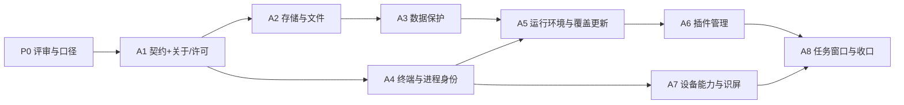

# DSHA 新生迭代路径（A1–A8）

> **一句话**：8 轮纵向闭环，每轮交付一个可发布、可回退的完整切片；本文件顶部的「进度看板」是**唯一进度事实源**。
> 版本：v0.1　日期：2026-11-12　基线：build359 / `0.2.1-rc.5` / `92acaa04`
> 维护：Lead（每轮结束更新看板）　读者：外部开发者、协作方、验收人
> 关联：[可行性评审主稿](README.md) · [对 18 模块方案的回复](reply-to-18-modules-20261112.md) · [覆盖升级契约](../../overwrite-upgrade-and-maintenance.md)

---

## 0. 进度看板（每轮结束更新这一节）

**当前阶段：P0 ✅；G0 工程装配 ✅ 且 Rebirth 固定测试证书已创建（2026-11-13，签名候选 job 在落，仍无 signed 候选/真机，G0 门禁未通过）；G3 v0.1 内部冻结（待对方追认）；G2 任务基线已写；A1 已开工 🟡（契约底座 + 关于/许可）。**
**完成度：0 / 8 轮**（前置 P0 已完成；G0 只做工程装配，不等于 G0 通过）
**下一里程碑：Rebirth signed 候选 CI → 一加真机安装/覆盖 → A1 出口评审（7 步闭环 + 非实现者复核）**
**发布目标：Rebirth 隔离实验线**（`dsh.android.client.rebirth`，独立测试证书，与正式包/Mod 包共存；见 §11 Q8 与 ADR-0004 决定八）。
**阻塞项：A1 开工条件未全部满足**（G0–G5，见 §11.1，**缺一不开工**）。G0 只有工程装配可先行（身份文件、`rebirthCandidate` 开关、独立签名配置、核验器、CI 变体），**证书未创建、无签名候选、无真机安装，G0 门禁未通过**；**A1 业务编码不开工**。文档评审不替代首包门禁——对方明确要求，我方同意。

### 0.1 轮次状态

| 轮次 | 主题 | 状态 | 开始 | 完成 | 用户可见变化 | 覆盖更新影响 | 证据 |
|---|---|---|---|---|---|---|---|
| P0 | 评审、口径与 ADR 冻结 | ✅ 已完成 | 2026-11-12 | 2026-11-12 | 无 | 无（仅文档） | [评审主稿](README.md)、[回复](reply-to-18-modules-20261112.md)、[ADR-0004](../../adr/0004-kotlin-rust-direction.md) |
| A1 | 契约底座 + 关于/许可 | 🟡 进行中 | 2026-11-13 | — | 关于页补第三方许可；契约注册表 | 目标：无维护（`ui/`+新 `contract/` 不在清单） | [任务基线](a1-task-baseline-20261113.md) |
| A2 | 存储与文件 | ⬜ 未开始 | — | — | 文件工作台（SAF） | 一次维护页 | — |
| A3 | 数据保护 | ⬜ 未开始 | — | — | 备份/恢复/保留数据 | 一次维护页 | — |
| A4 | 终端与进程身份 | ⬜ 未开始 | — | — | 终端标签与会话 | 一次维护页 | — |
| A5 | 运行环境与覆盖更新 | ⬜ 未开始 | — | — | 维护页/一键更新 | 一次维护页 | — |
| A6 | 插件管理 | ⬜ 未开始 | — | — | 插件启停/更新 | 一次维护页 | — |
| A7 | 设备能力与识屏 | ⬜ 未开始 | — | — | 设备通道/识屏/Root 清单 | 一次维护页 | — |
| A8 | 任务窗口与工程收口 | ⬜ 未开始 | — | — | 桌宠/对话窗口 | 一次维护页 | — |

**图例**：⬜ 未开始　🟡 进行中　✅ 已完成（有证据）　⛔ 受阻（写明原因）　⏸ 暂停（写明恢复条件）
**"覆盖更新影响"** 指该轮 APK 覆盖安装到旧版时，是否会因受管运行时身份变化而进入一次维护页；判定依据见 §7。

### 0.1.1 开工前置 G0–G5（2026-11-12 状态）

| 门禁 | 状态 | 当前事实 |
|---|---|---|
| G0 Rebirth 身份 | 🟡 证书已建、签名在落 | 身份文件、`rebirthCandidate` 开关、独立签名配置、核验器、CI 变体已落盘；unsigned 候选 12 项核验 PASS；**2026-11-13 固定测试证书已创建**（SHA-256 `912ca1c1…9faec0`，私钥只进 GitHub Secrets 与本机本仓 host runtime [43292602074](https://github.com/SunsetRNE/DSHA-Sunset-mod/actions/runs/43292602074) 回执 **94/128 PASS、34 FAILED**（浏览器/网络/仅设备或历史 APK 夹具），未全绿库外目录），签名 job 在落；**signed 测试候选已产出**（run 43294241607，APK SHA-256 `a5cd7ddc…`，测试证书 v1+v2+v3，非发布）；**尚未真机安装**，G0 门禁未通过 |
| G1 首包门禁清单 | ⛔ 未通过 | 五层清单已并入；对方 runtime 95/128 未绿（不阻塞我方）；本本仓 host runtime [43292602074](https://github.com/SunsetRNE/DSHA-Sunset-mod/actions/runs/43292602074) 回执 **94/128 PASS、34 FAILED**（浏览器/网络/仅设备或历史 APK 夹具），未全绿已触发 [host runtime 43292602074](https://github.com/SunsetRNE/DSHA-Sunset-mod/actions/runs/43292602074)，回执待出 |
| G2 A1 任务基线 | ✅ | [A1 任务基线](a1-task-baseline-20261113.md)：范围/文件/验证/回退/owner，零维护判据 |
| G3 契约草案 | ✅ 内部冻结 | v0.1 于 2026-11-13 自冻结为我方基线（O1–O5 挂起待对方追认），不再阻塞 A1 |
| G4 数据与授权边界 | ⬜ | 跨线不继承/系统授权不随导入已定，待写入首包验收 |
| G5 代码基线 | ✅ | build360 release [run 43199896721](https://github.com/SunsetRNE/DSHA-Sunset-mod/actions/runs/43199896721)：全量 4495/0/0/0、签名构建、干净工作树 |

### 0.2 怎么读这份文档

1. **只想看进度**：看完本节即可，`0.1` 表 + 「当前阶段」两行。
2. **想知道每轮做什么/怎么算完成**：看 §3 总览 + §5 各轮。
3. **想参与开发**：先看 §2（三个口径）、§4（跨轮不变式）、§9（质量门禁）、§10（协作方式）。
4. **想确认兼容性**：看 §6（覆盖更新与数据格式）。

### 0.3 更新规则（写死，避免进度失真）

- 每轮**结束**时改：该行「状态／完成／证据」，以及顶部的「当前阶段／完成度／下一里程碑」。
- 每轮**开始**时改：该行「状态=🟡」「开始=日期」。
- 受阻时：状态 ⛔ + 在 §11 记一条（原因、影响轮次、解除条件）；**不得只把状态改成"差不多完成了"**。
- 证据只放**可复核**链接（测试回执、真机记录、导出的诊断），不放"口头确认"。
- 历史行不改写；修正写在 §12 版本记录里。

---

## 1. 这条路径要解决什么

### 1.1 目标

1. **外壳模块化**：把 964 个 Java 文件 / 206,983 行的单体，按**状态所有权**切成 21 个逻辑模块，再收敛为 9 个 Gradle 编译模块。
2. **Rust 核心引擎**：只做可差分验证的确定性计算与计划校验，首期旁路接入（A3），不接管进程与 Android 权限。
3. **旧版覆盖更新零损失**：包名、签名、versionCode 三条红线不动；I1–I10 一条不丢；数据"双读单写"。
4. **对外可见的工程节奏**：每一轮结束都能发布、能回退、能验收，外部开发者不需要读源码就知道做到哪了。

### 1.2 不做什么

- 不做全量重写（706 个 `*Test.java`、50 个 Manifest 组件、19 个 Gradle 任务、10 条覆盖更新不变式）。
- 不为凑模块数建空壳；不把"18 / 21 / 9"当成三个可以相减的数字。
- 不换包名、不换签名、不清数据、不用"卸载重装"当升级。
- 不在 ADR 落地前写 Kotlin 业务代码；不默认上 Compose。
- 不把 Rust 当成绕过 Android 权限的捷径（FFI 无裸 `exec`）。

### 1.3 为什么是"纵向闭环 × 8"，而不是"先拆工程"

这是**吸收对方方案的核心优点**：先用一个浅依赖的功能闭环证明契约（声明→注册→卡片→页面→恢复→停用清理），再按真实耦合拆工程。先拆 21 个 Gradle 模块的风险是：拆完才发现契约不对，返工面覆盖全部模块。

本路径把两者合并：**每轮闭环同时清掉它经过的依赖边**，8 轮走完后，Gradle 工程化（A8）是机械收口，而不是大爆炸重构。

---

## 2. 三个口径（先对齐，避免混算）

| 口径 | 数量 | 用途 | 谁维护 |
|---|---|---|---|
| 逻辑模块（对方 18） | 18 = 4 核心 + 6 能力 + 8 功能 | 产品/职责讨论口径 | 对方文档 |
| 状态模块（我方 21） | 21 = 15 必须 + 4 建议 + 2 强制隔离 | 工程边界、状态所有权、回归归属 | [评审主稿 §4](README.md) |
| Gradle 编译模块 | 9（+2 二期） | 真正影响构建、R8、增量编译 | A8 收口 |
| Rust crate | 1（首期） | 纯计算 + 计划校验 | A3 起 |

**一句话**：18 是"用户能看懂的功能"，21 是"谁持有唯一状态"，9 是"编译器能看懂的边"。三者只做映射，不做加减。

### 2.1 18 ↔ 21 ↔ 轮次 映射（外部开发者定位用）

| 轮次 | 对方 18 覆盖 | 我方 21 覆盖 | Gradle 落点 | 用户可见 |
|---|---|---|---|---|
| A1 | C01 模块协议、C02 宿主核心、C03 授权核心、F01 关于/许可、A06 的契约部分 | M05 授权派发、M18 外壳 UI、M01 配置契约、M03 诊断出口、M20 legacy（读旧偏好） | `:app` `:core:policy` `:core:grants` `:ui` | 关于/许可入口 |
| A2 | A01 存储、A02 网络（传输部分）、F04 文件工作台 | M15 桥与入站（SAF 面）、M16 网络与传输、M12 的 SAF 部分、M02 凭据（下载凭据代理） | `:bridge` `:data` | 文件工作台 |
| A3 | F05 数据保护 | M12 宿主数据与备份、M20 legacy（v1–v4 读）、M01（配置快照）＋ **Rust 首次旁路** | `:data` | 备份/恢复/保留数据 |
| A4 | F03 终端 | M14 终端、M04 进程身份与退出证据 | `:runtime`（终端子域） | 终端标签 |
| A5 | F02 运行环境工作台 | M09 生命周期与租约、M10 命令与挂载、M11 受管安装、M17 应用更新、M04（复用）、M20（旧会话 schema） | `:runtime` | 维护页/一键更新 |
| A6 | F06 DSH 插件管理 | M13 插件生命周期与热检查、M01（插件配置命名空间） | `:data` + `:runtime` 契约 | 插件启停/更新 |
| A7 | A03 设备执行通道、A04 实体屏、A05 虚拟屏、F07 Root 模块管理（只读先行） | M06 设备执行通道、M07 物理屏、M08 虚拟屏、M02（设备通道凭据） | `:device` | 设备通道/识屏/Root 清单 |
| A8 | F08 桌宠与对话窗口、A06 收口、A02 收口 | M18 任务窗口与呈现、M19 网页宿主、M15/M16 收口、M01/M02/M03 收口 | 9 个 Gradle 模块 + 2 个二期 | 桌宠/对话窗口 |

**横切模块的落点**：M01 配置、M02 凭据、M03 诊断、M04 进程身份、M20 legacy 不属于单一轮次，按"首次被使用"落地（A1 配置/诊断/legacy，A2 凭据，A4 进程身份，A3 数据事务）。

---

## 3. 八轮总览

| 轮次 | 主题 | 吸收对方的优点 | 主要风险 | 可发布 | 粗估（未测量） |
|---|---|---|---|---|---|
| A1 | 契约底座 + 关于/许可 | C01/C02 的"声明→注册→贡献→停用清理"闭环 | 契约定错，后面全部返工 | 是 | 6–9 人日 |
| A2 | 存储与文件 | A01 的"逐文件授权不绑定所有文件访问" | SAF/URI 生命周期与撤销 | 是 | 6–9 人日 |
| A3 | 数据保护 | F05 的"数据操作走受管事务 + 维护屏障" | 备份格式与旧版兼容 | 是 | 8–12 人日 |
| A4 | 终端与进程身份 | F03 的"切页/旋转/语言切换不终止进程" | PTY 出生身份与退出证明 | 是 | 6–9 人日 |
| A5 | 运行环境与覆盖更新 | F02 的"功能层不复制状态机" | I1–I10 回归；白屏复发 | 是 | 10–15 人日 |
| A6 | 插件管理 | F06 的"错误/取消/超时/未知/排队不能被 UI 掩盖" | 未提交事务与 writer 锁 | 是 | 8–12 人日 |
| A7 | 设备能力与识屏 | A03/A04/A05 的"后端可用≠业务获准""两屏不混用凭据" | 权限回归、UNKNOWN 重放 | 是 | 10–15 人日 |
| A8 | 任务窗口与工程收口 | F08 的"一个逻辑窗口 owner + 真实任务身份" | 串会话；Gradle 拆分的边界腐化 | 是 | 8–12 人日 |

> 粗估仅用于排序与人力安排，不是承诺排期；每轮实际取决于并行度与真机可用性。

### 3.1 依赖关系

**排序理由**：A1 的依赖最浅（只贡献卡片与导航），且它定义的契约是后续所有轮的前提；A2/A4 可并行；A3 依赖 A2 的文件事务；A5 依赖 A3 的数据事务与 A4 的进程身份；A6 依赖 A5 的维护屏障；A7 依赖 A4 的进程身份；A8 收口所有轮次并做 Gradle 工程化。

### 3.2 每轮结束的"可发布"定义

- 能产出 `assembleStandardRelease`；
- 覆盖安装到上一轮版本成功，数据完好；
- 用户可见变化**只限本轮回环**（不夹带未验收的重构）；
- 有回退点（tag 或开关），回退不需要清数据。

---

## 4. 跨轮不变式（每轮都必须满足）

| # | 不变式 | 检查方式 |
|---|---|---|
| G1 | 包名 `io.github.sunsetrne.dsha`、签名、versionCode 单调，三者不动 | 发布门禁 `verifyPublishCertificate` + 身份文件核对 |
| G2 | 覆盖更新后 I1–I10 一条不丢 | 门禁用例 + 真机覆盖安装 |
| G3 | 数据"双读单写"：新格式只写旁路文件，不抬既有容器版本号 | A3/A5 专项检查 |
| G4 | 不按裸 PID / 端口 / 名称发信号；未知结果不重放 | `WebProcSelTest` 等 11 个停止相关测试 |
| G5 | 设备命令白名单默认拒绝，`[POLICY_BLOCKED]` + 126，无"仍然允许" | `DeviceShellPolicyTest` + 设备审计脚本 |
| G6 | 敏感能力默认关闭、可撤销；全局允许不代答敏感类别 | `DeviceGrantsTest`、`SensitiveScreenPolicyTest` |
| G7 | Rust 首期**没有执行入口**（只有压缩/摘要/计划校验三类纯函数），无裸 `exec`、无 `argv` | FFI 接口评审 + 越界入口反例 |
| G8 | 日志统一走脱敏出口；Rust 不直写 logcat | `SensitiveDataTest` + 代码审查 |
| G9 | 不做空壳：每轮必须有真实闭环与可复核证据 | 出口评审 |
| G10 | 全量单测 + 边界脚本 + 文档链接检查通过 | `dsha-gradle :app:testStandardDebugUnitTest`、`tools/test-core-boundaries.py`、`tools/check-document-links.py` |

---

## 5. 各轮详情

### A1 契约底座 + 关于/许可

- **吸收对方的优点**：先证"声明→注册→卡片→页面→排序/隐藏→重启恢复→停用清理"，再谈拆工程。
- **覆盖模块**：C01、C02、C03、F01、A06（契约）；M05、M18、M01、M03、M20。
- **交付物**：
  - 用户可见：设置里的「关于与许可」入口（版本、包身份、第三方许可、外部项目链接）。
  - 工程：模块契约（身份/版本/贡献/能力声明）、宿主注册表与路由、贡献句柄登记与撤销、安全模式/恢复入口、诊断脱敏唯一出口（ADR-0004 与口径修正已在 P0 落地）。
- **出口判据（A+）**：7 步闭环全部通过；停用卡片后法定许可入口仍可达；无新增敏感能力；全量单测绿；边界脚本 PASS；文档链接 PASS。
- **覆盖更新影响**：目标为**零维护**——`launcherInputs` 实测不含 `ui/`（0 个），若本轮只新增 `ui/` 与独立新包，`runtimeId` 不变；若改 `DshaApp`/`util` 等已列入清单的文件，则变（见 §6）。
- **回退点**：入口开关 + tag；回退不涉及数据格式。
- **风险**：契约定错会波及后续 7 轮——A1 出口评审必须由非实现者逐条核对"停用后安全兜底"与"未知状态语义"。

### A2 存储与文件

- **吸收对方的优点**：逐文件选择授权**不绑定**"所有文件访问"；URI/FD 归属、生命周期、限额与撤销在能力层落实。
- **覆盖模块**：A01、A02（传输）、F04；M15（SAF/桥面）、M16、M12（SAF 部分）、M02。
- **交付物**：SAF 授权簿、跨应用文件工作台（浏览/导入/导出/传输记录）、受控流与限额、`/app/saf/*` 端点保持；下载续传只信已核验偏移。
- **出口判据**：正/反例齐全（未授权目录、软链接、凭据区）；撤销后旧句柄失效；`/app/export` 与 `/app/readfile` 边界用例通过；桥协议不变（加法端点不改协议号）。
- **覆盖更新影响**：改 `HttpShellService`/`saf/` → `runtimeId` 变 → 覆盖安装进一次维护页。
- **回退点**：tag；数据格式不变。
- **风险**：SAF URI 持久权限与 Android 版本差异；跨应用路径别名与 NOFOLLOW 核验。

### A3 数据保护

- **吸收对方的优点**：数据操作沿用受管事务、完整性验证与维护屏障；APK 回退 ≠ 数据恢复。
- **覆盖模块**：F05；M12、M20（v1–v4 读）、M01（配置快照）＋ **Rust 首次旁路**。
- **交付物**：一键备份（无密码 v5）、恢复与迁移、自动计划、保留数据管理；**Rust 旁路**：三类封闭纯函数（`archive_pack/archive_unpack`、`digest`、`verify_plan`），与 JVM 实现差分对拍，可一键回退；`cargo vendor` + 锁文件 + 字节复现门禁 + 16 KB 页对齐。**不含 `execute`/`argv`/fd 执行/进程操作。**
- **出口判据**：v5 备份跨版本可恢复；"双读单写"验证；Rust/JVM 解压后字节、摘要、清单 100% 一致；体积增量在 1.10 MiB 基线预算内；旧格式（v1–v4）导入路径有测试。
- **覆盖更新影响**：改 `backup/`（83 类全部在 `launcherInputs` 内）→ `runtimeId` 变 → 一次维护页；**数据格式不升级**（`dataWrite` 保持 `dsh-0.2.2-rc.1`）。
- **回退点**：Rust 开关回 JVM；tag。
- **风险**：离线 cargo 链（本机能编、CI 编不出）；归档体积与 100k 条目上限。

### A4 终端与进程身份

- **吸收对方的优点**：切页/旋转/语言切换不终止进程；关闭标签必须核验该会话退出。
- **覆盖模块**：F03；M14、M04。
- **交付物**：真 PTY 与简易终端、会话 ID 永久递增、显示编号独立复用、出生身份登记（子进程自读 stat→父进程确认→exec）、退出证明、维护前关闭顺序。
- **出口判据**：进程存活跨配置变更；关闭单个标签后核验退出才移除；不按裸 PID 发信号；`PtySession` 相关测试 + 真机抽验。
- **覆盖更新影响**：改 `PtySession`/`RootShellMain` → `runtimeId` 变 → 一次维护页。
- **回退点**：tag（终端不影响数据格式）。
- **风险**：PTY 原生握手与 proot 交互；proroot 下回收 guest。

### A5 运行环境与覆盖更新

- **吸收对方的优点**：功能层（工作台）只展示与提交请求，**不复制**一套进程/容器状态机。
- **覆盖模块**：F02；M09、M10、M11、M17、M04（复用）、M20（旧会话 schema）。
- **交付物**：启动/停止/重启、环境检查、维护页、一键更新、受管运行时候选→试运行→事务提交→回切、覆盖更新弃旧版（T91）、强制结束入口。
- **出口判据**：覆盖安装后必进一次整屏维护页且主操作正确；旧 Web 未确认时只拦自动开始；"旧树+新 APK"不拉 Web；T91 双次核验 6 类夹具（Java/Rust 差分）；无白屏、无侧栏重复。
- **覆盖更新影响**：改 `runtime/`（63 类全在清单）→ `runtimeId` 变 → 一次维护页；描述符主文件仍写 `version=1`。
- **回退点**：tag；回滚=发更高 versionCode 的旧代码，不清数据。
- **风险**：I1–I10 回归遗漏；白屏复发；维护屏障与界面忙状态混淆。

### A6 插件管理

- **吸收对方的优点**：错误/取消/超时/未知/排队语义**不能被 UI 缓存掩盖**；管理容器内插件，不替代其协议。
- **覆盖模块**：F06；M13、M01（插件配置命名空间）。
- **交付物**：插件列表/配置/安装更新入口/启停意图/结果展示；系统插件按当前 APK 精确证明重建；`.disabled` 意图优先；未提交事务保留现场并拦启动；热检查与 writer 锁同所有者。
- **出口判据**：pending 进维护页且不自动重放；系统插件字节来自新 APK；启停意图跨重启保持；UI 不使用缓存掩盖未知态。
- **覆盖更新影响**：改 `plugins/`、`core/` → `runtimeId` 变 → 一次维护页。
- **回退点**：tag；插件事务日志只读兼容。
- **风险**：插件写事务与热检查竞态；系统/用户插件分层。

### A7 设备能力与识屏

- **吸收对方的优点**：后端可用 ≠ 业务获准；实体屏与虚拟屏共用策略语义但**不混用**实例/代次/观察/输入凭据。
- **覆盖模块**：A03、A04、A05、F07；M06、M07、M08、M02（通道凭据）。
- **交付物**：三通道（su/Shizuku/ADB）可用性、身份与类型化执行；实体屏观察/截图/语义与坐标动作；虚拟屏 Core 生命周期与动作；统一能力枚举 + 失败码 + 通道声明（**不统一凭据**）；Root 模块管理**只读先行**（清单 + 管理器握手/能力探测）。
- **出口判据**：白名单/126 反例；UNKNOWN 不重放；坐标/语义/锚定凭据不可互换；模式互斥不回退另一块屏；Root 写入口仍关闭（不因本轮开启）。
- **覆盖更新影响**：改 `vscreen/`、`screen/` → `runtimeId` 变 → 一次维护页。
- **回退点**：tag；设备能力均为可选开关，默认关闭。
- **风险**：权限回归；两屏凭据串用；Root 管理器识别被写成"全版本兼容"。

### A8 任务窗口与工程收口

- **吸收对方的优点**：**一个逻辑窗口 owner + 真实任务身份**，避免串会话/重复连接；隐藏桌宠 ≠ 暂停任务。
- **覆盖模块**：F08、A06 收口、A02 收口；M18、M19、M15/M16 收口、M01/M02/M03 收口。
- **交付物**：桌宠显隐/移动、任务气泡、会话关联、半透明对话窗；网页宿主收口（WebView 生命周期、页面代次、IME/PiP/麦克风、文件上传下载）；**Gradle 工程化**：9 个编译模块（+2 二期）、convention plugin、依赖白名单、边界脚本改路径。
- **出口判据**：18 项逻辑模块全部有归属；9 个 Gradle 模块依赖单向、`:core:policy` 为唯一叶子；706 个测试全绿；视觉门禁（中英/日夜/短屏/1.3×）通过；文档一致性检查 PASS。
- **覆盖更新影响**：全量工程化会改 `util/`/`core/` 等 → 一次维护页；**gecko/引擎决策在此轮关闭**（见 §11）。
- **回退点**：tag；Gradle 拆分按模块回退（单提交级）。
- **风险**：模块化后测试静默跳过；Manifest 合并顺序破坏语言锁存；为凑模块数过度拆分。

---

## 6. 覆盖更新与数据兼容（每轮检查表）

> **横向前提（2026-11-12 已确认）**：Rebirth 是**隔离实验发行线**，`applicationId = dsh.android.client.rebirth`，独立测试证书，与正式包 / Mod 包**可共存、互不覆盖**；"候选暂不接正式更新 feed"只影响推送，不取消系统覆盖安装与 I1–I10。本节的"每轮进一次维护页"只指 **Rebirth 线内部**的覆盖；跨线不构成覆盖安装、数据默认不继承（见 §11 Q8 与 ADR-0004 决定八）。
>
> 因此本表 §6.1 的 `launcherInputs` 统计仍然成立（同一套受管运行时），但"用户"指 Rebirth 线用户；正式 Mod 线在本路径内不受影响。

### 6.1 为什么"改代码"会触发维护页

实测（`app/src/main/assets/runtime-descriptor.json`）：`launcherInputs` 共 **481** 项，其中 **423 个 Java 源文件 + 14 个 `.so` + 44 个生成输入**。Java 覆盖 `util` 139、`backup` 83、`runtime` 63、`vscreen` 36、`core` 34、`screen` 19、根包 14、`plugins` 9、`capabilities` 6、`device` 6、`bridge` 4、`saf` 4、`diagnostics` 3、`data` 2、`recovery` 1；**`ui/` 为 0**。

因此：

- 改上述任一文件 → 受管运行时摘要变 → `runtimeId` 变 → 覆盖安装后**必然进一次整屏维护页**（I1/I6，设计如此，不是缺陷）。
- 只改 `ui/`、`res/`、Manifest 的非受管部分 → 可能**不触发**维护（A1 的目标）。
- 新建包若未纳入 `launcherInputs` 生成契约，则不改 `runtimeId`；**一旦纳入，之后每次改它都会触发**——A1 定契约时必须明确新包是否进清单。

### 6.2 每轮检查表

| 轮次 | 改 `launcherInputs`？ | 覆盖安装 | 数据格式 | 桥协议 |
|---|---|---|---|---|
| A1 | 视实现（目标：否） | 目标零维护 | 不变 | 不变（3，加法端点不改号） |
| A2 | 是（`HttpShellService`/`saf`） | 一次维护页 | 不变 | 不变 |
| A3 | 是（`backup` 全量） | 一次维护页 | **不升级**（双读单写，新字段走旁路） | 不变 |
| A4 | 是（`PtySession`/`RootShellMain`） | 一次维护页 | 不变 | 不变 |
| A5 | 是（`runtime` 全量） | 一次维护页 | 描述符主文件仍 `version=1` | 不变 |
| A6 | 是（`plugins`/`core`） | 一次维护页 | 插件事务日志只读兼容 | 不变 |
| A7 | 是（`vscreen`/`screen`） | 一次维护页 | 不变 | 不变 |
| A8 | 是（全量工程化） | 一次维护页 | 不变 | 不变 |

### 6.3 三条红线（每轮发布都核对）

1. `applicationId` = `io.github.sunsetrne.dsha`（`app/build.gradle:86`，另由身份文件强制）。
2. 签名 = Mod 自有证书，v1+v2+v3 全开（`verifyPublishCertificate`）。
3. `versionCode` 单调递增（当前 359；每轮发布 +1）。

**违反任一条 = 老用户拿到的不是升级**：换签名会被系统拒装（`INSTALL_FAILED_UPDATE_INCOMPATIBLE`），唯一出路是卸载重装，等于丢 Keystore 加密的会话记录与设备授权。

---

## 7. 质量门槛（Definition of Done）

每轮出口必须**同时**满足：

| 项 | 命令 / 证据 |
|---|---|
| 全量单测 | `dsha-gradle :app:testStandardDebugUnitTest`（共用 `/root/.gradle`，离线） |
| 架构边界 | `python3 tools/test-core-boundaries.py`，基线 JSON 只减不增 |
| 文档链接 | `python3 tools/check-document-links.py` |
| 格式 | 现存 Java 格式门禁；Kotlin 启用后同批加锁 |
| 覆盖更新 | 真机覆盖安装：数据完好、进一次维护页（或零维护）、无白屏、无侧栏重复 |
| 安全回归 | 每轮涉及的能力对应测试类（白名单/凭据区/授权/识屏凭据/脱敏） |
| 用户可见 | 只限本轮回环；变化写进该轮证据 |
| 可回退 | tag + 开关；回退不需要清数据 |

**不接受的"完成"**：只编译通过、只在模拟器跑过、只测 happy path、用"已修复"代替回执、把未闭环的项移到下一轮却不更新看板。

---

## 8. Rust 引擎在这条路径上的位置

| 项 | 结论 |
|---|---|
| 首次接入 | **A3**：归档 deflate + 流式摘要，旁路双实现 + 差分对拍，可一键回退 |
| 扩展 | A3 之后保持旁路；不因"引擎"一词扩大范围 |
| 契约边界 | 三类封闭纯函数 + 正交五字段结果；**无 `execute`/`argv`/fd 执行/进程操作**（`PlanEnvelope` 仅类型占位，不进 ABI） |
| 不承接 | 进程出生身份、信号、PTY、3090 桥、proot/proroot 启动器、日志脱敏、插件事务（在 guest） |
| 独立进程 | 不在本路径；若确需引擎级隔离，另立 ADR（参考未实施的 `:web` 独立进程设计） |
| 构建 | NDK r26、`aarch64-linux-android`、16 KB 页对齐、`cargo vendor` + 锁文件 + 字节复现 `--check` |

---

## 9. 风险与止损

| # | 风险 | 影响轮次 | 症状 | 止损 |
|---|---|---|---|---|
| R1 | 契约定错（C01/C02/C03） | A1→全部 | 后续每轮都要改接口 | A1 出口评审由非实现者逐条核对；契约冻结前不进 A2 |
| R2 | 覆盖更新白屏/不进维护页 | A5、每轮发布 | 主界面空白、侧栏重复 | I1–I10 回归；维护页传 `ready=false`；不放宽 Web 启动准入 |
| R3 | 停止/进程身份改坏 | A4、A5、A7 | 杀错进程、残留、环境连 App 一起走 | 11 个停止相关测试；Java/Rust 差分；不按裸 PID |
| R4 | 权限回归 | A2、A6、A7 | 白名单被放宽、凭据可导出、默认开启 | 安全回归清单；PR 逐行审查 |
| R5 | 离线构建断裂 | A3、A8 | 本机能编、CI 编不出 | `cargo vendor` + 锁文件；先验证再合入 |
| R6 | 模块化后测试静默跳过 | A8 | 测试数变少但全绿 | convention plugin；测试数门禁 |
| R7 | 数据格式被顺手升级 | A3、A5 | 旧版回滚即 fail-closed | "双读单写"；`dataWrite` 不变 |
| R8 | 为凑模块数过度拆分 | 全部 | 空壳模块、循环依赖 | 21/9/1 口径；边界脚本 |
| R9 | 语言锁存被库模块破坏 | A8 | "跟随系统"切一次即锁死 | `DshaApp` 尽早锁存；Manifest 合并核对 |

---

## 10. 协作方式（外部开发者）

| 项 | 约定 |
|---|---|
| 工作树 | 一任务一工作树，基线取 `origin/main`；不在主检出改代码 |
| 分支 | `feat/<topic>`、`fix/<topic>`、`docs/<topic>` |
| 提交 | 中文 + `type:` 前缀说明原因（见 [CONTRIBUTING](../../../CONTRIBUTING.md)） |
| 构建 | 只走 `dsha-gradle`（勿直接 `./gradlew`；勿建 `/root/.gradle-*` 副本） |
| 测试 | 日常定向 `--tests`；合并前全量；一次只跑一个构建（内存即稳定性） |
| 审查 | 外部 PR 必须**逐行全量审查**，结论只有 APPROVE / REQUEST_CHANGES，意见带 `file:line` |
| 证据 | 每轮出口证据放 `docs/releases/` 或本轮 PR 描述；不接受口头确认 |
| 禁止 | 换包名/签名、清数据、跳过测试、放宽 I5 门禁、Rust 裸 exec |
| 看板 | 只有 Lead 改 §0；其他人通过 PR 评论请求更新 |

**入口文档**：[AGENTS.md](../../../AGENTS.md)（约束）、[BUILD.md](../../../BUILD.md)（构建）、[CONTRIBUTING.md](../../../CONTRIBUTING.md)（流程）、[工程规范](../../engineering-standard.md)。

---

## 11. 决策记录（2026-11-12 已定）

> 用户于 2026-11-12 批准全部推荐项；正式记录见 [ADR-0004](../../adr/0004-kotlin-rust-direction.md)。本节保留"为什么定"与"影响哪一轮"，供后续轮次与外部开发者核对。

| # | 问题 | 结论 | 影响轮次 |
|---|---|---|---|
| Q1 | 产品形态：可安装模块宿主 vs 内部工程模块化 | **内部工程模块化**；C01/C02 先落编译期接口 + 最小注册表；"可安装模块"另立项 | A1（决定 C01/C02 深度）、A8 收口 |
| Q2 | Gecko 是否恢复 | **不在本路径引入 GeckoView 依赖**（与是否恢复 low 线无关）；A06 收窄为"系统 WebView + 能力接口预留"，新增/恢复另立评审；可保留在 Rebirth 计划范围 | A8 |
| Q3 | 自更新停用范围 | **只停自动检查/下载/安装**；保留应用内覆盖安装与维护门禁 | A5 |
| Q4 | 执行结果态：六态 vs 五态 | **正交五字段**（`dispatched/executed/partial/effect/retry`），枚举仅作投影；`PARTIAL` 不再承担"取消后可能已执行" | A1（契约）、A7（识屏） |
| Q5 | Root 模块管理节奏 | **只读先行**（清单 + 管理器识别/能力握手）；写入口等 Root 写入口封闭/降权后再开 | A7 |
| Q6 | Kotlin 引入与 ADR-0004 | **批准**；按模块切换、不混写、格式工具同批加锁；**不引 Compose**（新页面另行评审） | A1 起全部 |
| Q7 | 每轮发布进一次维护页 | **接受**（A1 目标零维护除外） | A2–A8 每次发布 |
| Q8 | Rebirth 的 `applicationId` 与签名身份 | **已定**：`dsh.android.client.rebirth` + 独立测试证书（未创建，创建后共享公钥/SHA256）；与正式包、Mod 包可共存；versionCode 首包 359、同线递增；跨线数据默认不继承（导入需单独验证格式/范围/密钥/授权，系统授权不继承） | A1 的发布目标、§6 全表 |
| D6 | cargo 依赖入库 | `cargo vendor` 入库 + 锁文件；`.so` 作为 CI 产物不入库 | A3 |
| D7 | 灰度期新格式 | **禁写**（journal format 4 / session schema 2 暂不启用） | A3、A5 |
| D8 | Java↔Kotlin/Rust 差分回归 | **列为 P0 硬门槛**，6 类身份夹具必须一致 | A1 出口起 |
| D9 | 短信递归 READ 缺口 | **先单独修**（`security-model.md` 已声明缺口），不等架构迁移 | P0 收尾 |

**仍需对方回应/确认的 2 件事**（阻塞 G0 的首包产出，不阻塞文档准备）：① **首发候选由哪个本仓 host runtime [43292602074](https://github.com/SunsetRNE/DSHA-Sunset-mod/actions/runs/43292602074) 回执 **94/128 PASS、34 FAILED**（浏览器/网络/仅设备或历史 APK 夹具），未全绿库/分支产出**（Rebirth 同一 `applicationId` 只能有一个签名身份；两个本仓 host runtime [43292602074](https://github.com/SunsetRNE/DSHA-Sunset-mod/actions/runs/43292602074) 回执 **94/128 PASS、34 FAILED**（浏览器/网络/仅设备或历史 APK 夹具），未全绿各自签名会互相拒绝覆盖安装）；② **测试证书由谁创建与保管**，另一本仓 host runtime [43292602074](https://github.com/SunsetRNE/DSHA-Sunset-mod/actions/runs/43292602074) 回执 **94/128 PASS、34 FAILED**（浏览器/网络/仅设备或历史 APK 夹具），未全绿若构建必须共用同一证书或只产 unsigned。已确认：命名空间有意选定（`dsh.android.client.rebirth`，不改 Mod 命名空间）、五层门禁清单、产品形态拆分、Gecko 方向、收敛表 6 列。

### 11.1 A1 开工条件（Gate，缺一不开工）

| # | 条件 | 谁 | 验收 |
|---|---|---|---|
| G0 | Rebirth 发行身份落地：`applicationId`、测试证书与 SHA256、签名配置、CI 变体、独立更新/核验链（不复用 Mod 证书） | 双方（待定唯一签名持有方） | 能产出可安装的 Rebirth 测试包，且与正式包共存；**同一 `applicationId` 只能有一个签名身份**。当前：工程装配 🟡（身份文件/开关/签名占位/核验器/CI 变体），证书未创建，仅 unsigned；**未通过** |
| G1 | 首包门禁清单双方确认（合并对方 v0.2 协作约定与本表） | 双方 | 一张清单，含构建/签名/安装/数据边界 |
| G2 | A1 任务基线：范围、改动文件、验证方法、回退点、owner | 我方 | 任务单可评审；不含未定契约 |
| G3 | 契约草案：C01/C02 最小接口 + 结果五字段 wire + 投影表 | 双方 | 一页接口表 + 反例（未知 tag、取消后已执行、panic 逃逸） |
| G4 | 数据与授权边界确认：跨线不继承、系统授权不随导入、导入需单独验证 | 双方 | 写入文档并在首包验收中检查 |
| G5 | 代码基线：当前工作树干净、全量单测绿、`assembleStandardRelease` 可复现 | 我方 | 回执链接进任务单 |

> 对方最后一段的立场我方接受：**"答完不等于自动启动 A1"**。G0–G5 全部满足才开工；文档评审、契约评审和真机首包门禁是三件不同的事。
>
> **可先行（不需要 G0–G5 完成）**：ADR 与文档维护、契约草案与投影表、收敛表、Gecko 评审、G0 工程实现（身份文件/构建开关/签名配置/CI 变体，产出 unsigned 候选也不得称可安装）。
> **不可开工**：A1 业务编码（含 C01/C02 接口实现、页面、数据路径改动）。
>
> 对方 2026-11-12 事实快照（供双方对齐，不作为我方证据）：候选身份代码在 `feat/rebirth-identity`；第五轮 fast 97/97、全量 unit 4496 项通过，**runtime 95/128、33 失败**；第六轮 CI 终态 failure；无首包 APK、证书未创建、未安装。按五层门禁，**G1-B 尚未通过**，不能据此启动 C/D/E。

---

## 12. 版本记录

| 版本 | 日期 | 变更 |
|---|---|---|
| v0.1 | 2026-11-12 | 初稿：8 轮纵向闭环、21/18/9 映射、覆盖更新检查表、质量门槛、协作约定 |
| v0.2 | 2026-11-12 | 全部决策批准并落地：P0 完成、ADR-0004 生效、§11 改为决策记录；A1 待启动 |
| v0.3 | 2026-11-12 | 采纳对方四点技术意见：Rust 首期去掉执行入口/`argv`；HMAC 定位更正；结果态改正交五字段；补失败域矩阵 |
| v0.4 | 2026-11-12 | 采纳对方三点澄清：Rebirth=隔离实验发行线、Gecko=单包新增适配（非恢复 low）、不接 feed≠取消覆盖安装；新增 Q8（`applicationId` 待定） |
| v0.5 | 2026-11-12 | Q8 已定（`dsh.android.client.rebirth` + 独立测试证书）；发布目标改为 Rebirth 线；新增 §11.1 A1 开工条件 G0–G5 |
| v0.6 | 2026-11-12 | 对方确认命名空间有意选定并给出五层门禁；G0–G5 改为"缺一不开工"，删除"不阻塞编码"冲突表述；新增可先行范围与两本仓 host runtime [43292602074](https://github.com/SunsetRNE/DSHA-Sunset-mod/actions/runs/43292602074) 回执 **94/128 PASS、34 FAILED**（浏览器/网络/仅设备或历史 APK 夹具），未全绿签名唯一性约束 |
| v0.7 | 2026-11-12 | 对方未交收敛表两列草稿，我方自拟 v0.2；G0 工程装配落盘（Rebirth 身份文件、`rebirthCandidate` 开关、独立签名占位、核验器、CI 变体，unsigned only）；G3 契约草案 v0.1 成稿；新增 §0.1.1 门禁状态表 |
| v0.8 | 2026-11-12 | G0 工程装配 CI 回执：identity-matrix 7 组负控通过，unsigned 候选 12 项核验 PASS（APK SHA-256 `7f9702cd…`）；证书未创建、无 signed 候选、无真机，G0 门禁仍未通过 |
| v0.9 | 2026-11-13 | Rebirth 固定测试证书创建（SHA-256 `912ca1c1…`，私钥只进 GitHub Secrets/本仓 host runtime [43292602074](https://github.com/SunsetRNE/DSHA-Sunset-mod/actions/runs/43292602074) 回执 **94/128 PASS、34 FAILED**（浏览器/网络/仅设备或历史 APK 夹具），未全绿库外）；G3 内部冻结、G2 任务基线成稿、G5 以 build360 回执关闭；A1 开工（契约底座 + 关于/许可） |

---

*本文件是路径与进度文档，不是验收报告；每轮的真实交付以该轮的测试回执、真机记录与 PR 为准。*
