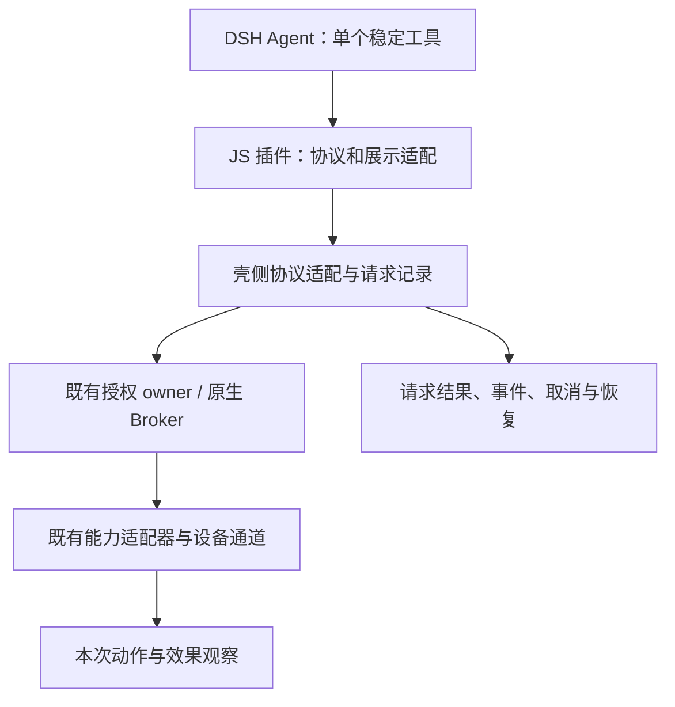

# DSH 单工具特权执行插件：数据与生命周期草案 0.1

状态：**Draft / docs-only / 未实现、未冻结公开协议**。日期：2026-11-15（北京时间）。参考源码：`71e331854dc3e4d76b1d601a61bd5b6d48398e84`，A7 已合入的代码树；不将其合并、CI 或历史真机记录等同于本插件已经可用。本稿不修改 Java/Kotlin、插件资产、Manifest、桥协议、偏好、版本或 runtime descriptor。

交付物：[数据 Schema](protocol.schema.json)、[正反示例](examples.json)、[验收与待定项](acceptance.md)。示例全部是虚构的目标协议数据，不是当前设备权限回执。

## 1. 已确认的方向与本稿建议

用户已确认的核心约束：

> 能力目录和权限状态可以动态变化，DSH 的基础运行与启动条件保持独立；每次特权请求的失败都必须有自己的结果和收尾路径。

| 项 | 来源与确定程度 | 本稿如何承接 |
|---|---|---|
| 单个工具、多能力、组合参数 | 用户明确偏好 | 固定一个工具入口，操作通过 `op` 与能力参数区分 |
| 特权实现与授权由应用壳决定 | 用户明确偏好 | 插件只做发现、参数、通信与结果适配；不自带第二套 su/ADB 客户端 |
| 同一 Agent 会话能看到工具变化，但有延迟 | 用户多次插件开发观察 | 将延迟视为设计条件；可见性与执行授权分开，不要求权限变化时卸载工具 |
| 撤权、断连不能导致 DSH 停机、崩溃循环或无法重启 | 用户确认的目标 | 将可预期能力故障限制在该请求/执行器；普通启动不等待特权 |
| Java→Kotlin 过渡期先落实数据稿 | 本轮范围 | 先定义语言无关的 wire、状态、owner 和验收向量，不翻译生产类 |
| 七个 op、prepare/admission、持久请求域、预算数值 | **本稿建议，尚未逐项批准** | 可评审的协议候选；不能据此直接开始执行器、存储或 APK 改造 |

暂定工具名 `privileged` 只是设计名称，不代表已注册工具、npm 包名或现有桥端点。模型参数不承载可自报的授权、UID、owner、Root 档位或任意执行脚本。

## 2. 与当前工程的接缝

| 已有事实/约束 | 本稿复用与限制 |
|---|---|
| [ADR-0004](../../adr/0004-kotlin-rust-direction.md) 规定按模块增量 Kotlin 化，Rust 首期没有执行入口 | wire 与实现语言无关；后续 Java 适配器与 Kotlin 模块实现同一契约，不保留两套权限真相，不把请求交给 Rust 执行 |
| [DeviceAuthorization](../../../app/src/main/java/com/deepseekharness/app/util/DeviceAuthorization.java#L34) 已提供共享进程内授权围栏，委托原偏好 | 插件只读投影；不新增授权 prefs，不用插件缓存布尔值替代原 owner 的 `current`/派发检查 |
| [DeviceChannelFacts](../../../app/src/main/java/com/deepseekharness/app/util/DeviceChannelFacts.java#L26) 已区分用户意图、发现、许可、绑定、连接证据、请求 Root、实际 UID 和业务许可 | 按来源分别显示；未知保持未知，不拿 TCP、su 候选或 `requestedRoot` 填 UID 0/2000 |
| [DeviceTransportIdentity](../../../app/src/main/java/com/deepseekharness/app/device/DeviceTransportIdentity.java#L5) 区分应用身份与执行身份 | 继续区分；内部 `-1`/空值显式投影成 wire `null`，不补默认身份 |
| [DeviceTransportResult](../../../app/src/main/java/com/deepseekharness/app/device/DeviceTransportResult.java#L7) 仍有旧五态、真实退出码、输出/退出证明 | 以已有事实保守适配到五字段；不声称当前全链已采用本 wire，不凭 `COMPLETED` 或 exit 0 推断效果已验证 |
| [A1 ResultV1](../kotlin-rust-rearchitecture-20261112/a1-contract-draft-20261112.md#L270) 与 ADR 已规定五个正交字段 | 沿用枚举和语义；旧五态仅作兼容投影，取消作为事件 |
| [A7 任务边界](../kotlin-rust-rearchitecture-20261112/a7-task-baseline-20261114.md#L50) 保留 M05/M06/M07/M08 各自 owner | 单工具不统一实体 pixel、semantic、虚拟 raw、editor、anchor 的凭据，不自动换屏/换通道 |
| [F07 原生只读能力](../../../app/src/main/java/com/deepseekharness/app/device/RootModuleReadCore.java#L13) 已有执行代码，A7 未开放助手端点 | 本稿不直接暴露模块清单、不增加 Root 写入口；将它映射到插件仍需另行设计和批准 |
| ADR 的 C01/C02 是壳内编译期模块，DSH JS 插件属于另一套生命周期 | 不把工具热更新等同 Android 原生模块动态加载；不引入下载 DEX/so 或第三方原生模块平台 |

T40 命令确认、T42 原生 ADB/私钥迁移、定时唤醒、全屏提醒与独立 Root Linux runner 均不因本稿自动进入实施。`app.present` 是组合参数的示例能力；当前是否存在所需原生实现与授权必须另验。

## 3. 职责与故障边界

- **DSH/插件**：注册工具、读取能力目录、检查参数形状、保存请求引用、发起调用、重建订阅和展示结果；不自行授予权限，不根据能力快照选择下一通道重放。
- **壳协议适配器（拟建）**：将认证上下文与固定协议关联，管理不可变准备计划、请求记录和有界通知；不是新的执行器或授权数据库。
- **既有授权/业务 owner**：实际许可、全局/敏感子策略、当前目标、系统权限、任务与屏幕凭据的最终检查。
- **既有能力适配器**：选择一次执行通道、验证实际身份、执行与观察、按自身 owner 回收资源。公开协议不允许调用方覆盖既有选择顺序。

可预期的禁用、拒绝、断连、版本不符、超时和解析错误必须返回本请求结果。能力状态不进入 rootfs 就绪判据，也不调用停止 Web、杀 Node、重建容器或清理用户数据的路径。插件 import/register 不得同步等待 su、ADB、Shizuku 或原生确认；缺桥时工具仍可返回 `HOST_UNAVAILABLE`。

**范围限制**：这是一项待验收的稳定性要求，不是“任意故障都能捕获”的保证。Android 杀宿主 UID、覆盖安装、SIGSEGV、OOM、abort 仍可能结束进程；本稿要求下次可无特权启动、恢复请求事实且不重放。屏幕 Core 的 cleanupPending、数据/运行时的真实健康屏障仍由原 owner 保留；不借“DSH 可运行”解除相应域的保护。

## 4. 单工具外壳与组合参数

| `op` | 主要输入 | 返回 | 是否可产生设备副作用 |
|---|---|---|---|
| `status` | 可选 SUMMARY / RECORDED_IDENTITY | catalog 状态快照 | 否；只读已有事实，不自动探测、连接或请求授权 |
| `describe` | 可选 capabilityId | catalog，含该能力输入/结果 Schema | 否；无远程 schema 获取或可执行内容 |
| `prepare` | requestRef、expected、能力 ID/版本、arguments、timeoutMs | prepared 或 fault | 不执行设备动作；在壳侧可靠记录不可变计划，不请求 su |
| `execute` | requestRef、admissionId | receipt 或明确 fault | 可以；每次及组合每步仍通过既有原生授权与派发闸口 |
| `result` | 原 requestRef | 当前 receipt 或 REQUEST_UNKNOWN/RESULT_EXPIRED | 否；不恢复执行，不因查询自动重新探测目标 |
| `cancel` | 原 requestRef | 当前 receipt，含取消事件 | 可以发取消信号；接受取消不证明终止或回滚 |
| `events` | after、limit≤20 | eventBatch | 否；通知丢失仅要求重新读目录/结果，不触发动作 |

主动身份探测是示例能力 `channel.identity.probe`，也必须显式 `prepare → execute`，不能藏在状态轮询或插件加载里。它可能需要管理器确认，因此身份探测结果不等于任意业务许可。

示例能力 `app.present` 用一组参数表示亮屏、拉前台和壳自己的提醒窗口；参数分支见 Schema 的 `AppPresentArguments`。`HOST_FULLSCREEN_ACTIVITY` 只描述壳有权显示的提醒 Activity，不承诺覆盖所有系统/安全窗口，不解锁设备。其他能力只接受其声明的分支，未知参数直接拒绝，不接收裸 `command/argv`、动态脚本或调用方自定回调代码。

执行步骤由壳内受控能力定义展开，不接收模型自由编写的步骤程序。默认先校验整组支持情况、参数和目标，再按固定依赖顺序执行；最多 8 步（建议值）。执行中授权可变化，每一步都重新核验。某一步拒绝后不继续；不默认补偿、回滚、补跑或重放整组。

## 5. 数据对象、身份与有效范围

[Schema](protocol.schema.json) 中定义了七类 request 和 catalog/prepared/receipt/eventBatch/fault 五类响应。请求字段封闭，禁止未知参数静默改变语义；响应允许增加非判定字段，未知判定枚举必须保守处理。

| 字段/对象 | 含义 | 不能替代 |
|---|---|---|
| `protocolVersion` / capability `version` | 外层 wire / 单项操作参数语义版本 | 不等于 `BRIDGE_PROTOCOL=3`；本稿不升现有桥号 |
| `callId` | 一次传输调用的关联 ID | 不用于设备动作去重 |
| `host.instanceId` | 壳进程/协议运行实例，重启必换 | 不用作持久去重唯一域 |
| `host.requestEpoch` | 壳持久管理的新请求准入域；账本不可用时为 null | 不是授权 epoch、screen generation 或 DSH 会话 ID |
| `requestRef={epoch,id}` | 一个持久逻辑请求的不可变引用 | 不得在未知后换 epoch/id 自动复刻同一业务 |
| `catalogRevision` | 能力/版本/参数定义目录修订 | 不是当前业务许可 |
| `authorizationRevision` | 壳发布的组合授权视图修订 | 不合并或替代 DeviceAuthorization、Broker、screen 等真实 owner 的围栏 |
| `expected` | prepare 使用的壳实例、目录与授权视图版本 | 仅用于发现过期数据；不授予执行权 |
| `admission.id` | 壳持有的、绑定本计划的短期不透明引用 | 不等于系统授权、长期 lease 或最终 dispatch permit |
| `recordRevision` | 单请求结果记录单调修订 | 迟到回调不得覆盖更高修订的事实 |
| `identity` | 执行 UID、来源、采样时间及证据引用 | 请求 Root、通道名、guest UID 0 不能补齐未知身份 |

UUID 使用小写规范形式；修订与单调时钟值限制在 JS 安全整数范围内。现有 native long 超出 wire 范围时，当前能力返回兼容/状态错误，不截断、回绕或令整个 DSH 无法启动。

调用者安装身份、完整 DSH 会话/任务/轮次从认证的传输上下文取得并在壳侧核对，不允许模型通过参数自报 owner。当前桥 token/原生确认继续独立生效；凭据不进 URL、argv、目录响应或日志。协议传输方式和端点路径尚未冻结，不扫描固定端口、不向另一个安装的壳回退。

内部未知 UID/时间的 `-1` 转为 `null`；`authorityReadState=CHANGING/UNAVAILABLE` 时，wire `enabled=null`，不把临时关闭读解释成用户已经关了开关。`channelAuthorization` 未得到明确拒绝证据时为 `UNVERIFIED`，不能从 false 自动投影为 DENIED。

guest 模拟 UID 可作为诊断字段 `guestReportedUid`。不定义“用户态 Root/内核态 Root”两级权限：Root 管理器实现机制是可选的提供方信息，实际进程仍需核 UID/capabilities/SELinux。根本事实由执行器取证；插件不自行宣称已验证 UID。默认结果不包含完整安装路径、SELinux 分类、密钥、模块名或用户正文。

## 6. prepare、派发与撤销

1. 插件为新业务保留 `requestRef`，请求域必须来自壳；不得省略 epoch 后默认为当前值。
2. `prepare` 验证版本、参数、目标与当前状态，规范化出不可变计划，计算稳定 payload 指纹，可靠记录后返回 admission。指纹覆盖能力/版本、参数、目标、身份要求和固定步骤顺序，不覆盖短期 callId/连接 ID/hostInstance。
3. 同请求域、可信 caller scope、requestId 的 prepare 并发原子化；相同 payload 返回原准备状态，不延长 admission；不同 payload 返回 REQUEST_ID_CONFLICT，不覆盖原计划。
4. `execute` 不再接收 arguments；壳通过 admission 找回原计划，核 caller/hostInstance/准入域/有效期/原生当前授权/目标和凭据。准备成功不阻止后来撤权，也不替代原生确认。
5. 壳原子消费 admission，可靠记录本步 dispatch intent，才允许对应适配器越过一次性派发闸口。重复 execute 只查询既有状态，不产生第二次派发。
6. 撤权与派发的竞态以各真实 owner 的闸口为界：撤权先发生则本步未发送；已越过闸口则停止后续步骤，并按实际证据记录当前步骤，不声称无副作用。
7. 日志写入失败、容量满或本域账本损坏时，拒绝本能力的新副作用；status/result 的有限诊断及普通 DSH 启动不等待修复。不能退回纯内存去重。

规范化与指纹的跨语言算法是实施前待冻结项，本稿不把普通 `JSON.stringify` 当标准，也不据演示中的 64 位十六进制值声称字节对拍已通过。JSON 重复键、非有限数值、超界整数、原型污染字段以及不支持的 schema 关键字须在执行前拒绝。

admission 建议存活 60 秒，只限制**开始派发**，不是执行完成期限，也不证明超时进程已经退出。超时/取消后，清理依然由本次 owner 监督；不能通过新的 helper 去猜测或终止未核身份的 PID。

## 7. 结果、取消与部分完成

`facts` 沿用 ResultV1：`dispatched / executed / partial / effect / retry`，另含 `resultVersion=1` 和 `reasonCode`。Schema 表达 A1 的 J1–J5 静态关系；新观察是否可信、身份是否新鲜、参数是否已授权，仍须运行时核验。

`lifecycle` 只描述请求记录：PREPARED / QUEUED / ACTIVE / SETTLED / UNCERTAIN；`business` 单独表达 PENDING / SUCCEEDED / FAILED / UNKNOWN / NOT_RUN。ACTIVE 可以是仍在等待执行证据；SETTLED 必须已知派发、执行与完成度，可以是确定拒绝或业务失败。已经确认执行但业务效果未知，可为 SETTLED + business=UNKNOWN + effect=UNKNOWN；其未知摘要仍保留，不转成可重试。UNCERTAIN 专指执行事实无法收口，不因后续资源释放就改成成功。执行器退出码 0 不自动成为 SUCCEEDED，更不自动成为 `effect=VERIFIED`。

- **取消是事件**：CANCEL_REQUESTED/CANCEL_ACCEPTED 不改写执行事实，不新增一个会抹掉副作用的 CANCELLED 结果态。排队请求只有确证未派发时才可按未执行结案。
- **已知部分完成**：前序步骤确证执行、后续明确未发送，整体 `partial=PARTIAL`；逐步保留结果，不隐藏既有副作用。步骤集合只含该计划的必需动作，未请求的可选动作不作为失败步骤；整体 SUCCEEDED 必须所有必需步骤都成功，不能用摘要覆盖未执行/失败步骤。完整性还需与壳保存的计划逐项核对。
- **任一步执行未知**：整体 UNCERTAIN、executed/partial=UNKNOWN，保留前序已知步骤；不得用“部分成功”掩盖未知。
- **效果验证**：顶层与每个步骤的 VERIFIED 都必须带本次有效的新观察引用；有引用字符串还不够，原 owner 要验证其归属。部分效果仍通过步骤展示。
- **退出与输出**：outputComplete、exitCode 与原始 `transportEvidence.localExitConfirmed/remoteExitConfirmed` 分开记录。原始传输快照保持既有 A1/DeviceTransportResult 的 UNKNOWN 不得附远端退出证明约束，不能由超时/取消补出退出。后续资源核对另记 `cleanup.resources/evidenceId`：证据须绑定原 requestRef/步骤、资源 owner、出生身份或 Core 代次、观察时刻/时钟域及完整应回收资源集合。确认整组资源已收回时，可以 UNKNOWN 执行事实 + resources=RELEASED，保留原传输快照，不回填业务效果或自动重试。只观察一个 helper 退出不等于所有后代已退出。合法退出码 125 可以是普通退出，124 也不能统一解释成未发送。
- **重试**：SAFE 只表示满足对应资格，不是自动重发指令；UNKNOWN/PARTIAL、旧凭据、取消、失回执都不得由插件换通道或复制业务重试。

fault 是本次通信/契约故障，不改写请求账本。没有提交动作的 status 失败可带 facts=null；execute 请求已交出但回执丢失，插件只能合成未知事实并引导按原 requestRef 查询。账本查不到只返回 REQUEST_UNKNOWN/RESULT_EXPIRED，不能以“没有记录”证明未执行。每次结果查询仍核对认证 caller 与原能力的数据访问策略；可返回状态不等于可重发旧敏感正文，撤权后允许只返回元数据并隐藏 payload。

## 8. 热更新、持久化与恢复

**工具可见性延迟**：插件可异步更新能力说明；不在每次断连/撤权时注销工具。不支持的新参数在 prepare 返回 SCHEMA_STALE/UNSUPPORTED_OPERATION，读取新描述后重新规划；不得自动翻译旧请求后执行。能力 Schema 仅作为数据，必须有界、自包含或使用本地受控引用；不远程解引用，不执行目录提供的 JS/shell。

**插件热重载**：新包装实例先读状态、按原 requestRef 查询并重建事件订阅。执行请求由壳持有，不随 JS 订阅消失；旧回调按 hostInstance、订阅代次和 recordRevision 过滤。事件可以重复或丢失，gap=true 时只重新读目录/结果，不重放动作。身份与秘密不进入事件载荷。

**壳重启**：instanceId 换新、单调时钟域换新，旧 admission、未决确认与执行许可全部失效；requestEpoch/账本留存。可信记录证实从未记 dispatch intent 的准备请求可按未发送中止；有 intent 且无可靠完成证明的请求保持 UNKNOWN。现存 helper 可能仍活着，App 重启不等于其退出；恢复只重接/观察，不自动续跑。未决能力请求不进入 DSH 全局运行环境损坏判据。

**准入域与去重**：请求键为安装实例＋认证 caller scope＋requestEpoch＋requestId。hostInstance 和插件连接代次不构成去重唯一域。准入域退休立即禁止新 prepare，并废止未消费 admission；旧域结果仍可查询。未知后不得通过新域、新 requestId 或新计划复刻原业务；本协议不提供跨域的业务去重。

**保留边界**：ACTIVE/UNCERTAIN、资源未退出和未完成核对记录不按普通 TTL 清理；业务仍 UNKNOWN 的 SETTLED 记录也保留未知事实摘要，不按成功回执丢弃。UNCERTAIN 的资源已经独立释放时，不必继续占用相应运行资源，但仍保留请求未知与去重记录。已结案可先清大输出，保留请求键/指纹/事实摘要 tombstone；只有准入域已退休、所有合法 admission 已失效且无在途派发，才允许按另行批准的保留策略清 tombstone。查不到旧结果绝不转成首次执行。存储满时拒绝本域新任务，不能为腾位删除未知记录。账本回退/重置不能恢复旧授权或准入域；需要可证明的代次连续性，不能证明时只关闭能力请求域，不关闭普通 DSH。

这提供的是**受管请求域内同一计划只启动一次、每一步至多派发一次及未知不重放**；组合计划本身可以包含多个不同步骤，不承诺外部副作用 exactly-once，也不隔离同 UID 任意代码。持久计划、tombstone、结果正文的物理布局、认证/回退检测与保留数值均须在存储实现阶段单独评审；本稿未引入新数据格式或迁移。

## 9. Java/Kotlin 过渡与后续切片

| 阶段 | 交付 | 本轮是否执行 |
|---|---|---|
| D0 数据稿 | 本文、Schema、合成正反例、故障矩阵；标明已确认与建议 | 是 |
| D1 纯协议适配 | 既有 A7 facts 到 wire 的保守映射、解析器与 Java/Kotlin 同向量差分、稳定工具的无壳降级 | 否，需另定实现写域 |
| D2 单项只读闭环 | 一个不扩大权限面的能力，显式探测/原生授权/真实身份；清楚记录不能暴露的 F07 接口 | 否 |
| D3 请求生命周期 | prepare/execute/result/cancel/events、持久记录、准入域和断连恢复；先反例再接真实副作用 | 否 |
| D4 组合与调度/窗口 | 按已批准能力逐项接入；定时任务为独立可撤销资源，每次触发重新核授权并产生 occurrence 请求 | 否 |

阶段编号不加入 A1–A8 路线图状态，不预占 Kotlin 模块名。现有 Java 服务保持原 owner；迁移时只替换对应适配实现，不让 Java/Kotlin 双份保存授权。DSH JS 插件的热重载与 APK 编译模块的替换分别验收。

详细准入预算、故障矩阵、Schema 验证与待定项见 [验收稿](acceptance.md)。本数据稿没有执行设备命令、权限变更、安装或真机故障注入；“不因撤权停机”是后续实现的硬验收项，尚未取得设备稳定性证明。
