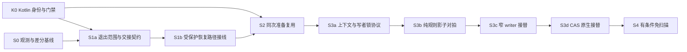

# 启动链路压缩实施方案与二次代码核验

> 用户批准：2026-11-13，原话“批准，然后整理成方案提交到主会话，进一步核实代码”。已批准[首轮评估](startup-kotlin-modularization-assessment.md)的方向，并要求本方案交付；本次仍为设计与核验，不把批准表述为生产功能已实现。
> 工作树基线 `c2e7aec1`，首轮调查提交 `a1b4fbda`；二次核对主线 `d0bc1b0b1e5404539c24da7b8becc3484b5f5f08`。本文所涉启动、停止、运行工具、插件、输入契约代码与所选测试在该区间未变化；区间内另有 Rust PlanView 与版本/文档变化，不包含在本方案修改范围。
> 状态：供主会话排期的实施方案。建议先 K0/S0，再 S1a/S1b；S3 的写锁与 S4 的快照条件未完成前，不启用相应优化。本方案补充并收窄首轮建议，发生差异时以本次核实后的前置条件为准。

## 1. 本次进一步核实出的四个前置条件

### F1：Kotlin 编译已接入，但运行时身份与架构门禁尚未完整覆盖 Kotlin

证据：

- [runtime_input_contract.py:100](../tools/runtime_input_contract.py#L100) 对 `launcherTrees` 下源码只枚举 `.java`；显式 `launcherSources` 没有限制扩展名。
- [app/build.gradle:491](../app/build.gradle#L491) 的运行时 descriptor 任务也只把 Java 树中的 `**/*.java` 纳入 inputs。
- [test-core-boundaries.py:54](../tools/test-core-boundaries.py#L54) 等多处只扫描 Java，且部分规则按 Java 源码形态匹配。仅加 `.kt` 后缀仍不够，需要等价 Kotlin 语法/导入/可见性规则。
- [format-kotlin-tree.py:39](../tools/format-kotlin-tree.py#L39) 已覆盖 Kotlin 格式；格式通过不能代替以上两种门禁。

用现成[输入契约测试夹具](../tools/test-runtime-input-contract.py#L14)和实际 `build_descriptor()` 做隔离验证，生产树未改：

```json
{"runtimeIdChangedOnKotlinAdd":false,"runtimeIdChangedOnKotlinEdit":false,"runtimeIdChangedWithExplicitSource":true,"isolatedFixture":true}
```

含义：直接在受管 runtime 树中新增 Kotlin 守护代码，会存在“可编译，但文件变化未自动进入运行时身份”的缺口。它是**后续 Kotlin 生产接线的 P0 前置条件**，不据此宣称当前 Java 启动流程已经失效。

**K0 必须同时做**：Python 输入枚举、Gradle inputs、边界扫描的 Kotlin 等价覆盖，以及新增/改动/删除 Kotlin 文件会改变受管身份的负控。若首批只使用 `main/java` 下的 Kotlin，应明确只承诺该源根；若新增 `main/kotlin`，两个源根的映射和重名键处理必须同批落地。临时显式列入 `launcherSources` 可以防漏，但不能代替最终覆盖门禁。

### F2：现有 STOPPED 结果不是完整 StopProof

[WebStopCoordinator:84](../app/src/main/java/com/deepseekharness/app/core/WebStopCoordinator.java#L84) 收集 guest/launcher 错误后，只要最后 `confirm()` 为 true 就返回 `STOPPED`，原错误列表不再附在结果中；[现有测试:30](../app/src/test/java/com/deepseekharness/app/core/WebStopCoordinatorTest.java#L30) 明确允许真实确认消解此前权限错误。

但 [WebProcessManager.confirmStopped:1218](../app/src/main/java/com/deepseekharness/app/runtime/WebProcessManager.java#L1218) 只核 tracked launcher、PID 与 owned Web，不重新遍历 [stopAll:1333](../app/src/main/java/com/deepseekharness/app/runtime/WebProcessManager.java#L1333) 的 trial 目录/marker 等全部范围。因此不能从通用 `STOPPED` 反推“每个拟议证明字段都已验证”，更不能拿它跳过下一次 trial 范围检查。

这不要求把既有“错误后核实退出”一律改成失败。新证明必须按**同一范围的最终证据**消解旧错误：guest 已退出可以消解该 guest 的信号错误；不能用“当前没看见 Web”消解未核验的 trial 目录或旧记录身份。

现有 confirmStopped 还会写停止哨兵、退休记录，不能称为完全只读；实现应区分“无信号核验”与“无副作用”。[停止 worker:1846](../app/src/main/java/com/deepseekharness/app/core/WebLifecycleController.java#L1846) 在发布共享结果后仍释放桥、调度备份、停止 LAN，这些同步收尾可能失败。新 completion 要在这些原本可令本次 stop 失败的步骤收口后冻结；被核验对象身份须在 [confirm/prune](../app/src/main/java/com/deepseekharness/app/core/WebProcessSession.java#L97) 清理前捕获，不能事后从已清共享状态补成成功。

### F3：共享租约和线程快照不足以构成可写文件的不变性

[EnvironmentTaskGate:19](../app/src/main/java/com/deepseekharness/app/util/EnvironmentTaskGate.java#L19) 区分独占和共享租约，启动获取共享租约；多个正常使用者可以并存。[Lease.run:146](../app/src/main/java/com/deepseekharness/app/util/EnvironmentTaskGate.java#L146) 与 [RuntimeHostPorts:115](../app/src/main/java/com/deepseekharness/app/runtime/RuntimeHostPorts.java#L115) 都使用线程上下文。

因此 S2 首版保留现有串行 IO 线程和范围，不同时切换协程调度。共享租约只阻止合作方进入独占维护，不阻止终端内的文件修改或任意同 UID 写入；不能据此全局缓存 ready=true。

另一个可直接复用的现状是 [RuntimeApkAssets:129](../app/src/main/java/com/deepseekharness/app/runtime/RuntimeApkAssets.java#L129) 已缓存可信 APK 字节，[RuntimeLauncher:25](../app/src/main/java/com/deepseekharness/app/runtime/RuntimeLauncher.java#L25) 已让同次 builder 的绑定和环境共用一次 preload 准备。S2 只计算剩余重复工作，不重复计功。

### F4：三个 guest 操作不能直接拼接成一个批次

[operation_lock](../app/src/main/assets/register-builtin-plugins.py#L455) 的 data `flock` 与 [profile_writer_lock](../app/src/main/assets/register-builtin-plugins.py#L418) 的 PID 文件锁，按 data → profile 获取；它们不是可随意嵌套的重入锁。[旧审阅迁移:82](../app/src/main/assets/plugin-lifecycle.py#L82) 默认再次获取 operation_lock。

还有两个独立边界：CAS 与 legacy 都输出 `PLUGIN_RESULT`，而 [requireCasCopyReceipt:416](../app/src/main/java/com/deepseekharness/app/core/StartupPipeline.java#L416) 要求唯一 CAS 回执；当前 [prepare:313](../app/src/main/java/com/deepseekharness/app/core/StartupPipeline.java#L313) 在阶段之间检查 `actions.current()`，单个 child 不会自动继承这道原生代次门。

**修正首轮过渡建议**：3→1 不列入首批默认实现。只有专门设计“不重入锁、逐阶段回执、取消/代次传递、原预算与退出闭环”的协议后才可评审，不能用 shell 串联、一个总退出码或外层锁包住三个 main 函数来替代。优先直接按职责进行 S3 原生迁移，保留原有 guest 写执行作为尚未迁完的执行端。

## 2. 实施顺序与最小交付



| 切片 | 最小实现与文件范围 | 验收出口 | 排除内容 |
|---|---|---|---|
| K0 | [输入枚举](../tools/runtime_input_contract.py)、[Gradle inputs](../app/build.gradle#L491)、[源码门禁](../tools/test-core-boundaries.py)、[输入契约测试](../tools/test-runtime-input-contract.py)；必要时同步[受管清单](../app/src/main/assets/managed-runtime-inputs.json) | Kotlin 增/改/删均触发对应身份变化；Java/Kotlin 越层 import、多个 owner、错误可见性负控被拒；Python 与 Gradle 所选输入一致 | 不借机扩大整个 APK 都触发维护的范围；不改启动行为 |
| S0 | [StartupPreparationTiming](../app/src/main/java/com/deepseekharness/app/core/StartupPreparationTiming.java)、[RuntimeCommandTiming](../app/src/main/java/com/deepseekharness/app/runtime/RuntimeCommandTiming.java)、已有启动诊断出口 | 分开统计 stop 事务、发现扫描、helper 调用、准备命中/失效、Node 到鉴权；计时不赋予执行权限 | 不延长等待、不新增轮询、不记录原始凭据/用户路径 |
| S1a | [WebStopCoordinator](../app/src/main/java/com/deepseekharness/app/core/WebStopCoordinator.java)、[WebProcessSession](../app/src/main/java/com/deepseekharness/app/core/WebProcessSession.java)、[WebProcessManager](../app/src/main/java/com/deepseekharness/app/runtime/WebProcessManager.java) 的事实投影接口；新 Kotlin 交接判据 | 对相同事实差分；明确范围完整与通用 STOPPED 的区别；尚不跳过停止链 | 不修改信号算法/强停策略，不持久化新启动许可 |
| S1b | [WebLifecycleController](../app/src/main/java/com/deepseekharness/app/core/WebLifecycleController.java)、[HarnessSessionState](../app/src/main/java/com/deepseekharness/app/core/HarnessSessionState.java)、[StartupEnvironmentActions](../app/src/main/java/com/deepseekharness/app/core/StartupEnvironmentActions.java)、[StartupPipeline](../app/src/main/java/com/deepseekharness/app/core/StartupPipeline.java) | 仅受保护、未插入插件变更的 recover→start 可以消费本次完整证明；重复 Stop/未知/旧票据仍拒绝；一次恢复只提交一次停止事务 | 首批不扩展普通冷启动、watchdog、无票据恢复、强停、维护/应急或停用故障插件路径 |
| S2 | [RuntimeInstallationState](../app/src/main/java/com/deepseekharness/app/runtime/RuntimeInstallationState.java)、[ManagedRuntimeAssets](../app/src/main/java/com/deepseekharness/app/runtime/ManagedRuntimeAssets.java)、[RuntimeTools](../app/src/main/java/com/deepseekharness/app/runtime/RuntimeTools.java)、[RuntimeExecution](../app/src/main/java/com/deepseekharness/app/runtime/RuntimeExecution.java) | 固定同次输入避免重复解析；变化/排队/修复后失效；ready/latest/pending 不混同；最终执行门仍存在 | 不将所有工具准备结果跨启动缓存，不移动 guest 路径语义 |
| S3a | [PluginManagementEngine](../app/src/main/java/com/deepseekharness/app/plugins/PluginManagementEngine.java)、[PluginRepository](../app/src/main/java/com/deepseekharness/app/core/PluginRepository.java)、[GuestPluginScripts](../app/src/main/java/com/deepseekharness/app/runtime/GuestPluginScripts.java) + 跨语言锁适配 | 明确所有合作写者、锁协议、操作身份、未知结果与版本失效；真实 Kotlin↔Python↔Node 竞争夹具通过 | 未证明锁互操作前不让 Kotlin 写 profile |
| S3b | [旧标记规则](../app/src/main/assets/plugin-lifecycle.py#L82) 与[内置注册](../app/src/main/assets/register-builtin-plugins.py#L1155)的纯读取/计划模块 | 隔离夹具上比较 marker/禁用/安全模式/别名/模板/隔离计划与原结果，生产写入仍走 guest | 不把纯规则对拍扩大为已替代真实依赖图或写入 |
| S3c | 在锁协议通过后选择 normal-web 的窄注册 writer，随后接替旧标记迁移；统一插件准备协作者选择执行端，[StartupPipeline](../app/src/main/java/com/deepseekharness/app/core/StartupPipeline.java) 与 [PluginRepository](../app/src/main/java/com/deepseekharness/app/core/PluginRepository.java) 分别接入并保留各自准入 | 精确包/数据源/操作身份，部分失败和激活账本保持；逐段减少 helper | 不恢复旧人工审阅；不双跑写入；未覆盖 terminal/Web 写者仍使缓存失效 |
| S3d | [CAS 入口](../app/src/main/assets/materialize-cas-links.py)、[CAS 扫描与事务](../app/src/main/assets/plugin-transactions.py#L478) 对等原生化 | 开放目录仍扫描；FD/NOFOLLOW/祖先变更/候选发布/SHA512 等边界保持；三类工作完全迁完后 helper 目标 3→0 | 不把减少解释器数量写成已免除文件 IO |
| S4 | 单独冻结受管插件快照、发布与外部写入失效协议，再接 S2/S3 | 只对满足前提的快照省去整树扫描；开放/不明来源回到核验路径 | 不用 dirty 位、mtime、version 或只读 mode 冒充不可变证明 |

这些是职责切片，不要求一次新增九个 Gradle 工程。遵循 [ADR-0004](adr/0004-kotlin-rust-direction.md#L20) 按模块迁移，Java facade/平台适配器可以作为临时接缝；同一生产操作不得双跑 Java/Kotlin 或 Python/Kotlin 写逻辑。Rust 不接管进程身份、信号、PTY 或插件事务执行。

## 3. S1 可直接交给实现会话的契约

### 3.1 首批入口

首批只选择 `recoverWeb(..., protection)` 中 **protection 非空、disabledPlugin 为 null** 的恢复路径。原因：原恢复能力可以跨自己的 internal Stop；停用故障插件会在 stop 与 start 之间进入另一个写操作，必须使交接证明失效或额外核验，不适合第一批。

[requestStart:941](../app/src/main/java/com/deepseekharness/app/core/WebLifecycleController.java#L941) 的准入、前台保护、共享环境租约、generation 与排队后 current 检查保留。其余启动入口保持现有路径，收集影子判定即可。

### 3.2 三个对象必须分开

| 对象（拟议类型） | 绑定内容 | 生存期与权限 |
|---|---|---|
| `StopOperationId` | 本次 stop 操作号、stop intent generation、被停实例 generation/instance、取消修订号 | 用于收集本次结果，不能用最后一次全局状态替代 |
| `StopCompletion` | 操作号、root/boot、guest/owned launcher/recovered launcher、trial 目录与残留范围各自的最终事实、观察时点/输入版本 | 不可变的历史事实；只在同宿主进程内交接，不能直接启动或发信号 |
| `RestartAdmission` | 原 `WebStartProtection.Ticket` 身份、当前 intent/cancel revision、未消费状态、关联 stop 操作号、来源环境身份 | 一次性恢复能力；每次显式 Stop 均撤销，消费前和派发前都核对 |

现有 [WebStartProtection](../app/src/main/java/com/deepseekharness/app/util/WebStartProtection.java#L182) 已有 internal Stop / resume / cancelAll / worker claim，优先扩展或组合这些事实，避免并排造第二套票据系统。

**禁止推导**：`Future.get()` 返回不代表停止成功；`lastStopResult` 是可被新意图替换的共享展示状态；`STOPPED` 不代表完整 trial scope；空进程 map 不代表没有 detached guest；signal SENT 不代表进程已退出；旧成功不覆盖新的未知停止。

### 3.3 生产接线顺序

1. stop 请求进入队列前，在现有 lifecycle 锁内分配本次操作身份，owner 绑定共享 `HarnessSessionState`；显式 Stop 先按现有规则撤销恢复能力，包括不推进 generation 的重复 Stop。分别保存被停实例 `gR` 与本次 internal Stop 的 `gS`。
2. 执行既有 guest/launcher 停止与范围核验，在退休对象前收集各范围事实。完成原有同步收尾后，只有每个必需范围有最终可核验结论才创建可交接 completion；未解决的 trial/记录错误不能因另一个范围的确认而被抹掉。
3. Future 返回本次 typed completion，或使用 operationId 查找不可变结果；禁止从 Future 成功后再猜当前全局 lastStopResult 属于哪次操作。
4. continuation 核 owner/operationId、当前 `gS`、cancel revision、精确 waitingStop 票据及服务保护，再调用原 `resumeAfterStop`。保留 requestStart 慢预检前后两次门禁；`beginStart(ticket)` 将 `gS` 推进成 `gN` 后，交接许可显式绑定 `gN`。
5. worker 先走既有 `claimQueuedStart(ticket,gN)`，再做当前 root/boot/记录及新鲜 trial/残留范围核对，前后均核 `gN` 和取消修订。已 admitted 的 ticket 不再 pending，不能再调用 `canAdmit()` 判它有效；不得要求新代次仍等于旧 `gS`。
6. 成功消费交接许可的 pipeline 只略过重复 guest/launcher 停止及对应等待；保留 stopLan、必要旧桥/对象释放、环境门禁、unlock sentinel 和存档退休。不能整段删除 `releasePrior`，它还负责资源释放。
7. **未选择快路径**且仅缺少可复用证明时，继续原链；**已进入交接**后出现 UNKNOWN、对象变化或许可失效时，阻断本次续启并保留诊断，不把它当 cache miss 重放 stop/launch。应用内部 spawn epoch 不是全部创建源的证明。

S1a 应先记录“本次原链最终事实 / 新判据是否允许交接”的差分，S1b 再在窄路径启用。新旧双跑只能用于纯判定，不能为了差分发两次停止信号。

### 3.4 S1 必须补的测试

现有 [WebLifecycleStartProtectionTest](../app/src/test/java/com/deepseekharness/app/core/WebLifecycleStartProtectionTest.java)、[WebStartProtectionTest](../app/src/test/java/com/deepseekharness/app/util/WebStartProtectionTest.java)、[RecoveredWebStopBarrierTest](../app/src/test/java/com/deepseekharness/app/core/RecoveredWebStopBarrierTest.java)、[WebStopCoordinatorTest](../app/src/test/java/com/deepseekharness/app/core/WebStopCoordinatorTest.java) 作为原行为基线；新增用例必须覆盖：

- Future 正常返回，但 guest/trial/launcher 中任一范围不明 → 不签发交接证明。
- 早期信号失败，随后同一 guest 真实退出 → 可消解该范围错误；另一未核 trial 错误仍不能消解。
- stop A 完成后 stop B 改写共享状态 → A 的 completion 不能被错配到 B。
- 相同 generation 的第二次显式 Stop → 已排队 restart 失效。
- 交接后出现新 guest、根/记录/trial 变化、旧服务销毁、前台保护丢失 → 不派发旧启动。
- disabledPlugin 非空、无保护票据、冷启动、自动 watchdog → 首批保持原链。
- guest 已退出但 recovered launcher 未退出 → 保留屏障与前台保护。
- 窄路径成功时停止事务数量从重复发起降为一次；身份核验、最新残留核对和桥租约释放仍执行。

现有[恢复夹具:79](../app/src/test/java/com/deepseekharness/app/core/WebLifecycleStartProtectionTest.java#L79) 会手写 `lastStopResult` 并完成 Void Future，不能拿这个夹具的绿灯证明新的操作绑定正确。必须补真实 coordinator + 注入 IO ports 的集成测试，验证 `gR/gS/gN`、owner、操作号和最终收尾结果。若触及 cancel revision，还须跑 [PluginRepositoryQueryLifecycleTest](../app/src/test/java/com/deepseekharness/app/core/PluginRepositoryQueryLifecycleTest.java) 的批量安装续启/重复 Stop 哨兵，不改变该计数的既有含义。

## 4. S2 准备复用的实施边界

按事实来源分层，不建立一个覆盖全部内容的缓存：

| 来源 | 允许复用范围 | 失效/重核条件 |
|---|---|---|
| APK 内 descriptor/固定资源 | 已验证 APK 身份下的解析结果 | APK/split/AssetManager 身份改变或不可验证 |
| 当前一次 settings 快照 | 现有 RuntimeHostPorts invocation | scope 结束；不跨线程借用 |
| 已装 root/Bash/loader/运行入口 | 同次观察结果及明确未变化的输入 | 文件/根身份变化、外部写、排队后输入不再成立；实际执行门仍保留 |
| 工具准备戳 | 当前既有 fixed-file stamp 契约 | 与 [RuntimeAssetStamp](../app/src/main/java/com/deepseekharness/app/runtime/RuntimeAssetStamp.java) 相同的字段复核，未知就失效 |
| pending 事务/插件意图 | writer 与读取身份绑定的小快照 | 维护/恢复/新操作、外部写者、观察缺口；UI 缓存永不授权执行 |

[RuntimeExecution.collect:302](../app/src/main/java/com/deepseekharness/app/runtime/RuntimeExecution.java#L302) 的固定 proot helper 走 install 路径，不能把每个 helper 都算作完整 `prepareTools()`。S0 必须在真实入口计数后再决定哪些准备可合并。节点依赖安装、Python/pnpm 首次准备、preload 校验属于不同成本。

首版只改数据流与范围复用，不同时改线程模型、DNS 策略、端口策略、自动回退或快照持久格式。接线后用同次配置改变、APK 身份改变、同路径文件替换与末次执行核验的负控证明复用范围。

## 5. S3 写者矩阵与接替顺序

| 写者/入口 | 当前事实 | 原生接替要求 |
|---|---|---|
| 原生插件 UI/导入 | [PluginRepository](../app/src/main/java/com/deepseekharness/app/core/PluginRepository.java) 调度 guest 与维护事务 | 操作号、取消、源身份与回执逐项保持；结果未知不补发 |
| 普通启动的注册/旧迁移/CAS | [StartupPipeline](../app/src/main/java/com/deepseekharness/app/core/StartupPipeline.java#L294) 与脚本执行端 | 阶段次序、锁序、回执、阶段间代次检查仍有唯一负责者 |
| 终端 CLI | [dsha-plugin.sh](../app/src/main/assets/dsha-plugin.sh) 直接调用 guest 管理器 | 仍是独立外部写者，不能假设已被 Kotlin writer 收编；必须使宿主缓存失效 |
| Web Node PluginManager | [注册脚本的共锁契约](../app/src/main/assets/register-builtin-plugins.py#L418) 与现有[真实 Host 夹具](../tools/test-native-plugin-manager.mjs) | 保持 PID 文件锁互操作与写后读取；磁盘提交不冒领当前 fiber 的 loaded 状态 |
| 备份恢复/修复/用户手改 | 可替换整个数据树或改变原始文件 | 数据/恢复代次与根身份失效；任意同 UID 写不受 Kotlin Mutex 约束 |

**先锁协议，后写迁移**：Kotlin `Mutex` 只管合作方内存，Java `FileChannel.lock()` 也不能未经验证就宣称等价于 Python `flock`。选定可与现有 Linux data lock 和 Node PID lock 互操作的真实后端，验证 rootfs 宿主/guest 指向同一锁 inode、锁顺序、进程死亡、超时、取消、旧锁接管。后端未闭环时，只迁纯读取/计划判定，实际写入仍由既有 guest 事务执行。

当前并不存在“所有写者都取同样两把锁”的事实：Node 主要使用 profile 文件锁，并按[固定补丁](../app/src/main/assets/config-editor-lock-order-patch.json)保持 profile lock → HMR；不能从持锁 Node 回调同步进入“停 Web 再执行”的宿主维护路径而等待自己退出。现代恢复依赖宿主维护屏障，也不等同于 guest profile 锁。映射同样必须核实：[UserDataLayout:73](../app/src/main/java/com/deepseekharness/app/backup/UserDataLayout.java#L73) 把选定数据映射到 guest `/root/.dsh`，受管脚本另逐文件覆盖；不能从宿主 dataRoot 的父目录随意拼出 data lock 路径。

S3a 的 `InvocationContext` 至少冻结 guest DSH_HOME/profile、宿主 root/data/绑定、startup/operation/cancel、工具摘要和阶段预算。Python 模块在 import 时缓存路径与单例，不能靠中途修改环境变量复用到另一 home。CAS、register、legacy 的预算/超时收尾不同；新的批次协议若无法保持这些边界，就继续保留三个执行端。

迁移粒度：

1. **S3a**：冻结来源/操作/锁/取消契约；与主线 `a9212f89` 已合入的[插件管理对齐方案](https://github.com/SunsetRNE/DSHA-Sunset-mod/blob/a9212f8953b32d3bfe45a2586ffca396368e0c2e/docs/design/plugin-management-alignment-20261113/README.md)共用 bundle/entry/意图/运行态模型，不另造一份 loaded 布尔值。
2. **S3b**：只读规则影子对拍。先核旧审阅候选与内置注册计划，保留真实 Python 依赖图读取作为对照；不发生产写入、不冒充 helper 已删除。
3. **S3c**：锁互操作通过后，先选择 normal-web 受管注册的窄 writer，保留签名实体/profile 差分、禁用优先、APK 启用意图、共享依赖链接、模板、quarantine 与 PARTIAL 副作用。旧审阅迁移另作子切片：精确标记、link 来源、包身份/依赖、queue_activation 和启用读回全部保留；不是仅删除标记文件。
4. **S3d**：CAS 最后迁移。它有最高的路径/FD/发布前竞争要求；Kotlin 可减少 Python 进程，但不自动减少开放目录扫描。CAS 无候选也可能归档终态 journal，`changed=false` 不是无副作用，见[事务入口:668](../app/src/main/assets/plugin-transactions.py#L668)。

[plugin-review 测试](../tools/test-plugin-review.py)、[startup-recovery 测试](../tools/test-startup-recovery.py)、[CAS 正常/失败夹具](../tools/test-plugin-cas-materialize.py)、[CAS 扫描负控](../tools/test-plugin-cas-scan-review.py)、[插件事务测试](../tools/test-plugin-transactions.py) 为语义对照。新旧实现先在隔离复制的夹具上比较结果、文件布局、journal 与 retained originals；不能在用户正式 profile 上双跑写操作。

## 6. S4 的开工条件

只有同时证明以下条件才讨论“免扫描”：

- 实际加载的是已验证版本快照，输入包含内容摘要而不仅是包版本或目录时间。
- 发布原子性、原件保留、恢复/回滚和未提交事务的处理均已定义。
- 所有合作写者在改动前退出快路径；未合作写者、hardlink 别名、监听空窗/丢事件/覆盖上限有可执行的发现与失效策略。
- 不能保证读取期间的内容不变时，保留扫描/末次核验；同 UID 的只读 mode 不当作隔离。
- Node 的 resolution/import/apply/服务/MCP ready 保留；不以原生证明伪造运行完成。

S4 首期可以只覆盖精确受管内置快照，用户自由编辑的插件继续原核验。是否改变写入布局、是否引入强隔离、发行线与覆盖维护影响需另作明确设计，不从本次方向批准推导成无条件启用。

## 7. 验证回执与尚缺证据

本次核验没有修改生产源码，源码范围在 `c2e7aec1..d0bc1b0b` 的相关差异核对为空。

| 验证 | 本次结果 | 边界 |
|---|---|---|
| 11 类定向 Gradle 请求 | **未执行到测试**；退出 1，停在 `prepareBackupAssets`，工作树缺少离线 `dsh-runtime.bin` | 不记任何 Gradle 测试通过；未拉取大归档或改正式环境来凑验收 |
| 实际纯 Java 源码 + 既有 JUnit 测试 | **4 类 / 48 passed** | JDK17 `javac --release 17` + 缓存 JUnit 4.13.2；无 Android stub、未改测试；不替代 Android/Robolectric/完整 Gradle |
| `python3 tools/test-core-boundaries.py` | **9 passed** | 当前 Java 边界检查通过，同时确认它不覆盖 Kotlin |
| `python3 tools/test-runtime-input-contract.py` | 首次 12 个 setUp error（缺临时输出目录）；创建空 `app/build` 后 **11 passed / 1 error** | 剩余错误仍是生产资产 `dsh-runtime.bin` 缺失；保留失败记录，不记整套通过 |
| 独立 Kotlin 输入负控 | **已复现遗漏** | 临时夹具上实际 descriptor：新增/修改 Kotlin 均不改 runtimeId，显式列入 source 后才改变；这是缺口证明，不是功能通过 |

48 项手工 JUnit 精确集合：

- [WebLifecycleTest](../app/src/test/java/com/deepseekharness/app/util/WebLifecycleTest.java)
- [WebStartProtectionTest](../app/src/test/java/com/deepseekharness/app/util/WebStartProtectionTest.java)
- [RuntimePreparedProofTest](../app/src/test/java/com/deepseekharness/app/util/RuntimePreparedProofTest.java)
- [WebRuntimeFallbackTest](../app/src/test/java/com/deepseekharness/app/util/WebRuntimeFallbackTest.java)

调用现有源码直接编译，仅这四个生产类及对应测试参与手工运行。不能把“48 passed”扩写成 stop IO、trial 扫描、Kotlin 接线或真机已通过。首轮 42 项 Python 回归为[调查报告](startup-kotlin-modularization-assessment.md#L237)的历史验证，本次没有重复运行它们，也不合并成一次全绿。

实施阶段仍需：完整固定输入下的目标 Gradle/Robolectric、Kotlin 编译与格式、受管输入/descriptor、跨语言锁竞争、真实测试包覆盖与停止/恢复/热启动计数。必要目标集见首轮报告及各切片，不以工具未执行到测试作为放宽标准的理由。

两份交付文档的目标链接检查：132 ok / 0 warning / 0 error；暂存差异空白检查通过。S1 与 S3 分别由两位只读协作者复核，普通启动/插件管理分别接入统一协作者的表述已按复核修正。源码、定向结果与未完成项分开记录，不给本方案填写虚构的性能收益。

## 8. 交付主会话的建议

1. 接收首轮调查与本次实施方案，记录用户已经批准方向与交付；文档合入按主会话的授权和队列规则处理。
2. 将 **K0 + S0** 作为首个小批次；先补齐 Kotlin 覆盖，冻结真实计数和差分夹具。K0 不夹带启动行为变化。
3. 排 **S1a → S1b**，只开受保护且未插入插件写入的恢复路径；验收后才扩大。完整确认的范围和当前意图必须分开。
4. S2 延续现有 owner/线程/租约；S3a 先证明锁互操作，再迁旧标记/注册，CAS 最后。3→1 批次暂不列默认优化。
5. S4 保持条件性设计，不以“用户批准极致压缩”跳过写入与快照前置条件。各切片具体开工会话、发行线、版本及真机安排由主会话按既定 ADR 与当前队列分配。

本工作会话仅提交文档与核验结论，不推送、合并、发布、安装或操作手机；待实现条目不作为 build363 已包含的功能。
