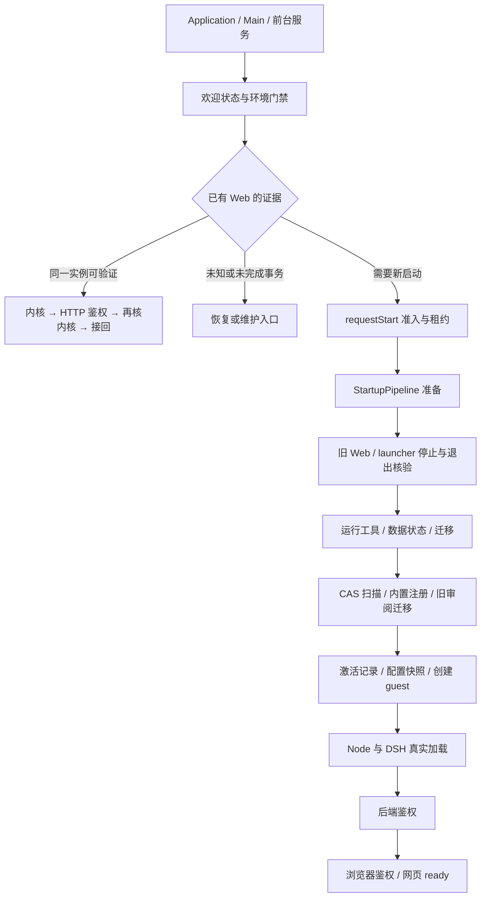
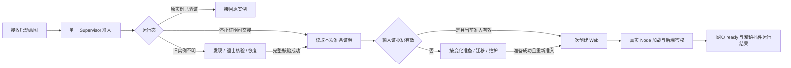

# 启动链路压缩与 Kotlin 模块接替评估

> 日期：2026-11-13。调查基线：`c2e7aec1f27f585e1276b0d938d9b10313cba616`；对应 build362 之后的主线，已发布 build362 为 `75924add`，二者不混用。调查中主线推进至 `0abfaea5`，已核对本文涉及的 `core/`、`runtime/` 及两个插件管理/注册脚本没有差异。
> 性质：源码调查、方案建议及现有隔离测试回归；没有改变生产行为，没有运行手机启动测速、停止正式 Web 或安装 APK。下文新模块名、证明对象和目标调用次数均为设计，未实现。
> 后续：用户于 2026-11-13 批准方向，并要求整理方案交主会话、进一步核实代码。[实施方案与二次核验](startup-kotlin-implementation-plan.md) 已补 K0（Kotlin 输入/门禁覆盖）、完整停止范围与意图交接、跨运行时锁协议；三个 guest 操作直接合批降为可选实验。本文保留首轮调查事实，具体开工前置条件以实施方案为准。

## 1. 评估结论

**有明显的链路压缩空间。推荐把重复编排收敛到 Kotlin 模块的单一状态所有者，把全量准备移到内容变更时执行；保留执行边界的身份、事务和实际加载核验。**

用户提出的两个方向分别成立，但前提不同：

- **削减旧有停止**：优先处理“已经完成停止，紧接着启动又走一次停止链”的情况，由同一生命周期模块交接完整停止证明。普通启动也应区分“本进程已证明为空”“接回同一实例”“明确重启”“旧实例不明”，分别选择路径。
- **削减旧插件检查**：Kotlin 可以接管安装状态、注册意图、旧格式迁移、候选/原件事务和准备证明。Node 的模块解析、真实 import、Cordis 服务依赖、版本兼容及 MCP 初始化仍由实际运行时裁决，不能用原生“检查通过”代替。
- **极致路径的限制**：当前终端、Web 插件管理器及同 UID 代码可以直接改文件。没有收到文件事件，不等于内容没有变化。当前尚不具备“跨启动只检查一个 dirty 位即可跳过所有扫描”的前提。
- **稳定性的来源**：状态所有权唯一、异步结果绑定代次、停止与启动交接证明、事务提交后发布，而不是 Java 换成 Kotlin 本身。Kotlin 模块也不能保证 Android 不回收宿主进程。

| 方案 | 可压缩内容 | 前提 / 代价 | 建议 |
|---|---|---|---|
| 同启动范围收敛 | 重复停止编排、同一批次重复准备、重复解析描述符 | 复用限定到同一租约与输入版本，执行前仍核代次和事实 | 首先实施 |
| 变更时准备、正常启动消费证明 | 内置注册、旧审阅迁移、部分 CAS/依赖准备退出普通启动 | 必须记录全部相关输入，处理外部写入、观察缺口、崩溃与恢复 | 分模块推进 |
| 封闭受管快照路径 | 已封闭插件快照上的普通启动可不运行 CAS/注册/旧迁移 Python helper | 改变受管部署与写入方式；开放修复区继续走核验路径；同 UID 仍非安全沙箱 | 后续独立切片 |
| 全部插件检查删除、只看历史成功 | 表面链路最短 | 无法发现新增坏链接、未提交写入、版本不兼容与真实加载失败 | 不采用 |

## 2. 当前代码实际是什么

历史入口文档中关于“大控制器”的规模是旧快照。当前 [HarnessController](../app/src/main/java/com/deepseekharness/app/core/HarnessController.java#L11) 已是约 300 行门面，[ProotBootstrap](../app/src/main/java/com/deepseekharness/app/runtime/ProotBootstrap.java#L19) 也已分出执行、安装状态、插件脚本等协作者。因此不应另建一个 Kotlin 巨型控制器，把已拆开的职责重新聚合。

[settings.gradle](../settings.gradle#L26) 已固定 Kotlin 2.2.10，当前仍只有 `:app` 编译模块。[ADR-0004](adr/0004-kotlin-rust-direction.md#L20) 要求先定职责、再拆编译边界、按模块迁移；21 个状态模块、9 个目标编译模块是不同口径。本方案对接其中 M04/M09/M10/M11/M13/M20，不额外发明一套模块宿主。A4/A5/A6 的对应关系见[迭代路径](design/kotlin-rust-rearchitecture-20261112/iteration-roadmap-20261112.md#L113)。业务实现优先放到该 ADR 规定的 Rebirth 实验路径；是否回移 Mod 线另定，不因本次评估自动扩大实施范围。

### 2.1 三条入口应分别核算



这张图展示主要分支，不表示每次 Main 打开都会创建 Web，也不把维护试运行算作一次普通启动。

1. **接回仍存活实例**：已有 [WebSessionRecovery](../app/src/main/java/com/deepseekharness/app/core/WebSessionRecovery.java) 与 [WebSessionRecheck](../app/src/main/java/com/deepseekharness/app/core/WebSessionRecheck.java)，不是一律先杀再拉。不能把现有接回路径当作本方案新增提速。
2. **新建 Web / 重启**：实际热路径见下面逐项表。
3. **首装、更新或中断恢复**：有完整安装、数据事务、隔离试运行和退出屏障；这些成本不能通过删普通启动检查直接消除，也不能从正常热启动样本中推导。

### 2.2 新启动的实际串行链

| 阶段 | 生产代码 | 实际工作与边界 |
|---|---|---|
| Main 门禁 | [MainActivity:363](../app/src/main/java/com/deepseekharness/app/ui/MainActivity.java#L363) | 检查维护、未关闭 trial、环境可用与候选更新；票据失效不能导航 |
| 启动准入 | [WebLifecycleController:941](../app/src/main/java/com/deepseekharness/app/core/WebLifecycleController.java#L941) | 复核恢复状态、维护忙/残留、就绪、配置修复；获取共享环境租约，检查代次后入队 |
| 准备前重查 | [WebLifecycleController:1133](../app/src/main/java/com/deepseekharness/app/core/WebLifecycleController.java#L1133) | 在实际 worker 中再次检查代次与 pending，载入停止证据；准入前检查不能替代排队后检查 |
| 旧进程退出 | [StartupPipeline:215](../app/src/main/java/com/deepseekharness/app/core/StartupPipeline.java#L215) | 无条件调用 stopLan、stopWeb、releasePrior；有未确认事实时在同一窗口等退出，不是每次固定等待整个预算 |
| 工具与环境 | [StartupPipeline:237](../app/src/main/java/com/deepseekharness/app/core/StartupPipeline.java#L237) | 准备运行工具，再查 ready；失败解压分支仍存在，但不能当作可越过前置维护门禁的捷径 |
| 数据与旧迁移 | [StartupPipeline:259](../app/src/main/java/com/deepseekharness/app/core/StartupPipeline.java#L259) | recoverData、cleanup、RC1 prepare；已有复用，不是每次重迁全部会话 |
| 插件准备 | [StartupPipeline:294](../app/src/main/java/com/deepseekharness/app/core/StartupPipeline.java#L294) | 非安全模式串行 CAS → helpers prepare → register → migrate-review-markers |
| 激活与快照 | [StartupPipeline:346](../app/src/main/java/com/deepseekharness/app/core/StartupPipeline.java#L346) | 有 queued/attempted 激活记录才启动 begin-load；随后解除停止标记并建立本次配置快照 |
| 创建真实进程 | [WebLifecycleController:1155](../app/src/main/java/com/deepseekharness/app/core/WebLifecycleController.java#L1155) | 原实例已确认退休才清保存记录；选择实际引擎/端口，创建独立 registration 与 guest |
| 实际加载和 ready | [startup-observer.cjs:137](../app/src/main/assets/startup-observer.cjs#L137)、[StartupDiagnostics](../app/src/main/java/com/deepseekharness/app/core/StartupDiagnostics.java) | 元数据观察、真实 loader 事件、后端与页面就绪分别记录；只收到鉴权地址不能宣称所有插件正常 |

正常非安全启动明确会请求 CAS、register、legacy-review **三个 guest 脚本操作**；RC1 cache miss 或激活记录待处理时再增加相应操作。这里是调用结构，不是固定进程总数、启动秒数或每轮全量 IO 数。

## 3. 已确认的压缩候选

### 3.1 停止链：优先消除重复事务，不取消真实退出证明

[recoverWeb](../app/src/main/java/com/deepseekharness/app/core/WebLifecycleController.java#L1999) 已经 enqueueStop 并等待 Future，再调用 requestStart；之后 [StartupPipeline](../app/src/main/java/com/deepseekharness/app/core/StartupPipeline.java#L215) 又进入前置停止链。这是最清晰的去重接缝。

单次链内也有重复观察：[stopAll](../app/src/main/java/com/deepseekharness/app/runtime/WebProcessManager.java#L1329) 处理主 Web、trial 和残留扫描；[releasePrior](../app/src/main/java/com/deepseekharness/app/core/StartupEnvironmentActions.java#L49) 再处理 launcher 并调用 confirmStopped；[confirmStopped](../app/src/main/java/com/deepseekharness/app/runtime/WebProcessManager.java#L1218) 又查 PID/残留。它们覆盖 guest 与 launcher 的不同事实，不能直接删掉一个调用就认定等价。

**接替方案**：同一 Kotlin 生命周期 owner 串行提交 stop，只有 guest、owned/recovered launcher、trial 与残留的最终完整 confirm 成功后才签发结构化 `StopProof`。底层 `WebProcessManager.stopResult` 的 `STOPPED/WEB_GUESTS_STOPPED` 不能单独当完整证明；[WebStopCoordinator:84](../app/src/main/java/com/deepseekharness/app/core/WebStopCoordinator.java#L84) 的现有最终结果也会折叠早期错误，不能反推完整 trial 范围已经核验，详见[二次核验 F2](startup-kotlin-implementation-plan.md#L28)。证明包含运行根与 boot 身份、被停止实例的 generation/instance、guest 与 launcher 各自出生身份及退出状态、trial/残留核对结果、观察时点与 spawn 修订号。证明缺字段或未知时不走快速路径。

`StopProof` 描述历史退出事实，启动许可另由一次性的恢复/启动票据承载：绑定本次 stop intent 的 generation、ticket、cancel revision，restart 消费前再核当前意图。新的显式 Stop 必须撤销排队 restart 与证明交接许可，**即使重复 Stop 没增加 generation**；旧成功不能覆盖新的停止失败。该约束保持 [enqueueStop:1749](../app/src/main/java/com/deepseekharness/app/core/WebLifecycleController.java#L1749) 的现有行为，不把历史事实兼作启动授权。

- 同一次已封闭的停止事务可以合并重复等待与全量发现；发信号前的双次身份核验保留。
- 未证明可封闭所有进程创建源时，交接前保留一次新鲜的残留/身份核对；不能把进程注册表当作完整系统真相。
- Kotlin owner 自己的 spawn epoch 不能涵盖终端或同 UID 自写代码创建的 Web。冷启动、宿主重建、旧记录、观察不明仍走发现与恢复路径。
- 不能把 `isWebRunning == false`、PID 文件缺失、HTTP 不通或 launcher 退出解释为完整停止；不能缓存“以后永远没有旧进程”。

[HarnessService](../app/src/main/java/com/deepseekharness/app/HarnessService.java#L19) 已是原生 Java 前台服务与健康观察器，生命周期由应用 owner 持有。模块化应让它继续只持通知、系统电源租约与观察入口，重启决定交给生命周期模块；不是再增加一个并行 Kotlin 看门狗。保留旧哨兵/旧进程识别作为兼容适配，只有覆盖旧版本与残留现场的证据完整后才能退休。

### 3.2 准备与环境：复用一次读取，避免把门禁位置删掉

[RuntimeInstallationState:82](../app/src/main/java/com/deepseekharness/app/runtime/RuntimeInstallationState.java#L82) 的 ready 包括用户数据布局、安装标记、Bash/加载器、DSH 入口、descriptor 和健康记录；[ManagedRuntimeAssets:115](../app/src/main/java/com/deepseekharness/app/runtime/ManagedRuntimeAssets.java#L115) 明确普通就绪只读健康回执，不遍历整棵受管树。不能把这段描述成“每次启动全量 hash rootfs”。

Main、requestStart、pipeline、guest helper 和最终 exec 会重复触达这些能力。UI 放行与真实执行之间可发生停止、维护或文件变化，因此应保留两个决策边界，但可让它们读取同一 owner 发布的有版本快照。

**接替方案**：`RuntimeReadinessGate` 按本次 `PreparationSession` 返回拆开的事实：`installed / compatible / latest / health / pending / runnable`。不能折成一个 ready 布尔值：健康兼容前代不代表当前候选已更新；受限 UI 入口也不代表允许执行。

- APK 内不可变 descriptor 的解析可按 APK 身份缓存。
- 已装根、健康回执、待处理事务和配置必须绑定本次输入身份；在租约改变、排队后输入变化、修复/恢复/更新、读取失败时失效。
- 运行中终端与第三方代码不受共享环境租约完全约束；对开放可写文件保留新鲜检查。仅“持有同一租约”不足以无限期复用文件结论。
- Kotlin 迁移 Bash readiness 必须保留 guest 绝对链接解析、ELF 解释器及 lstat 执行位，见 [RootfsReadiness](../app/src/main/java/com/deepseekharness/app/runtime/RootfsReadiness.java#L10)。

### 3.3 运行工具：已有缓存，进一步优化只算增量

[RuntimeTools:48](../app/src/main/java/com/deepseekharness/app/runtime/RuntimeTools.java#L48) 已有进程内缓存与跨进程 prepared proof；命中时不重写完整覆盖层。但命中前仍准备临时目录、读取 DNS/settings/descriptor，并检查文件戳。[RuntimeExecution:172](../app/src/main/java/com/deepseekharness/app/runtime/RuntimeExecution.java#L172) 的最终 exec 仍调用 prepareTools。

[RuntimeAssetStamp](../app/src/main/java/com/deepseekharness/app/runtime/RuntimeAssetStamp.java#L39) 检查 root 与固定文件的 dev/inode/size/mtime/ctime/mode。该戳是变化检测与已有准备结果的复用条件，不能在迁移时升级成任意内容的安全证明。

**接替方案**：一次 `PreparationSession` 统一输出经核验的工具环境、绑定清单与输入版本，消费方不再各自跑一套完整准备；DNS、网络变化走已有事件刷新。复用范围跨过可写窗口或修复后，必须重新核验。不得通过把 Hash/NOFOLLOW 检查删掉而宣称“缓存优化”。

### 3.4 插件：按职责分别接替

| 现有工作 | Kotlin 接替位置 | 可从普通启动移走的条件 | 仍须保留 |
|---|---|---|---|
| 内置插件实体/注册 | `PluginPreparationCoordinator` + 受管安装提交 | 签名清单、实际受管文件、profile 选择/patch、禁用意图、依赖与注册版本都符合新鲜证明 | 用户 `.disabled`、安全模式、profile 写锁；不能只比较 APK 版本 |
| 旧审阅标记迁移 | `LegacyUpgradeMigrator` | 目标旧格式已迁移，或对本次完整相关标记集合取得“无需迁移”事实 | 新恢复/导入、外部写入让证明失效；不自动恢复用户主动禁用 |
| RC1 迁移保护 | `LegacyUpgradeMigrator`，沿用宿主缓存契约 | 已有同输入/同数据根/同恢复代次回执 | 新旧原件、settings readback、失败/未提交保留；已有快路径不重复计功 |
| CAS 旧链接发现/实体化 | 插件安装/更新/恢复事务的提交阶段 | 完整目标树来自受控快照，后续变更都能检测并使证明失效 | 当前开放目录仍须遍历；NOFOLLOW、持有目录 FD、祖先/成员稳定性、发布前核验 |
| 候选 begin/complete/failed load | 插件模块持事务状态，消费真实 Node 事件 | 精确 operation/startup/generation/entry 证据可跨语言接线 | 文件提交不等于 loaded；失败不把全体插件推断为故障，不自动重放 |
| Node 解析、版本兼容、import、服务/MCP ready | Node 中保留薄适配器，Kotlin 只消费结果 | 只有纯静态重复诊断可在有精确元数据契约后去重 | 实际动态执行、依赖注入、HMR 与生效状态不能被原生预测取代 |

[GuestPluginScripts:159](../app/src/main/java/com/deepseekharness/app/runtime/GuestPluginScripts.java#L159) 已将 register 与 legacy 共享一次 helper 准备，但仍是两次 runner；可以先将**顺序和失败语义**收敛，再迁移纯文件处理，不能机械地把两条命令拼起来而丢掉逐阶段失败回执。

若 Kotlin 迁移暂未具备条件，可以先设计一个保留 CAS → register → legacy 顺序的单次 guest 批次，以减少跨容器/解释器启动；目标是三个固定批次合为一个，不是跳过检查。该适配器必须维持 data → profile 锁序、每阶段的取消/预算/失败中止与独立回执，最后仍核验实际退出；不能让“总命令返回 0”掩盖前一阶段失败。它属于 S2/S3 之间的备选过渡切片，需实测确定是否值得保留，不与 Kotlin 接替收益重复相加。

需要分开计算两个指标：三类工作完整原生化后，可以把这三类 Python helper 调用降为 0，**但 Kotlin 仍执行必要的文件扫描和核验**；S4 才进一步讨论在封闭快照上省去整树扫描。少解释器进程和少文件工作不是同一个收益，不能重复相加。这里也不包含依赖安装时仍需要的 pnpm/Node、真实 DSH 进程或尚未迁移的其它 guest 命令。

[PluginActivationHooks:66](../app/src/main/java/com/deepseekharness/app/core/PluginActivationHooks.java#L66) 已在宿主侧先查 ledger，没有 queued/attempted 就不运行 begin-load。这个快路径已经存在。激活健康确认依赖 browserReady 与 issues；迁移时应保留真实证据，并逐步补齐 entry 级归因。

[startup-observer.cjs](../app/src/main/assets/startup-observer.cjs#L1) 不只是“可删的插件预检”：它观察真实 Loader、关联诊断，并有 [node-pty 加载顺序兼容处理](../app/src/main/assets/startup-observer.cjs#L46)。整体移除会同时改变其它行为；静态 inventory、诊断观察、动态加载应先拆开再评估。Kotlin 不应重实现 Node resolution、YAML 可执行表达式或 Cordis 激活。

### 3.5 CAS 是高潜力项，也是证据要求最高的项

[plugin-transactions.py:478](../app/src/main/assets/plugin-transactions.py#L478) 明确规定完整目录扫描，**不允许旧回执、根目录时间或旧条目列表跳过扫描**。当前每次扫描不是单纯历史遗留；它还负责发现启动之间新出现的坏 CAS 链接。已有测试包含“前次成功后新增坏链接”和祖先目录替换。

因此，单纯新增 `KotlinGuard.checked = true` 或 `FileObserver` 缓存，会与现有保护契约冲突。可实施方向分两步：

1. 保持开放目录的完整扫描，先减少 guest 启动与重复解析；若改为宿主实现，必须对齐 guest 路径、符号链接与 FD 锚定行为，不用普通 `File.walk()` 替代。
2. 另立受管快照协议：安装、更新、恢复在私有候选中实体化并核验；提交指向已验证版本；任何编辑先退出快路径。只有真正能保证读取的是该快照时，普通启动才可以省去整树 CAS 扫描。

“不可变快照”不能只靠同 UID 目录的只读 mode 位命名。需要明确哪些写者被覆盖、何时从可写区发布、如何识别外部修改；否则降回核验路径。开放终端/插件保持可用时，不能承诺所有用户都拥有零扫描路径。

### 3.6 低收益清理应如实标记

- [cleanupCompleted](../app/src/main/java/com/deepseekharness/app/core/EnvironmentMaintenance.java#L629) 当前为空函数。可去除无效阶段/接口，但不是大性能热点。
- [WebReadyTasks:28](../app/src/main/java/com/deepseekharness/app/core/WebReadyTasks.java#L28) 的迁移 finalize 已在鉴权后异步；不能把这段的三秒延迟算进“必需启动等待”再声称节省。
- [WebLifecycleController:1230](../app/src/main/java/com/deepseekharness/app/core/WebLifecycleController.java#L1230) 的 60 秒只是慢启动提示。砍掉或缩短它不会减少真实启动时间，也不能用它触发重启。

## 4. 建议的模块边界与证明生命周期

| Kotlin 职责模块（拟） | 对应现有 owner / 状态模块 | 唯一拥有的事实 | 不能越权的部分 |
|---|---|---|---|
| `WebRuntimeSupervisor` | WebLifecycleController / M09 | 启停意图、generation、当前实例、启动/停止交接、租约 | 不自行以端口或名字发信号，不拥有插件文件真相 |
| `ProcessIdentityGuard` | WebProcessManager + 纯判据 / M04 | PID 出生身份、guest/launcher 观察、可发信号候选 | 不决定自动重启，不把未知投影成已退出 |
| `RuntimeReadinessGate` | RuntimeInstallationState / M11，消费 M10 工具结果 | 安装/兼容/最新/健康/待处理事务、准备快照 | 不把 ready 与 latest 合并，不越过维护试运行 |
| `PluginPreparationCoordinator` | PluginManagementEngine + PluginRepository / M13 | 插件写队列、准备版本、候选事务、失效与实际运行投影 | 不产生第二个与 Node 竞争的 loader，不把 UI 缓存当启动证明 |
| `LegacyUpgradeMigrator` | 已有迁移/旧记录适配 / M20 | 已识别旧格式和该输入的完成回执 | 不删除旧数据，不按 APK 版本猜数据已迁完 |

这里的“守护”是应用级 owner + 有界任务/事件循环 + 持久化恢复记录，不是五个常驻 Android Service，不要求五个新 Gradle 工程。`HarnessService`、UI、Bridge 都提交意图，禁止分别驱动一套启停状态机。进程/文件 IO 应在受控工作队列执行；不要把持有线程所有权的旧 lease 简单跨协程挂起/换线程，需要先迁移 lease 的所有权契约。

拟议 `StartupProof` 至少拆成以下子证据，不能一个全局 ready 位覆盖全部：

```text
RuntimeProof: apk/runtime descriptor + root identity + data/restore generation + health revision
StopProof: boot/root + stopped generation/instance + guest/launcher birth and exit + residual/trial facts
PluginProof: profile identity + ordered bundles/patch/disable intent + actual dependency/content proof
MigrationProof: migration schema + input digests + restore generation + committed/protected result
Admission: current intent generation + ticket/cancel revision + environment lease + writer revision + dispatch state
```

- `StopProof` 是一次完整停止事务的结果，遇到新 spawn、根/boot 变化、未知观察就不得拿来跳过发现；也不授权杀死新复用 PID。它不是当前启动许可，重复显式 Stop 即使不推进 generation 也撤销恢复票据。
- `PluginProof` 绑定实际内容及意图，安装/卸载/更新/启停、Web 写者、终端编辑、恢复、观察空窗、丢事件/超限、进程重建都可能使它失效。事件只负责失效，不能产生成功。
- `RuntimeProof` 中 APK 内静态内容可长期解析复用，已装可写事实的生命周期更短。不能用旧 stat 代替执行前需要的身份核验。
- 新持久证明首版只做旁路可选文件，旧数据和键名保留；旧版本没有它时走原有慢路径。证明不承诺防同 UID 恶意代码篡改。
- 失败只让本次证明失效并进入明确恢复路径；`UNKNOWN/PARTIAL` 不自动重放脚本、迁移、启动或业务请求。

### 4.1 目标热路径



目标是把健康、已封闭的普通启动缩到“准入 → 必需的新鲜核验 → 消费准备证明 → launch → 真实 ready”。跨启动仍可能需要磁盘核验，不能把图中的一个框理解成常数时间或零 IO。

## 5. 必须保留的约束

1. **覆盖维护入口**：compatible/healthy 不等于 latest；新候选、未提交事务、未关闭 trial 仍进入维护。未解决的旧实例可以阻止自动执行，不能让维护页入口消失。
2. **停止身份**：guest 与 launcher 分别闭环；PID 出生身份、UID/命令/boot 等既有判据保持，保留发信号前双次核验，禁止端口/名称/进程组强杀。
3. **慢启动与未知**：60 秒不杀进程；proroot 回退仍只在鉴权前明确退出且无插件故障时进行一次；等待、取消、超时不是退出证明。[watchdog](../app/src/main/java/com/deepseekharness/app/HarnessService.java#L508) 只有在当前代次、用户停止/维护/恢复门禁允许时，才对连续连接拒绝按既有阈值（3 次）和冷却（120 秒）申请自动重启。HTTP 鉴权拒绝、仅 LISTENING、超时/UNKNOWN 不授重启权；退出未确认仍保留本轮前台保护。
4. **内容与事务**：NOFOLLOW/打开后身份/摘要、旧原件、journal、取消及发布前复核不能只由监听器代替。维护必须先确认终端和 Web/guest 退出。
5. **用户意图与就绪层次**：显式禁用、安全模式、entry 覆盖、版本兼容保持；保存意图、文件提交、后端鉴权、网页 ready、插件服务 ready 是不同事实。
6. **恢复与权限**：独立应急根与生命周期域保留；正式残留扫描的应急豁免须来自已登记的真实出生身份与受控工具检查，不能只认 profile 名。模块停用后宿主恢复入口仍可达；设备权限不因模块化扩大；Rust 首期仍只做旁路计算，不接管执行。

## 6. 推荐实施顺序

| 切片 | 具体交付 | 可以验收的收益 | 出口 / 回退 |
|---|---|---|---|
| S0 测量与冻结契约 | 为已有 phase 增加调用/guest 数、扫描文件数、证明命中和失效原因；冻结 Java→Kotlin 输入输出/事件 trace | 能区分重复工作、故障路径与后台工作 | 仅读观察，不改行为；按新日志字段回退 |
| S1 生命周期交接 | M09 单一生命周期 owner 消费 M04 身份判据；最终完整确认后交接 StopProof，restart 另核一次性意图票据；前台服务只观察/持系统租约 | 一次重启只提交一次停止事务，删除可证明重复的等待/发现 | PID 复用/不可读/孤儿/重复显式 Stop/旧回调/维护竞态差分一致；未知仍阻断 |
| S2 同次准备收敛 | RuntimeReadinessGate + PreparationSession，静态 descriptor 单次解析，工具准备结果有范围地复用 | 同次重复 prepare/read 计数下降，不把现有缓存计为新增 | 输入变化、终端外部写入、排队及取消使旧票据失效；回退旧 facade |
| S3 插件与迁移接替 | 纯文件/事务/注册规则按职责整体迁到 Kotlin；旧审阅迁移按输入触发，保持 Node adapter | 三类 helper 完整原生化后 Python 调用目标 3→0，但开放目录扫描及核验仍在；分批迁移时按实际计数 | 与 Python 黄金夹具差分；未知不重放；旧脚本不与 Kotlin 同时成为写 owner |
| S4 封闭受管快照快路径 | 对安装/更新/恢复形成的可验证快照，在提交前完成 CAS/依赖/注册，普通启动消费证明 | 在 S3 基础上进一步省去限定快路径的整树扫描/例行修复；Node launch/真实加载仍在 | 全部写者/快照前提完成才启用；开放/不明目录退回原核验；另行评审升级影响 |

优先 **S0→S1→S2**；S3 与既定插件实体/状态对齐工作共用契约，S4 是有条件的目标，不能靠一个开关默认对全部用户启用。不要一轮同时翻译停止内核、改数据格式、重写 Node loader 与删除旧迁移。

改到运行时/插件启动输入通常会改变 `launcherInputs`，应按实际 descriptor 判定覆盖维护，不能承诺 UI-only 的零维护。回退按具体模块/提交恢复，保留旧数据；已发布覆盖回退遵循更高 versionCode，不降级安装正式包。

## 7. 测量与验收

### 7.1 不凭源码承诺提速比例

现有 [StartupPreparationTiming](../app/src/main/java/com/deepseekharness/app/core/StartupPreparationTiming.java#L27) 已记录每阶段 duration/elapsed；[WebLifecycleController:1064](../app/src/main/java/com/deepseekharness/app/core/WebLifecycleController.java#L1064) 另记准入与排队。应继续使用这些时间零点，不把鉴权后的时间、用户手动进入网页、UI 动画或移到后台的工作当成已节省。

建议相同测试包身份、设备、数据/插件集合、实际引擎，分开比较：新安装、无变更冷启动、温重启、接回活实例、升级首启、插件变更后启动。每种条件报告样本数及中位数/范围，样本足够再报告尾延迟；交错运行基线/候选并记录缓存、充电/温度和系统负载。

指标至少包含：点击到准入、排队、各准备阶段、guest helper 次数、目录条目/文件读取/字节、Node launch 到鉴权、browser ready、指定插件服务 ready，以及 CPU/IO/峰值内存。只报“总耗时短了”无法判断是减少工作还是隐藏等待。

### 7.2 必需的反例与差分

| 领域 | 最少应覆盖的反例 |
|---|---|
| 停止/恢复 | PID 复用、UID/出生身份不符、proc 暂不可读、guest 活着但 launcher 已退出、旧 trial、Stop 后新意图、宿主重建 |
| 准入/准备 | queued 期间维护启动、Bash/loader 损坏、健康但不是 latest、pending journal、根被替换、旧异步结果迟到、取消后进程可能已创建 |
| 插件证明 | 先成功后新增坏 CAS、同名目录换链、祖先 rename-away/back、同版本改源码、经目录外 hardlink 别名改内容、安装中断、终端编辑、Web 热变更、后台监听空窗/溢出、恢复旧树 |
| 插件语义 | 用户 disabled 与安全模式、bundle/entry 不同粒度、版本不兼容、import 失败、服务依赖 pending、MCP 慢、网页 ready 但指定插件未 ready |
| 资源与升级 | 不新增常驻服务/轮询扫描；真实测试包覆盖、配置/会话保留、旧版本无新 proof 的慢路径、同一 run 重复启停 |

现成回归入口包括 [StartupPipelineTest](../app/src/test/java/com/deepseekharness/app/core/StartupPipelineTest.java)、[StartupStopWaitTest](../app/src/test/java/com/deepseekharness/app/core/StartupStopWaitTest.java)、[WebLifecycleStartProtectionTest](../app/src/test/java/com/deepseekharness/app/core/WebLifecycleStartProtectionTest.java)、[WebSessionRecoveryTest](../app/src/test/java/com/deepseekharness/app/core/WebSessionRecoveryTest.java)、[WebProcSelTest](../app/src/test/java/com/deepseekharness/app/util/WebProcSelTest.java)、[WebProofStopTest](../app/src/test/java/com/deepseekharness/app/util/WebProofStopTest.java)、[GuestPluginScriptsTest](../app/src/test/java/com/deepseekharness/app/runtime/GuestPluginScriptsTest.java) 与 [PluginChangeDetectorTest](../app/src/test/java/com/deepseekharness/app/plugins/PluginChangeDetectorTest.java)。实施前需按受影响模块确认测试实际纳入构建，并补足新证明失效反例。

### 7.3 首轮调查实际验证（a1b4fbda）

| 命令 | 实际结果 | 能证明的范围 |
|---|---|---|
| `python3 tools/test-plugin-startup-imports.py` | 4 passed | 当前 guest 启动命令保留回执/取消，且按需导入可选库 |
| `python3 tools/test-plugin-cas-scan-review.py` | 8 passed | 当前 CAS 描述符扫描与祖先/条目替换等负控 |
| `python3 tools/test-rc1-migration.py` | 30 passed | 当前迁移复用、同输入/新恢复代次、原件与回执边界 |

合计 42 项现有隔离测试通过，全部在临时夹具内执行。它们证明当前边界可作为迁移对照，**不证明本报告拟议 Kotlin 方案已经实现或更快**。未执行 Gradle 全量测试、APK 构建、真机启动或长时守护验收；没有当前版本的受控耗时对照，故不填写提速百分比。

文档验证：`python3 tools/check-document-links.py docs/startup-kotlin-modularization-assessment.md` 检查 51 个链接目标，0 warning / 0 error；`git diff --cached --check` 通过。停止与插件调查分别做了只读复核；停止证明签发/当前意图分离及 watchdog 约束已据复核补齐。链接检查只验证目标存在，不替代源码语义核对。

## 8. 实施建议

本次建议是：把停止/准备/插件管理的单一 owner 和证明交接作为压缩主体；先去掉已经完成的重复工作，再把变更相关准备移出健康启动路径。开放目录保持核验，封闭快照才争取免扫描。恢复、维护和 Node 动态加载仍有明确的实际裁决者。

下一项具体编码原建议为 **S1：stop→restart 证明交接**，并同步加入 S0 计数。进一步核验后，应先完成[实施方案](startup-kotlin-implementation-plan.md)的 K0，再按 S1a 事实投影 → S1b 受保护窄路径推进；其后做 S2，同步冻结 S3 的真实锁协议。该顺序保留用户批准的方向，并补齐具体代码前置条件。
